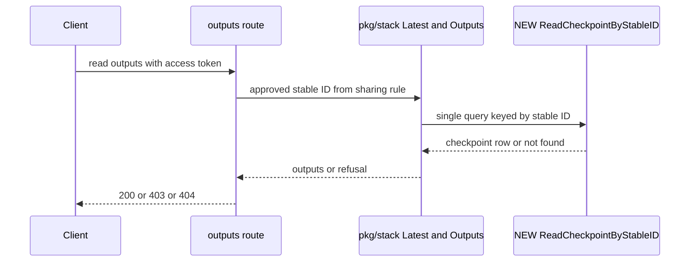
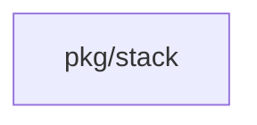

## Context

Latest and Outputs in pkg/stack/output_states.go look the stack up by name, read the checkpoint, then look the stack up again to compare the stable ID. Two lookups leave an ABA window inside one read.

## Decisions

1. **One keyed checkpoint read.** Bind the stable ID from the sharing rule for the named producer. The name finds the rule candidate only. Read the checkpoint with the NEW store method ReadCheckpointByStableID in one SQL statement on each dialect: a join from the checkpoint row to the stack row on the owner stable ID with a filter on the approved stable ID, run under the default read isolation of the store. The sharing-rule lookup stays a separate read; only the checkpoint pick is single-statement.
2. **Owner linkage of checkpoint rows.** Each checkpoint row stores its owner stable ID at write time. A delete of a stack hides its checkpoint rows from the keyed read. A restore of a stack exposes only rows with the same stable ID. The old name-keyed checkpoint read stays for other callers; the NEW method is additive.

## Structure

An unexported checkpoint reader in pkg/stack, made only by NewOutputStates. It holds the approved stable ID and has no name-keyed checkpoint pick.

## Risks

- The NEW method needs sqlite and postgres adapters with storetest conformance.
- A third-party store implements one more method.

## Diagrams

After this change:

Modules that the change touches, and their imports on main:

## Quality attributes

| Attribute | Target | Unit | Scope |
| --- | --- | --- | --- |
| none affected | Low severity hardening of one read path with no latency or storage target change |  |  |

## Contracts

**stack output state**

- Invariant: Output-state reads return only a checkpoint row that the keyed query finds for the approved stable ID.
- Invariant: Each checkpoint row stores its owner stable ID.
- `Latest`: pre: The caller holds an approved sharing rule for the stable ID.. Post: Latest returns the latest checkpoint of the approved stable ID or refuses the read..
- `Outputs`: pre: The caller holds an approved sharing rule for the stable ID.. Post: Outputs returns the root outputs of the approved stable ID or refuses the read..
