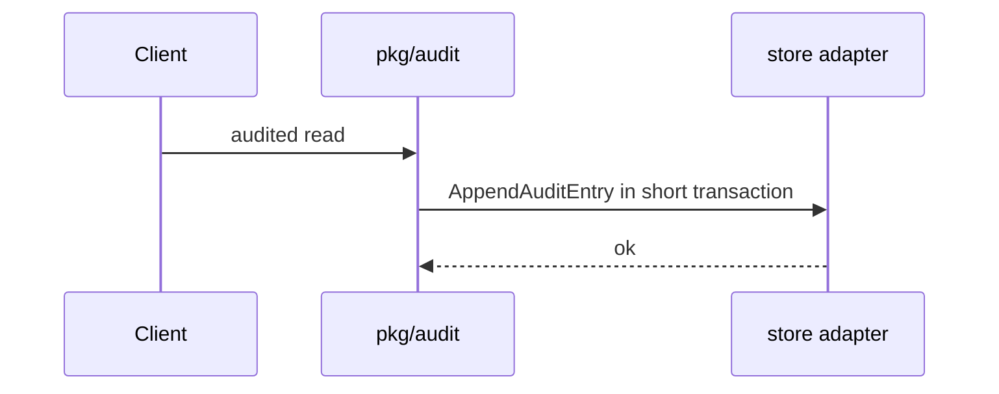
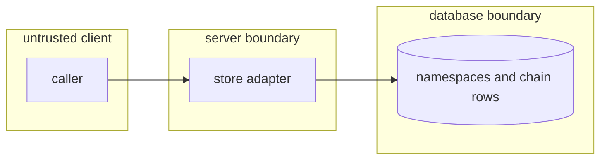

## Context

Audited reads and unit writes in one namespace wait on one row lock each: the namespaces row for the audit chain and inventory_change_heads for the change number.

## Decisions

1. **Shorten section only, keep row.** Run the AppendAuditEntry LastAuditEntry plus InsertAuditEntry pair in a short transaction of its own after the read, keep the existing namespaces-row FOR UPDATE lock so the fence check stays atomic, and document the ceiling.
2. **No schema change.** Touch both dialects in the same adapters with no baseline migration and no backfill.

## Structure

The fix boundary is the audit append transaction in pkg/store/postgres/audit.go. No unexported type removes the serial-chain need, so guards with hostile tests take its place.

## Risks

- A shorter transaction still chains per namespace, so the ceiling remains.
- A crash between the read and the audit transaction leaves a delayed audit entry until retry.

## Layers (defense in depth)

| Layer | Guard | Hostile test |
| --- | --- | --- |
| limit | The adapter holds the namespaces row only for the LastAuditEntry plus InsertAuditEntry pair. | Run 32 concurrent AppendAuditEntry calls in one namespace and expect every entry linked with no fork. |
| authorize at point of use | The fence is checked inside the short transaction. | AppendAuditEntry with a stale fence fails closed with no new entry. |

## Diagrams

After this change:

## Quality attributes

| Attribute | Target | Unit | Scope |
| --- | --- | --- | --- |
| throughput | record requests/s and p50 before and after | requests/s and ms | one namespace, audited state downloads, c=32 |

## Threat model

Data flow and trust boundaries:

| Boundary | STRIDE | Threat | Layer | Guard | Hostile test |
| --- | --- | --- | --- | --- | --- |
| server boundary | T | Tamper with the audit chain by racing two appends to fork the hash link. | boundary check | The fence names an existing namespace and version. | Append with an unknown namespace and expect refusal. |
| server boundary | T | Tamper with the audit chain by racing two appends to fork the hash link. | encode or contain | SQL placeholders for all values. | Submit a namespace value with SQL text and expect it stored as data or refused. |
| server boundary | T | Tamper with the audit chain by racing two appends to fork the hash link. | limit | The row lock is held only for the read and insert pair. | Run 32 concurrent appends and expect no fork. |
| server boundary | T | Tamper with the audit chain by racing two appends to fork the hash link. | authorize at point of use | The fence is checked inside the short transaction. | Append with a stale failover version and expect refusal. |
| server boundary | T | Tamper with the audit chain by racing two appends to fork the hash link. | fail closed | A lock or insert error returns a store sentinel and writes no unlinked entry. | Force a conflict and expect refusal rather than an unlinked entry. |

## Contracts

**audit chain per namespace**

- Invariant: Appends to one namespace chain stay serial and hash-linked.
- `AppendAuditEntry`: pre: The fence names an existing namespace.. Post: The chain holds the new entry linked to its predecessor..

**inventory change log per namespace**

- Invariant: Change numbers order unit writes by commit.
- `NextInventoryChangeSeq`: pre: The namespace exists.. Post: The caller holds a number it uses once for one change row..

## Failure modes

| Step | Failure | Retry | State after |
| --- | --- | --- | --- |
| Short audit-only transaction after the read | Process crashes before the audit transaction commits. | Re-read the last entry and append once with the next hash link. | Read done, audit entry missing until retry; chain stays linked. |
| Namespaces-row lock and insert | Transaction rolls back under concurrent appends. | Re-read the last entry and re-insert once. | No fork; one winner commits, the loser re-chains. |
