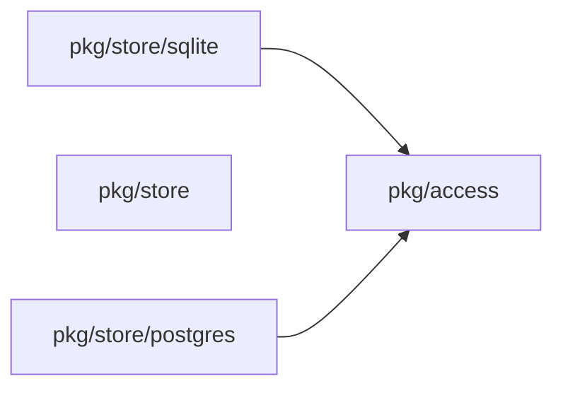

## Context

The caller-grants read is the authorization hot path. Extra member columns widen each member row and raise allocations. Suspension stays enforced by row exclusion in the caller-grants filter, not by reading a suspended column on the hot path.

## Decisions

1. **Narrow caller-grants read.** Keep a narrow caller-grants query at the old column set and keep the wide member source fields only in the group membership queries, with suspended members excluded by the caller-grants query filter.

## Structure

Separate caller-grants query text at the old column set, kept apart from the wide membership query text. A column-set regression test is the guard, because no constructor can stop a SELECT from widening.

## Risks

- A later query edit adds the wide columns back into the caller-grants read.

## Diagrams

Modules that the change touches, and their imports on main:

## Quality attributes

| Attribute | Target | Unit | Scope |
| --- | --- | --- | --- |
| allocation | at most 3146 allocs/op | allocs/op | BenchmarkCallerGrants others=0 in pkg/store/sqlite, median of 6 |
| memory | at most 341359 B/op | B/op | BenchmarkCallerGrants others=0 in pkg/store/sqlite, median of 6 |
