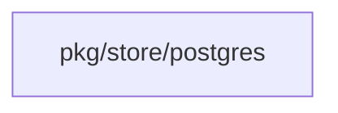

## Context

Open of a migrated PostgreSQL schema runs extra information_schema and schema_migrations trips. The fix reads columns once and reads recorded rows once, with no behavior change.

## Decisions

1. **Batch open reads without removing a check.** Read the schema_migrations column set once at the start of the open transaction with one SELECT column_name FROM information_schema.columns WHERE table_schema = current_schema() AND table_name = 'schema_migrations' and reuse the result inside that same transaction for the version query builder and for verifyRecorded. Read all recorded rows in one statement SELECT version, name, sha256 FROM schema_migrations with the same current_schema scope and compare exact version, name, and sha256 in Go. A missing embedded version, an extra recorded row with an unknown version, a duplicate version, a NULL sha256, a tampered name, a tampered sha256, and a schema without the sha256 column all refuse open with the same error text as today. The full-table read sees unknown versions because it has no ANY filter. On any SQL error inside the open transaction the open aborts and refuses with the same error path as today. Concurrent migration or schema change between the two reads is contained by the open transaction snapshot, and a failed statement fails the open closed. Keep verifyRecorded separate from migrate.Check. Restore staging opens use the same helper and the same schema scope and type handling.

## Structure

No new unexported type. The fix reuses the current open transaction and passes its column set and row map to helpers instead of re-querying.

## Risks

- Comparison in Go must stay strict on version, name, and sha256.

## Diagrams

Modules that the change touches, and their imports on main:

## Quality attributes

| Attribute | Target | Unit | Scope |
| --- | --- | --- | --- |
| latency | 17 | ms | postgres.Open on an already migrated PostgreSQL schema |
| round-trips | 2 | queries | postgres.Open metadata reads on a migrated schema |
