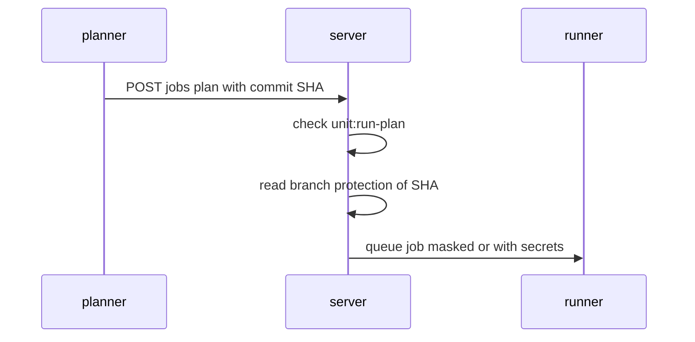
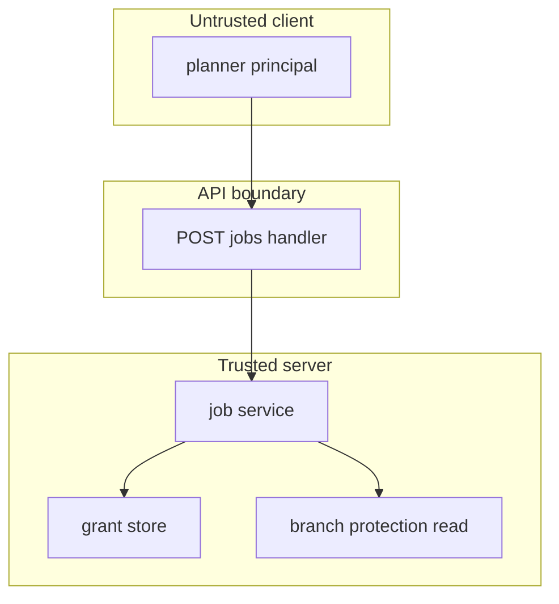

## Context

The job start path checks the caller action per operation in one mapping function. A plan maps to unit:run-plan. An apply and a destroy map to their write actions. An unknown operation is refused before any authorization check. Branch protection is read once at job start for the pinned commit SHA named in the request.

## Decisions

1. **Authorize by operation.** Check authorization at job start by operation: plan maps to unit:run-plan, apply and destroy map to their write actions, unknown operations fail closed with 400 and create no job.
2. **Gate secrets on pinned SHA.** Read branch protection of the pinned SHA at job start and open unit secrets only when that SHA is on a protected branch; a read error or timeout runs masked; a missing commit runs masked.
3. **Order the writes.** Keep the operation check, the queue insert and the audit entry in one store transaction; no out-of-band retry queue is added.

## Structure

Authorization stays in the job service with unexported field operationActions set only by newJobService; the constructor checks the mapping covers plan, apply and destroy, so a new operation cannot skip the mapping and fails closed.

## Risks

- A workstation plan reads state with state actions outside this check; the docs page warns about this caveat and names the state actions.

## Layers (defense in depth)

| Layer | Guard | Hostile test |
| --- | --- | --- |
| HTTP handler | Handler checks bearer token and requires the action of the operation; refuses unknown operations with 400. | Send plan, apply, destroy and unknown operations as planner directly to the handler and confirm only plan gives 201. |
| service | Job service rechecks the action before queue and reads branch protection of the pinned SHA before it opens secrets. | Call the service as planner for apply and for an unprotected or unreadable commit and confirm refusal and masked open. |
| port adapter | Store grant check resolves only stored grants and adds no implicit apply, destroy or secret read grant. | Grant planner only, resolve reach for apply, destroy and secret read, confirm denial, and confirm changeorder:author is allowed. |

## Diagrams

After this change:

New imports of this change (each one allowed by the module rules):

- `internal/api/jobs` imports `pkg/job`

## Quality attributes

| Attribute | Target | Unit | Scope |
| --- | --- | --- | --- |
| response-time | 500 | ms | POST jobs refusal for planner apply or destroy |
| correctness | 0 | secret values in log on masked runs | planner plan secret handling |

## Threat model

Data flow and trust boundaries:

| Boundary | STRIDE | Threat | Layer | Guard | Hostile test |
| --- | --- | --- | --- | --- | --- |
| API boundary | E | A planner elevates a plan right into an apply or destroy write. | boundary check | Handler checks the bearer access token and maps operation to action; refuses unknown operation with 400. | Send apply as planner and unknown operation and confirm 403 and 400 with no job. |
| API boundary | E | A planner elevates a plan right into an apply or destroy write. | encode or contain | Handler encodes the refusal as job.forbidden and never echoes a secret value. | Send hostile operation strings and confirm the refusal body holds no secret value. |
| API boundary | E | A planner elevates a plan right into an apply or destroy write. | limit | Handler limits start payload size and refuses oversize bodies before authorization. | Send an oversize jobs payload as planner and confirm refusal with no job. |
| API boundary | E | A planner elevates a plan right into an apply or destroy write. | authorize at point of use | Service rechecks the stored grant for the operation and object before queue. | Bypass the handler and call the service as planner for apply; confirm refusal. |
| API boundary | E | A planner elevates a plan right into an apply or destroy write. | fail closed | Unknown action or error fails closed to refusal with no job. | Send an unknown action and confirm 400 and no queue insert. |
| Trusted server | I | A planner plan on an unprotected commit leaks unit secret values. | boundary check | Service checks the pinned commit SHA is present and known before the branch protection read. | Send missing and unknown SHAs and confirm masked runs with no secret open. |
| Trusted server | I | A planner plan on an unprotected commit leaks unit secret values. | encode or contain | Secret values never enter the masked plan output or the log. | Read planner plan output and log and confirm no secret value. |
| Trusted server | I | A planner plan on an unprotected commit leaks unit secret values. | limit | Branch protection of the pinned SHA gates secret open; error or timeout runs masked. | Name an unprotected SHA and an erroring branch check and confirm masked run. |
| Trusted server | I | A planner plan on an unprotected commit leaks unit secret values. | authorize at point of use | Profile open rechecks the starter grant and the SHA protection result at use time. | Revoke the planner grant between queue and open and confirm the open runs masked or refuses. |
| Trusted server | I | A planner plan on an unprotected commit leaks unit secret values. | fail closed | Any branch read error fails closed to a masked run. | Make the branch read fail and confirm the job queues masked with no secret value. |

## Contracts

**job**

- Invariant: A job has exactly one operation of plan, apply or destroy.
- Invariant: A queued job names the starter, the unit reference and the pinned commit SHA.
- Invariant: A planner starter never owns an apply or destroy job.
- `startJob`: pre: The starter holds the action of the operation on the unit.. Post: A plan start by an allowed starter creates one queued job.; A refused start creates no job..
- `readPlan`: pre: The reader holds job:read-plans on the job.. Post: A planner read answers the masked plan with no secret value..

## Failure modes

| Step | Failure | Retry | State after |
| --- | --- | --- | --- |
| Branch protection check | Branch protection read errors or times out. | No retry at start; run masked. | Plan job queued masked. |
| Commit pin check | Commit SHA is missing, unknown, or has mixed protection. | No retry; treat as not protected. | Plan job queued masked. |
| Plan read | Grant removed after queue. | No retry; later reads refuse. | Queued job unchanged; later plan reads give 403. |
