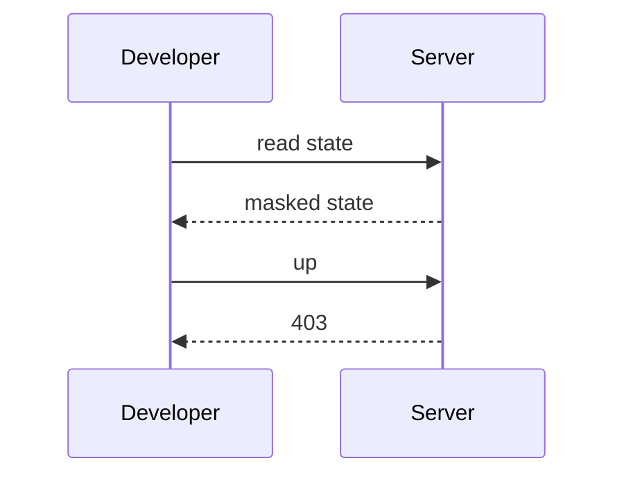
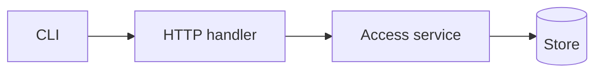

## Context

The planner role is a data role in the existing access model. No new table or grant shape is needed.

## Decisions

1. **Planner as role-table entry.** Keep planner in the built-in role table with no reveal action.

## Structure

The built-in role table with an unexported action set that only its constructor makes; the constructor checks that planner holds the viewer actions plus unit:run-plan, job:read-plans and changeorder:author.

## Risks

- A handler declares a wrong action and lets a planner write.

## Layers (defense in depth)

| Layer | Guard | Hostile test |
| --- | --- | --- |
| service | The access service refuses reveal, writes and token creation for another principal. | Call each action as planner on the service; each fails. |
| HTTP handler | Each route declares its action. | Send up, destroy, apply and reveal with a planner token; each gets 403. |

## Diagrams

After this change:

## Quality attributes

| Attribute | Target | Unit | Scope |
| --- | --- | --- | --- |
| audit completeness | 1 audit entry for each refusal | entries per refusal | planner refusals |

## Threat model

Data flow and trust boundaries:

| Boundary | STRIDE | Threat | Layer | Guard | Hostile test |
| --- | --- | --- | --- | --- | --- |
| API routes for state, secrets and tokens | E | A planner escalates a read grant to a write or a secret reveal. | boundary check | Each route declares its action. | Call each route as planner; each gets 403. |
| API routes for state, secrets and tokens | E | A planner escalates a read grant to a write or a secret reveal. | authorize at point of use | The service checks the action. | Call the service directly; it fails. |
| API routes for state, secrets and tokens | E | A planner escalates a read grant to a write or a secret reveal. | fail closed | An unknown action is denied and audited. | Send an unknown action; denied and audited. |

## Contracts

**access**

- Invariant: Planner holds the viewer actions plus unit:run-plan, job:read-plans and changeorder:author.
- `CheckAccess`: pre: Caller presents a session or an access token.. Post: Allows planner state reads.; Refuses writes and reveal..

## Failure modes

| Step | Failure | Retry | State after |
| --- | --- | --- | --- |
| planner runs up | The write is refused. | Ask an administrator for a write role. | No state version changes; the refusal is audited. |
