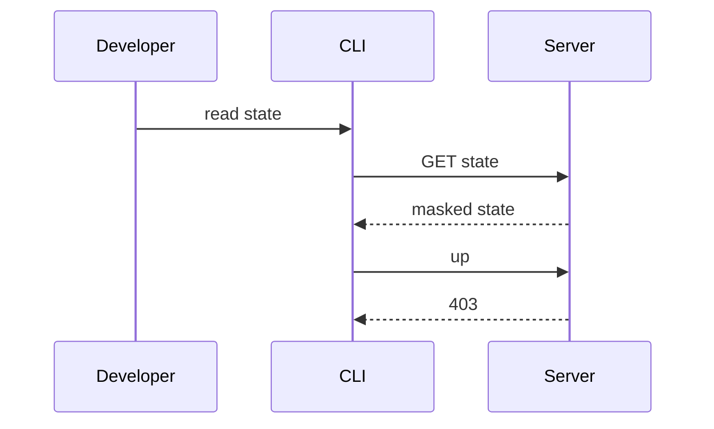
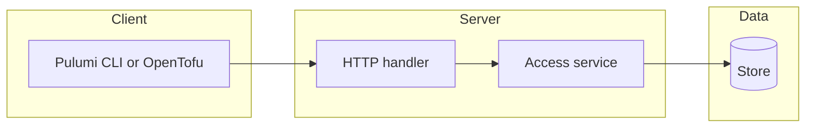

## Context

The planner role is a data role in the existing access model. No new table or grant shape is needed.

## Decisions

1. **Planner as role-table entry.** Define planner in the built-in role table with no secret reveal action. Reuse grant evaluation, masked read and the audit writer.
2. **Plan-job start refused until milestone 5.** The server refuses planner plan-job start with 403 until milestone 5 ships the protected-branch rule.

## Structure

Built-in role table with an unexported roleActionSet built only by NewRoleActionSet, which checks that planner holds exactly the viewer actions plus unit:run-plan, job:read-plans and changeorder:author.

## Risks

- A handler declares a wrong action and lets a planner write.
- A secret read path forgets the reveal check.

## Layers (defense in depth)

| Layer | Guard | Hostile test |
| --- | --- | --- |
| service | The access service refuses reveal, writes, non-plan job start and token create for another principal. | Call each action as planner directly on the service; each fails with 403. |
| HTTP handler | Each route declares its action; refusals are 403 with a fixed code. | Send up, destroy, apply, reveal, export and settings write with a planner token; each gets 403. |
| port adapter | The store checks the action in the fenced transaction and masks marked secrets at read time for every version. | Write with planner reach and read an old version; the write is refused and secrets are masked. |

## Diagrams

After this change:

## Quality attributes

| Attribute | Target | Unit | Scope |
| --- | --- | --- | --- |
| audit completeness | 1 audit entry for each refused write or reveal | entries per refusal | all planner refusals on stacks and workspaces |
| refusal clarity | 100 percent of refusals carry the refused action name | percent of 403 answers | planner write and reveal routes |

## Threat model

Data flow and trust boundaries:

| Boundary | STRIDE | Threat | Layer | Guard | Hostile test |
| --- | --- | --- | --- | --- | --- |
| API routes for state, secrets, settings, tokens and jobs | E | A planner escalates a read grant to a write or a secret reveal. | boundary check | Each route declares its action. | Call each route as planner; each gets 403. |
| API routes for state, secrets, settings, tokens and jobs | E | A planner escalates a read grant to a write or a secret reveal. | encode or contain | Mask marked secrets at read time. | Read an old version; no plain text. |
| API routes for state, secrets, settings, tokens and jobs | E | A planner escalates a read grant to a write or a secret reveal. | limit | The role holds only the planner action set. | Revoke mid-plan; next call fails. |
| API routes for state, secrets, settings, tokens and jobs | E | A planner escalates a read grant to a write or a secret reveal. | authorize at point of use | The service and store check the action. | Call the service directly; it fails. |
| API routes for state, secrets, settings, tokens and jobs | E | A planner escalates a read grant to a write or a secret reveal. | fail closed | Unknown action is denied and audited. | Send an unknown action; denied and audited. |

## Contracts

**access**

- Invariant: Planner holds exactly the viewer actions plus unit:run-plan, job:read-plans and changeorder:author.
- `CheckAccess`: pre: Caller presents a session or an access token.. Post: Allows planner state reads.; Refuses writes and reveal with 403..

**secret**

- Invariant: Reveal needs the reveal action.
- `ReadMasked`: pre: Caller holds state read.. Post: Marked secrets are masked for every version..

## Failure modes

| Step | Failure | Retry | State after |
| --- | --- | --- | --- |
| planner runs up | The write is refused. | Ask an administrator for a write role. | No state version changes; refusal is audited. |
| planner grant revoked | The next request fails. | Ask for a new grant. | 403 on the next call. |
