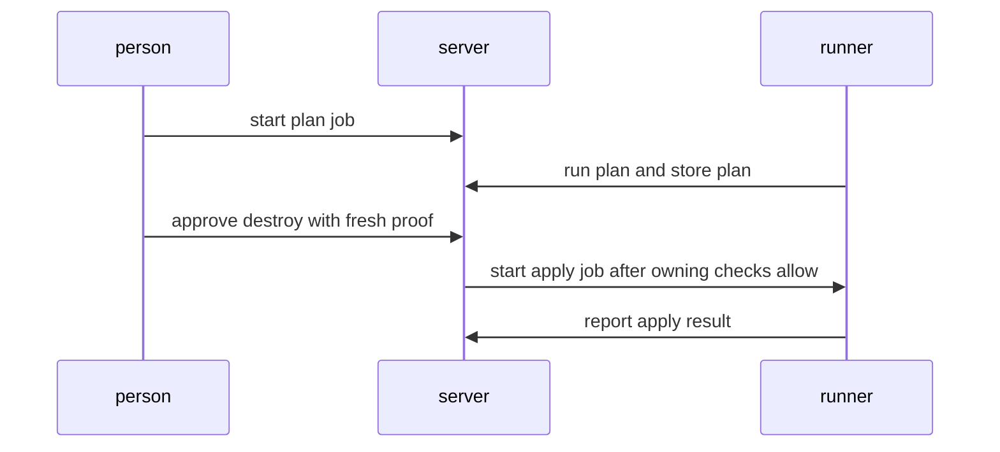
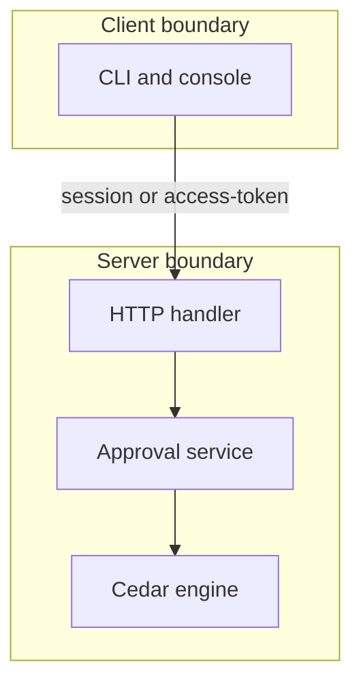

## Context

Jobs run on runners for a stack and a workspace. The owning changes implement counts, resets, limits and gates. This change owns only the destroy fresh check and the composed step-6 run through runner jobs.

## Decisions

1. **Destroy fresh check.** Destroy approval checks a fresh authentication in the window that holds, in the same transaction as the signature write. The window is the shortest of installation, namespace and rule. A window of 0 asks at each step. An access token, a job token, a trust token or an agent credential never gives a fresh step and gets 403 mfa.fresh-step-required with no change. A person with no enrolled factor gets the same 403 with the enrollment page and each way to enroll the first factor. When a revision holds both apply and destroy units, the whole approval needs the fresh step. Break-glass sessions meet the same destroy fresh rule and stay outside limits only.
2. **Composed step-6 run.** The composed run starts a plan job and an apply job on runners for a stack and a workspace. It exercises the owning behaviors together: wait in awaiting-approval, reset on new plan, recheck at change.apply that only adds, forbid refusal with its decision record, and enforce gate refusal. It adds no second count, void, limit or gate rule.

## Structure

Unexported destroyFresh type with constructor newDestroyFresh that checks the fresh window; only the constructor builds a valid destroy approval.

## Risks

- Bypass of the fresh step for a destroy approval allows a destructive apply
- Second definition of counts, voids, limits or gates drifts from the owning change

## Layers (defense in depth)

| Layer | Guard | Hostile test |
| --- | --- | --- |
| service | Service checks a fresh authentication before it records a destroy approval; token and agent callers fail closed with no state change. | Send a destroy approval on an access token and with no fresh step; remove the service check and show the test still gets 403. |
| HTTP handler | Handler declares authorization actions for approve and apply, masks the plan diff, and returns the 403 and 409 errors of the owning checks without change. | Call approve without a fresh step and read the plan-apply part; remove the handler check and show the handler test gets 403. |

## Diagrams

After this change:

## Quality attributes

| Attribute | Target | Unit | Scope |
| --- | --- | --- | --- |
| correctness | 100 percent refused with 403 | percent | destroy approval without fresh proof |
| auditability | 100 percent with decision record in 1 second | percent | limit and gate refusals in composed run |

## Threat model

Data flow and trust boundaries:

| Boundary | STRIDE | Threat | Layer | Guard | Hostile test |
| --- | --- | --- | --- | --- | --- |
| Client boundary | S | Forged approval request records a destroy approval without sign-in | boundary check | Handler rejects forged or missing credential at the boundary with an allowlist of credential kinds | Send approve with forged credential; remove boundary check and show 403 persists |
| Client boundary | S | Forged approval request records a destroy approval without sign-in | encode or contain | Handler encodes error text and contains plan-apply part so only the masked plan reaches the reader | Send hostile plan text and read plan-apply part; remove containment and show masked read persists |
| Client boundary | S | Forged approval request records a destroy approval without sign-in | limit | Handler limits approve payload size and approve rate per principal | Send oversize approve batch; remove limit and show rejection persists |
| Client boundary | S | Forged approval request records a destroy approval without sign-in | authorize at point of use | Handler checks authorization actions for approve and apply on the unit before it calls the service | Send approve without approve action; remove handler check and show 403 |
| Client boundary | S | Forged approval request records a destroy approval without sign-in | fail closed | Handler fails closed on unknown credential or parse error with no state change | Send unknown credential kind; remove fail-closed path and show denial persists |
| Server boundary | E | Stale or token caller bypasses the fresh step and starts a destroy apply | boundary check | Service validates fresh proof time and window at the boundary and rejects stale or token proofs | Send stale proof on a token; remove boundary check and show 403 persists |
| Server boundary | E | Stale or token caller bypasses the fresh step and starts a destroy apply | encode or contain | Service encodes limit ID and policy name in the record without copying secret values | Send secret value in approve context; remove encoding and show no secret in record |
| Server boundary | E | Stale or token caller bypasses the fresh step and starts a destroy apply | limit | Service bounds fresh window lookups and decision record writes per request | Send approve storm on one change; remove bound and show throttle persists |
| Server boundary | E | Stale or token caller bypasses the fresh step and starts a destroy apply | authorize at point of use | Service checks approve and apply actions on the unit at the point of signature write and dispatch | Send dispatch without approve action; remove point-of-use check and show 403 |
| Server boundary | E | Stale or token caller bypasses the fresh step and starts a destroy apply | fail closed | Service fails closed on engine error or unknown credential with gate.ErrRuleFailed and no signature | Force engine error on destroy approve; remove fail-closed path and show refusal persists |

## Contracts

**changeorder.Signature**

- Invariant: One signature binds one approval to one revision digest
- Invariant: A void signature never counts again
- `Destroy needs fresh step`: pre: Revision is current and plan is not stale. Post: Signature recorded with fresh proof, or 403 with no change.

## Failure modes

| Step | Failure | Retry | State after |
| --- | --- | --- | --- |
| Approve destroy | Fresh proof expired between approve and apply dispatch | Ask for a fresh step again, then approve again on the current digest | awaiting-approval, no signature recorded |
| Composed run | New plan lands while apply waits | Attach ends the wait; approvers approve the new digest | planning, old signatures void with cause new-plan |
| Approve destroy | Two approvals race a new plan attach or the recheck adds a requirement | Run the fresh check and the signature write in one transaction; recheck only adds and puts the change back in the wait | awaiting-approval with the new requirement, no lost signature |

## Change impact (computed from main)

Tests:

- `pkg/manuallock/manuallock_test.go` names `identity.Authorizer`
- `pkg/outputshare/outputshare_test.go` names `identity.Authorizer`
- `internal/outputsharesvc/outputsharesvc_test.go` names `identity.Authorizer`

ADRs:

- `docs/adr/0051-collections-of-units.md` names `identity.Authorizer`
- `docs/adr/0273-output-sharing-rules-and-the-read-outputs-action.md` names `identity.Authorizer`
- `docs/adr/0173-the-http-engine-and-its-execution-port.md` names `identity.Authorizer`
