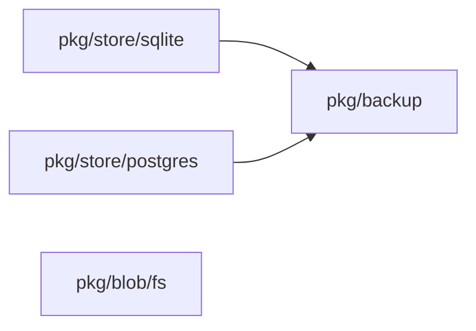
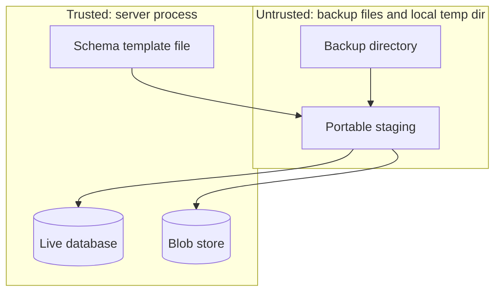

## Context

SQLite portable restore and import staging rebuilds the empty schema by running every migration from zero for each stage. Each restore also leaves a 0-byte staging lock file and an empty blob restore-tmp tree. Backup check misses a copied backup directory that restore accepts.

## Decisions

1. **Process-private checked template plus own-restore cleanup and manifest-based check.** Build the migrated empty SQLite schema once per process in a process-private 0700 directory made with exclusive create and a unique name, hold the template read-only at 0400, copy it for each buildPortableStaging call, set the copy writable at 0600, and check recorded migration versions and hashes on the copied bytes before use. Build the template once under a single-flight mutex that does not cache a failed build, remove the private directory at process end, and rebuild it after a corruption refusal. Check the PostgreSQL StagePortable path against recordedMigrations with no file copy. Remove only the staging lock file and empty restore-tmp directories of the ending restore id, never sweep other restore ids, and never delete a non-empty or live tree. Report a copied backup directory as found by backup check from its manifest while keeping the existing registry read and the existing 404 answer for a backup that is in neither place.

## Structure

Unexported type schemaTemplate with one constructor newSchemaTemplate that builds the migrated empty schema once per process and records its versions and hashes; only the constructor yields a usable value, and buildPortableStaging copies from it through a file copy helper that sets the copy writable.

## Risks

- A stale or replaced template stages data at the wrong schema version when the per-copy check is skipped.
- Cleanup that deletes a non-empty or live directory removes data of a running restore.

## Layers (defense in depth)

| Layer | Guard | Hostile test |
| --- | --- | --- |
| limit | Check recorded migration versions and hashes on the copied bytes before use and refuse mismatch with backup.corrupt. | Flip one byte in the copied staging file and show the next use fails with backup.corrupt. |
| fail closed | Hold the template read-only at 0400 in a 0700 process-private directory and never open it for staging writes. | Attempt to open the template for write and show the open fails. |

## Diagrams

Modules that the change touches, and their imports on main:

States on main in the touched packages:

## Quality attributes

| Attribute | Target | Unit | Scope |
| --- | --- | --- | --- |
| p95 staging build time | 2 | seconds | per SQLite portable stage in pkg/store/sqlite |

## Threat model

Data flow and trust boundaries:

| Boundary | STRIDE | Threat | Layer | Guard | Hostile test |
| --- | --- | --- | --- | --- | --- |
| Untrusted: backup files and local temp dir | T | A crafted backup or a replaced template stages rows at the wrong schema version. | boundary check | Check recorded migration versions and hashes on the copied bytes before use. | Flip one byte in the copied staging file and show the next use is refused. |
| Untrusted: backup files and local temp dir | T | A crafted backup or a replaced template stages rows at the wrong schema version. | encode or contain | Copy template bytes through the fixed file copy helper with no shell and no path join from backup content. | Stage a backup that names a foreign path and show only the restore id tree is touched. |
| Untrusted: backup files and local temp dir | T | A crafted backup or a replaced template stages rows at the wrong schema version. | limit | Hold the template read-only at 0400 in a 0700 process-private directory and set each staging copy writable at 0600. | Attempt to open the template for write and show the open fails while the staging copy opens for write. |
| Untrusted: backup files and local temp dir | T | A crafted backup or a replaced template stages rows at the wrong schema version. | authorize at point of use | Authorize the restore call at ANY /api/server/restores for the installation object before staging starts. | Call ANY /api/server/restores without the grant and show denial with no staging started. |
| Untrusted: backup files and local temp dir | T | A crafted backup or a replaced template stages rows at the wrong schema version. | fail closed | Refuse version or hash mismatch with backup.corrupt and stage no rows. | Change the template and show the next stage fails with backup.corrupt. |

## Contracts

**Portable staging area**

- Invariant: Each staging area starts from the migrated empty schema of the running binary.
- Invariant: A staging area whose recorded versions or hashes do not match the binary is refused with backup.corrupt.
- `StagePortable`: pre: The schema source passed its recorded-migration version and hash check.. Post: StagePortable returns a staging area ready for portable load..
- `buildPortableStaging`: pre: The copied bytes passed their recorded-migration version and hash check.. Post: buildPortableStaging leaves a staging file that holds a copy of the checked template with a writable mode..

## Failure modes

| Step | Failure | Retry | State after |
| --- | --- | --- | --- |
| Build staging area | Process crashes mid-restore and leaves its staging file and lock file. | No automatic sweep of other restore ids; only the owning process removes its own private template directory at end, and the operator reruns the restore which builds a fresh staging area for its own restore id. | Stale files of the crashed restore stay until the operator removes that restore id tree. |
| Clean staging area | Restore is refused by an active lock or runs check-only. | No retry; the same restore path removes its own staging lock file and empty restore-tmp tree before return. | No per-restore lock file and no empty restore-tmp tree of that restore id stays. |
| Build schema template | Template build fails for lack of disk space. | The stage fails with a staging failure without backup.corrupt and the next stage retries the one-time template build. | No half-written template is used; stages keep failing until the build succeeds. |
