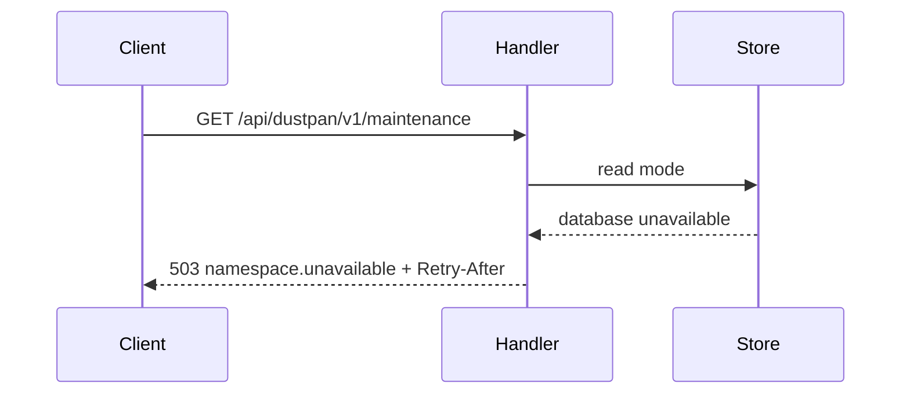
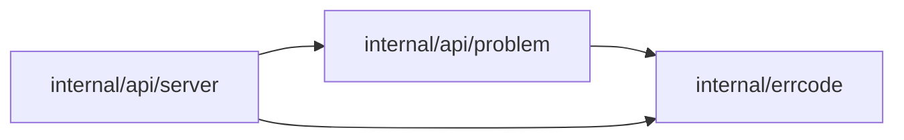

## Context

Reads check installation mode before the store. When PostgreSQL is down the mode read fails and handlers answer maintenance.in-maintenance. Worker paths log the raw error.

## Decisions

1. **One classifier.** Add the NEW func CauseClass in internal/errcode. Server mapping in internal/api/problem and worker logging call it. Allowlist: timeout, connection refused, cannot connect, pool exhausted, half-open, through any wrapping depth. A failed mode read maps to namespace.unavailable. Only a successful mode read with value maintenance answers maintenance.in-maintenance.
2. **Guard instead of structure.** No structure removes hand-mapped errors. Guard with table tests, a mutation test that deletes one row, and a hostile test with host, DSN userinfo and credential in the message.

## Structure

No unexported type removes the hand-mapping bug class; table tests, a mutation test and a redaction test guard it.

## Risks

- A new store error shape reports as generic unavailable.

## Diagrams

After this change:

Modules that the change touches, and their imports on main:

## Quality attributes

| Attribute | Target | Unit | Scope |
| --- | --- | --- | --- |
| retry-hint | 5 | seconds in Retry-After | every 503 namespace.unavailable read answer |
| log-rate | 1 | WARN line per 10 seconds | worker claim loop per operation during an outage |

## Contracts

**server-error-mapping**

- Invariant: Store unavailability never reports as maintenance mode.
- Invariant: Worker logs never include driver text, host, DSN or credential.
- `NEW mapStoreError`: pre: The input error carries the NEW CauseClass value.. Post: Result is namespace.unavailable with Retry-After 5 seconds for database-unavailable..
- `NEW CauseClass`: pre: The input error wraps a store failure.. Post: Result is database-unavailable for the allowlisted forms..
- `NEW logCauseClass`: pre: A durable claim or schedule store call failed.. Post: The WARN line names database-unavailable and omits host, DSN and driver text..
