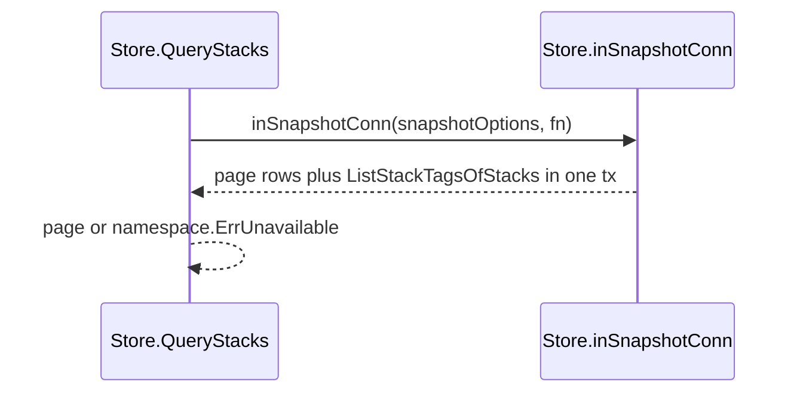

## Context

Postgres QueryWorkspaces runs in its own REPEATABLE READ transaction with private options, so it takes no swap lock and its errors skip readConflict. Postgres QueryStacks runs each select on the pool with no transaction. SQLite stack page and inventory QueryUnits run multi-statement reads outside inReadTx.

## Decisions

1. **Postgres workspace list keeps statements, gains swap lock.** Route Store.QueryWorkspaces through Store.inSnapshotConn with Store.snapshotOptions and keep its statements unchanged; wrap begin, statement and commit errors with readConflict so 40P01 and 40001 become namespace.ErrUnavailable.
2. **Postgres stack list uses one snapshot transaction.** Route Store.QueryStacks and stackRange through Store.inSnapshotConn so the page selects and ListStackTagsOfStacks read one snapshot; every range of one page call stays in the same closure.
3. **SQLite parity uses inReadTx.** Route the sqlite stack page and inventory QueryUnits reads through Store.inReadTx, as sqlite workspace_page.go does; no new helper.

## Structure

No new type. Callers pass a closure to Store.inSnapshotConn on postgres and to Store.inReadTx on sqlite. The closure handle can still be bypassed, so a guard test fails direct BeginTx, RepeatableRead and direct s.queries pool reads in page files.

## Risks

- A multi-range stack list holds one snapshot longer, so a restore swap waits on the swap lock until the list context ends; the list then rolls back and the client retries.

## Diagrams

After this change:

## Quality attributes

| Attribute | Target | Unit | Scope |
| --- | --- | --- | --- |
| availability | 100 percent of snapshot conflicts return namespace.ErrUnavailable with no driver text | percent | QueryWorkspaces and QueryStacks during a restore swap |

## Failure modes

| Step | Failure | Retry | State after |
| --- | --- | --- | --- |
| Snapshot begin waits on the swap lock. | Restore swap holds the swap lock while the snapshot begins. | Wait only until the caller context ends, with no extra timeout, then roll back and return namespace.ErrUnavailable; the client retries the same list call. | No rows returned; no transaction held. |
| Page and tag selects read one snapshot. | Swap commits between the selects, or the database reports 40P01 or 40001. | Roll back and return namespace.ErrUnavailable; the client retries the same page from its last cursor. | No mixed page; transaction rolled back. |
| Multi-range stackRange read. | Caller context cancels during the read. | Abort at the next statement, roll back, and return the context error. | No rows returned; transaction rolled back. |
