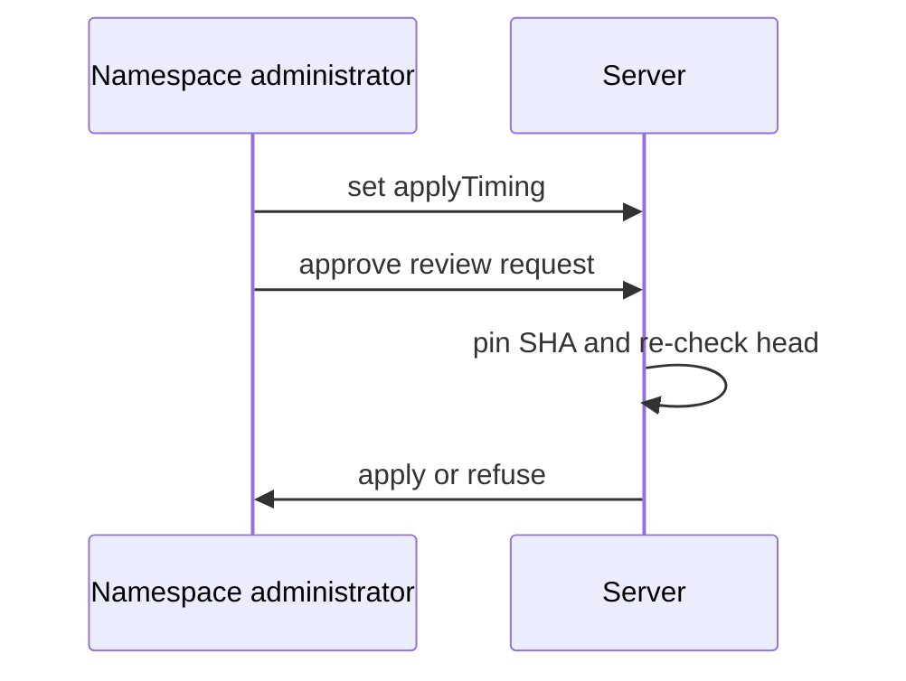
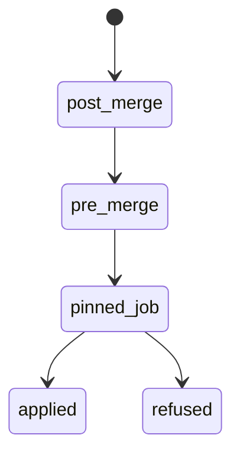

## Context

Apply after the merge is the default. Pre-merge apply is an explicit per-unit option. The plan on the exact branch head comes from the pull request automation work. The approval comes from the approval mirror work. This change adds applyTiming to unit settings if the apply-after-merge work has not added it.

## Decisions

1. **Pre-merge apply reuses applyTiming.** Store applyTiming on unit settings with pre-merge and post-merge (default), shown as its effective value in the API.
2. **Branch apply needs approval and plan on the exact commit.** An approved review request starts an apply from the branch only when the unit sets pre-merge, the approval targets the current head SHA, and a plan exists on that SHA.
3. **Pin SHA and re-check before first change.** Pin the SHA in the job and fetch the SHA, not the branch name. Re-check the head at start and before the first change. A forge check failure fails closed with no change and a record.
4. **One writer per unit.** The branch apply takes the unit lock. A second branch apply or a post-merge apply on the same unit while the lock is held is refused as locked. Each start writes an audit entry with the starter and the pinned SHA. A restarted job re-runs both checks.
5. **Toggle does not stop a running job.** A change of the option while an apply runs does not stop that run.
6. **Units decide alone.** Each unit carries its own value with no cross-unit rule.
7. **Docs state the option is not recommended.** The docs page states the project does not recommend pre-merge apply.

## Structure

Unexported type preMergeGuard built only by its constructor, which checks applyTiming, the approval SHA, the plan SHA and the pinned SHA.

## Risks

- A team enables the option and applies unmerged code.
- The branch head moves after approval, at start, or before the first change.

## Diagrams

After this change:

States and transitions after this change:

## Quality attributes

| Attribute | Target | Unit | Scope |
| --- | --- | --- | --- |
| correctness | 100 | percent of default-unit branch requests refused with named option | branch apply refusal |
| safety | 0 | changes applied after head move before first change | pinned apply |

## Contracts

**unit-settings**

- Invariant: applyTiming is post-merge unless set to pre-merge
- Invariant: effective value is visible in the API
- `Branch apply on exact head`: pre: applyTiming is pre-merge; approval targets the current head; plan exists on that head. Post: job is pinned to the approved commit SHA.

## Failure modes

| Step | Failure | Retry | State after |
| --- | --- | --- | --- |
| start branch apply | branch head moves after approval | re-approve and re-plan, then request again | no job started |
| pinned apply runs | branch head moves before first change | re-approve and re-plan, then request again | job stopped without the change |
| pinned apply runs | forge check fails at re-check | request again when the forge answers | job stopped without the change |
| start branch apply | two requests race on one unit, or a post-merge apply holds the lock | request again after the running job ends | one job runs, one refused as locked |
| job restart | server restarts during a pinned job | the restarted job re-runs both checks | no change without a matching head |
