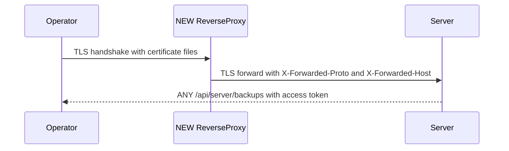
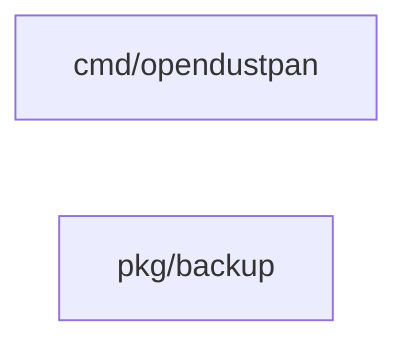
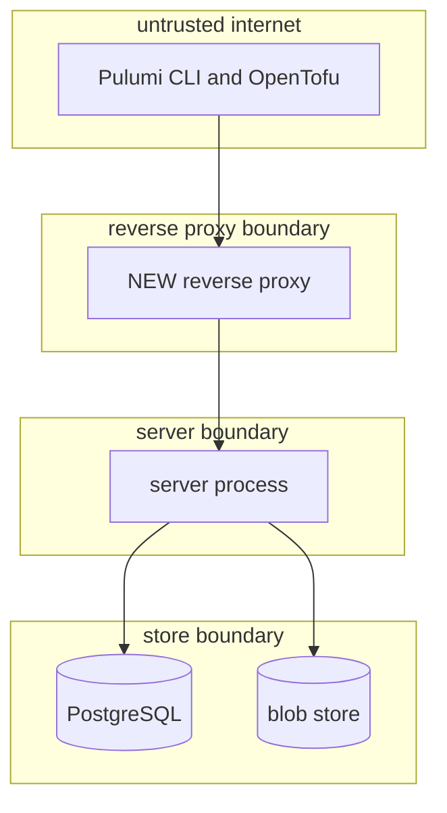

## Context

Operator installs a production server from one docs page. The shared command runner from docs-commands-run-in-tests runs page blocks as written. Install bits come from the install-from-artifacts page of release-artifacts-image-install-docs. This change owns only production fixtures: TLS files, proxy example, PostgreSQL and blob settings, schedule on, and key file backup note.

## Decisions

1. **Fixtures only with links to shared runner and artifacts.** Production page links to install-from-artifacts for image and archive install and owns only fixtures: server TLS from files, TLS between proxy and server, one pinned NEW nginx example, PostgreSQL store, blob store, backups on with check on ANY /api/server/backups, and key file copy backed up with the database per the restore rule of key-encryption-key-rotation.
2. **Proxy trust from allowlist with fail closed.** Server trusts proxy headers only from NEW allowlisted proxy addresses and fails closed on missing or forged headers. Persona path test uses the shared runner and ends with pulumi up and tofu apply through the proxy plus a backup check.

## Structure

No code structure change. The NEW fixture script and NEW nginx example keep production settings in one tested place. The shared runner from docs-commands-run-in-tests runs page blocks, so this change adds no second runner.

## Risks

- Docs fixtures drift from server flags and API shapes.
- Proxy example misses required headers or upload limits.

## Diagrams

After this change:

Modules that the change touches, and their imports on main:

## Quality attributes

| Attribute | Target | Unit | Scope |
| --- | --- | --- | --- |
| none affected | Docs and test change only, no latency or storage target change |  |  |

## Threat model

Data flow and trust boundaries:

| Boundary | STRIDE | Threat | Layer | Guard | Hostile test |
| --- | --- | --- | --- | --- | --- |
| reverse proxy boundary | S | Spoofed client or proxy headers reach server behind reverse proxy. | boundary check | Allow only TLS with valid certificate files and pinned NEW nginx config. | Connect with expired certificate and confirm handshake fails. |
| reverse proxy boundary | S | Spoofed client or proxy headers reach server behind reverse proxy. | encode or contain | Require X-Forwarded-Proto and X-Forwarded-Host only from allowlisted proxy addresses and strip other values. | Send request without proxy headers and confirm refusal. |
| reverse proxy boundary | S | Spoofed client or proxy headers reach server behind reverse proxy. | limit | Apply body size limit of 32 megabyte per request and read timeout of 120 second per state upload. | Send oversize upload and confirm refusal. |
| reverse proxy boundary | S | Spoofed client or proxy headers reach server behind reverse proxy. | authorize at point of use | Check stored grant for the access token object at the route. | Call backup route with no grant and confirm denial. |
| reverse proxy boundary | S | Spoofed client or proxy headers reach server behind reverse proxy. | fail closed | Deny on unknown header values and write denial to the audit log. | Send unknown proto value and confirm denial with audit entry. |
| server boundary | I | Tampered certificate files or leaked key material disclose secrets. | boundary check | Refuse start when TLS key file is missing or readable by group or others. | Start with open key permissions and confirm refusal. |
| server boundary | I | Tampered certificate files or leaked key material disclose secrets. | encode or contain | Repeat no secret value or key material in errors or logs. | Trigger TLS failure and confirm output holds no key bytes. |
| server boundary | I | Tampered certificate files or leaked key material disclose secrets. | limit | Limit TLS handshake rate and fail fast on bad files. | Replay bad handshake and confirm fast denial. |
| server boundary | I | Tampered certificate files or leaked key material disclose secrets. | authorize at point of use | Check authorization at backup route for the installation object. | Call backup check with foreign token and confirm denial. |
| server boundary | I | Tampered certificate files or leaked key material disclose secrets. | fail closed | Fail closed on unreadable files and unknown settings. | Remove certificate file and confirm server does not start. |
| store boundary | D | Unreachable or corrupt store and backups destroy state or hide loss. | boundary check | Allow only configured PostgreSQL and blob store addresses. | Point store at foreign address and confirm refusal. |
| store boundary | D | Unreachable or corrupt store and backups destroy state or hide loss. | encode or contain | Use placeholders for store queries and sealed storage for secrets. | Inject SQL through database address and confirm no execution. |
| store boundary | D | Unreachable or corrupt store and backups destroy state or hide loss. | limit | Bound store timeouts and backup schedule frequency. | Blackhole database and confirm bounded timeout. |
| store boundary | D | Unreachable or corrupt store and backups destroy state or hide loss. | authorize at point of use | Check stored grant before backup check read. | Read backups without grant and confirm denial. |
| store boundary | D | Unreachable or corrupt store and backups destroy state or hide loss. | fail closed | Refuse state writes when store is unreachable. | Stop PostgreSQL and confirm writes refused with audit entry. |
