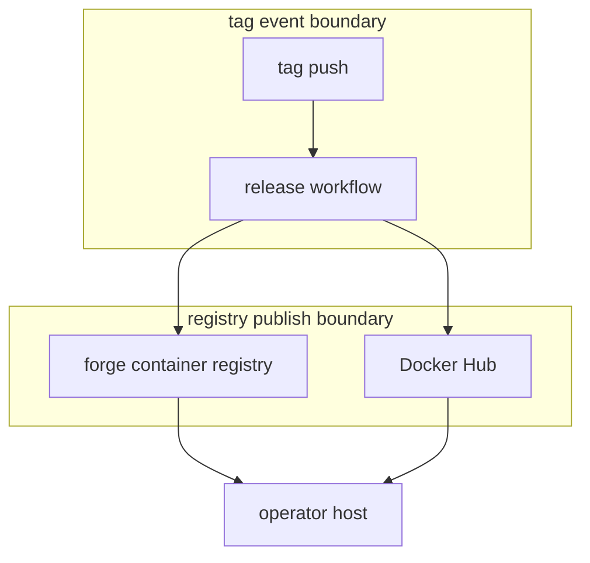

## Context

The release workflow publishes one multi-arch server image on a final version tag. ADR 27 left the registry open. The owner chose the forge registry and Docker Hub. This change is a v0.1.0 release-gate item under ADR 283, not a step of the milestone 7 exit test.

## Decisions

1. **One digest to both registries in fixed order.** Build once with buildx for linux/amd64 and linux/arm64. Push to the forge container registry first, then push the same digest to Docker Hub. Pull both references and compare the digest strings in the same run. A mismatch fails the run. The tag is announced as released only after both pushes and the comparison pass.
2. **Tag immutability with partial-push completion.** A re-run where one registry holds the digest pushes the same digest to the missing registry. A re-run refuses when a registry holds a different digest for the tag. A re-run refuses when both registries hold the same digest. The Docker Hub token is a push-only repository secret, read by name at push time and never printed. Publishing runs only on a final tag event in the main repository, never on a fork or pull-request run.
3. **Chart artifact and docs.** The chart goes as an OCI artifact to the forge container registry. The chart default image repository is the forge registry path. One value switches to Docker Hub. The value key is the same key that the W7 Helm change uses. The install page lists both pull commands pinned by tag. The digest is shown in the workflow summary and the release notes.

## Structure

No server code changes. The fix boundary is the release workflow, the chart values and the install docs. No new tool and no custom analyzer.

## Risks

- A missing or expired Docker Hub token blocks the Docker Hub push. The workflow fails closed with an error that names the setup step, and the tag is not announced.

## Quality attributes

| Attribute | Target | Unit | Scope |
| --- | --- | --- | --- |
| none affected | Distribution only: no server latency, storage, rate limit or timeout changes. |  |  |

## Threat model

Data flow and trust boundaries:

| Boundary | STRIDE | Threat | Layer | Guard | Hostile test |
| --- | --- | --- | --- | --- | --- |
| tag event boundary | S | A spoofed tag or workflow edit triggers a public image publish from untrusted code. | boundary check | Allowlist accepts only final version tags of the form vX.Y.Z with no suffix before any build step. | Dispatch the workflow with a pre-release tag and a branch push; both runs publish nothing. |
| tag event boundary | S | A spoofed tag or workflow edit triggers a public image publish from untrusted code. | encode or contain | Pin each action by SHA and keep the workflow file owned by the main branch with required review. | Submit a pull request that edits the workflow; the untrusted run stops before any secret read. |
| tag event boundary | S | A spoofed tag or workflow edit triggers a public image publish from untrusted code. | limit | Publish job runs only on the tag event in the main repository; fork and pull-request runs skip all push steps. | Run the workflow from a fork; the run stops before the first push and reads no token. |
| tag event boundary | S | A spoofed tag or workflow edit triggers a public image publish from untrusted code. | authorize at point of use | Check the actor has release permission at the publish job before any registry login. | Trigger the workflow as an actor without release permission; the publish job refuses. |
| tag event boundary | S | A spoofed tag or workflow edit triggers a public image publish from untrusted code. | fail closed | Deny by default on any tag parse error or permission error and publish nothing. | Send a malformed tag name; the workflow fails closed with no push. |
| registry publish boundary | T | A registry push writes a different image digest to one registry, so operators pull different bytes. | boundary check | Compare the digest strings pulled from both registries in the same run and allow only one equal digest. | Stage different digests in the two registries; the comparison step fails the run. |
| registry publish boundary | T | A registry push writes a different image digest to one registry, so operators pull different bytes. | encode or contain | Push by digest and keep the Docker Hub token out of logs; the workflow prints only the digest. | Run a push with secret masking on; the log holds the digest and no token text. |
| registry publish boundary | T | A registry push writes a different image digest to one registry, so operators pull different bytes. | limit | Use a push-only Docker Hub token stored as a repository secret and reuse one build for both pushes. | Attempt a delete or an overwrite with the stored token; the registry refuses. |
| registry publish boundary | T | A registry push writes a different image digest to one registry, so operators pull different bytes. | authorize at point of use | Log in to each registry at push time and refuse a re-run that finds a different digest for the tag. | Re-run the tag after one registry was overwritten; the workflow refuses to overwrite. |
| registry publish boundary | T | A registry push writes a different image digest to one registry, so operators pull different bytes. | fail closed | Fail the run on any push, login, or comparison error and do not announce the tag. | Remove the Docker Hub token; the run fails with the setup step named and pushes nothing. |
