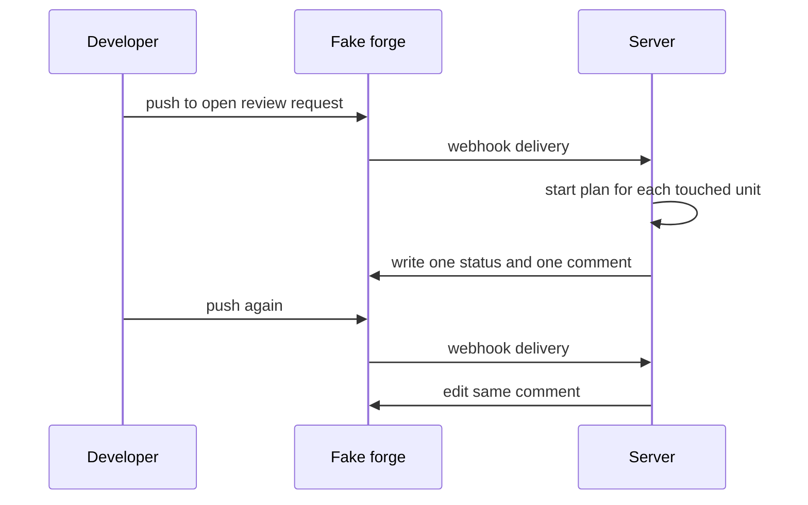
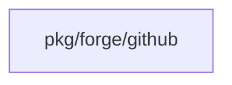

## Context

This change composes three changes into milestone step 7: webhook intake receives the push, run triggers start the plans, and the report change writes one status and one edited comment. This change adds no new intake, match, or report logic.

## Decisions

1. **Composition only.** This change adds no new webhook, plan-start, or status and comment logic; it wires the step-7 e2e step and docs page over the three composed changes.

## Structure

No new stored type. Comment keys, delivery records, and plan jobs stay owned by the three composed changes.

## Risks

- E2e drift if any of the three composed changes changes its contract.

## Diagrams

After this change:

Modules that the change touches, and their imports on main:

## Quality attributes

| Attribute | Target | Unit | Scope |
| --- | --- | --- | --- |
| comment stability | 1 | comment | one review request across pushes |

## Failure modes

| Step | Failure | Retry | State after |
| --- | --- | --- | --- |
| Report status and comment | Report write fails, plans run but status stays stale | Push again triggers a fresh delivery through the composed changes | Plans complete, status refreshed on next push |
| Match push to units | No unit matches the push, no plan starts | Fix unit code location, then push again | No plan, delivery record of the intake change names empty match |
