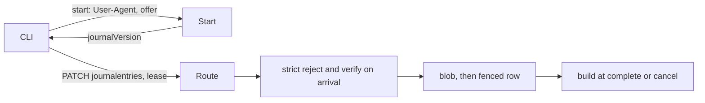

## Context

Two build tags choose two constants and two writer functions today. The
release build answers `journalVersion` 0 and has no journal writer. The
recording build answers 2 and has the writer. The split held decision 2.4 of
ADR 43 while the journal work was not complete. This change removes the
split when the open preconditions are done, so that every binary answers the
negotiated version of decision 2.1.

## Decisions

1. **One build.** The files `internal/api/pulumi/journal_release.go`,
   `internal/api/pulumi/journal_recording.go`,
   `pkg/dustpan/journal_release.go` and `pkg/dustpan/journal_recording.go`
   go away. `maxSupportedJournalVersion` is one constant with the value 2 in
   `internal/api/pulumi/journal.go`. `journalWriter` is one function in
   `pkg/dustpan` with the body of the recording build: the update store must
   implement `stack.JournalStore`, else the server does not start
   (`stack.ErrMissingDependency`).
2. **Previews answer 0 in the domain.** `Updates.StartBy` stores journal
   version 0 for an update that does not mutate (`Update.Mutates` is false:
   a preview or a dry run), whatever the caller passes. The handler already
   answers `started.Update.JournalVersion`, so the answer follows the row.
   The rule sits in `pkg/stack`, so every caller of `StartBy` gets it, not
   only the HTTP handler.
3. **The setting keeps its place.** `journalVersionFor` keeps its first
   check: with `--disable-pulumi-journaling` set to `true`, it answers 0
   before the gate runs.
4. **One list of verified CLIs for the e2e suite.** `e2e/tool.go` gets the
   label `journal`. `E2E_PULUMI_VERSIONS=journal` expands to the verified
   journal CLIs: 3.250.0, 3.262.0 and 3.268.0. `make e2e-journal` sets that
   label and runs `TestPulumiJournalingBothModes` with the four journal
   steps.
5. **The gate bounds are exported for one test.** `internal/api/pulumi`
   exports `VerifiedJournalCLIRange() (oldest, newest string)`, which reads
   the two functions of the gate. A test in the `e2e` package fails when
   either value is not in the `journal` list. A move of the newest verified
   CLI without an e2e run of that CLI then fails (work item 19, second
   acceptance criterion; ADR 43 decision 8.5, step 6).
6. **The on run asserts the gate.** `checkJournalingOn` in
   `e2e/journaling_test.go` reads the CLI version of the run. For a CLI in
   the verified range, every start must answer a non-zero version and the
   server must accept at least one batch. For a CLI outside the range
   (v3.200.0 in the default matrix), every start must answer 0.
   `journalingBuildAnswersNonzero` and the two build files of the e2e
   package go away.
7. **The guards that held the split go away.** `make journal-guard`,
   `make lint-journal-build` and `make journal-test` go away, with their
   entries in the `check` target. The tests that ran only with the tag run
   in `go test ./...`. The route coverage allowlist entry
   `journalAllowEntries` goes away, because `TestPulumiJournalingBothModes`
   reaches the journal route in `make e2e`.
8. **Workflow first.** A cloud session cannot push `.github/workflows`. The
   workflow patch (remove the `journal-guard` step, the
   `golangci-lint-journal` job and the `journal-test` job; keep the
   `e2e-journal` job) goes in its own pull request through the managed
   computer that has workflow rights, and merges first. Each removed call
   still passes on main before this change, so main stays green between the
   two merges.
9. **The release gate is a checklist item.** The build tag held decision
   2.4 until now. After this change, the first-tag checklist in
   `docs/roadmap.md` holds it: one open item names #456, #672, #419 and
   #3207. The first tag waits for each item of that list.
10. **The load harness.** `load/harness.go` drops its build tag check, and
   `docs/guides/load.md` drops the `-tags journalrecording` command.
11. **The CLI version is stored at start and used at complete.** With the
    release build on, the replayer gets `cliVersion` "" at
    `pkg/dustpan/dustpan.go:2074`, so the manifest magic of a built checkpoint
    does not name the CLI that ran the update. The handler reads the version
    once, at start: `cliVersionOf(userAgent)` in
    `internal/api/pulumi/journal.go`, which accepts only
    three dot-separated numbers (`parseCLIVersion`). The handler passes it in the NEW
    field `StartedBy.CLIVersion`; `StartBy` keeps its signature. `StartBy`
    checks the value again with the NEW function `stack.ValidCLIVersion`
    (digits and dots, three parts, at most 32 bytes) and answers the NEW
    sentinel `stack.ErrInvalidCLIVersion` for any other non-empty value. The
    row of the update stores it in the NEW column `cli_version` of `updates`
    (`NOT NULL DEFAULT ''`). The column is added to the one baseline
    migration of each dialect, because no tag shipped (one schema file per
    dialect). A start without a version, or with a `User-Agent` that
    `parseCLIVersion` refuses, stores "" and the manifest then carries the
    version "" as it does on main. This rule is stated in the Contract, not a
    hidden fallback.
12. **The replayer gets the version through an optional method.** The
    signature `Replay(ctx, openBase, batches, out)` of
    `stack.JournalReplayer` does not change, because about 30 test files and
    `pkg/stack/replayertest/replayertest.go` call it. The NEW method
    `(*pulumijournal.Replayer).WithCLIVersion(version string) *Replayer`
    returns a copy that writes `version` in the manifest. The NEW interface
    `stack.CLIVersionedReplayer` has the method `WithCLIVersion(string)
    JournalReplayer`; `pkg/stack/journal_build.go` calls it with `Update.CLIVersion`
    when the replayer implements it. A replayer that does not implement it
    writes the version it was built with. `NewReplayer(now, cliVersion)`
    keeps its signature. Alternative that was rejected: a fifth argument of
    `Replay`, with the fallout above.
13. **The e2e suite checks the route that the CLI really uses.** With
    journaling on, a verified CLI saves state through
    `PATCH .../journalentries` and sends no `PATCH .../checkpoint`. The e2e
    steps that asserted a checkpoint PATCH therefore assert the state save by
    CLI: the NEW helper `checkStateSaved(env, cli, stepName)` in
    `e2e/e2e_test.go` asserts a `journalentries` PATCH with status 200 for a
    CLI inside `VerifiedJournalCLIRange()`, and a `checkpoint` PATCH with
    status 200 for a CLI outside it (v3.200.0). The four uses of
    `checkCheckpointSaved` call it. `checkDeltaCheckpoints` and the masked
    delta check assert, for a CLI inside the range, the journal route in both
    environments and no delta PATCH; the delta and verbatim checkpoint routes
    stay covered by the run of v3.200.0 in the default matrix. The contract
    files of v3.250.0 and v3.262.0 get the journal route (regenerated with
    `E2E_CONTRACT_UPDATE`). The default matrix does not turn journaling off.

## Structure

The bug class is "the release build and the tested build differ". With one
build, the binary that CI tests is the binary that a release ships, so that
class goes away. No new check is added for it. The second bug class is "a
preview row carries a journal version". The rule lives in `StartBy`, the one
function that writes the journal version of a start, so no caller can skip
it.

## Contract

- `func (s *Updates) StartBy(ctx context.Context, ref Ref, id UpdateID, by StartedBy, journalVersion int64) (Started, error)`:
  signature unchanged. New postcondition: `Started.Update.JournalVersion == 0`
  when `!Started.Update.Mutates()`. Errors unchanged.
- `StartedBy.CLIVersion string` (NEW) and `Update.CLIVersion string` (NEW):
  the CLI release without the leading `v`, or "" when the start offered none
  or the `User-Agent` failed `parseCLIVersion`. `StartBy` answers
  `stack.ErrInvalidCLIVersion` (NEW) for a non-empty value that fails
  `stack.ValidCLIVersion` (NEW): not three dot-separated numbers of digits, or longer
  than 32 bytes. The store keeps the value in the column `cli_version` and
  returns it in `StartUpdate` and `GetUpdate`.
- `func (r *Replayer) WithCLIVersion(version string) *Replayer` (NEW) in
  `internal/pulumijournal`: returns a copy that writes `version` in the
  manifest. No error. A complete build of an update with `CLIVersion` "" gives
  the same manifest as main.
- `func VerifiedJournalCLIRange() (oldest, newest string)` in
  `internal/api/pulumi`: returns the release versions without the leading
  `v`, for example `"3.250.0"` and `"3.268.0"`. No error.
- `POST /api/stacks/{namespace}/{project}/{stack}/update/{update}` (start):
  response `{"tokenExpiration": <unix seconds>, "token": "...", "version": <n>, "journalVersion": <0|1|2>}`.
  `journalVersion` is 0 when the setting is `true`, when the update is a
  preview or a dry run, when the CLI offered no version, and when the gate
  refuses the `User-Agent`. Otherwise it is the lower of the offer and 2.
- `PATCH /api/stacks/{namespace}/{project}/{stack}/update/{update}/journalentries`:
  unchanged (`unit:write`, lease). Reachable in the release build.
- Operator setting: `--disable-pulumi-journaling`,
  `DUSTPAN_DISABLE_PULUMI_JOURNALING`, file key `disable-pulumi-journaling`,
  default `false`. Unchanged.

## Risks

- A replay bug can build a wrong checkpoint for a real user (ADR 43,
  consequences). The open preconditions (#3207 corpus, #419 nightly run) and
  the on and off export comparison reduce this risk.
- A server error during a journaled update fails the `pulumi up`. The
  operator turns journaling off with one setting.
- An embedder whose store does not implement `stack.JournalStore` gets a
  start error from `dustpan.NewServer`, where the release build gave no
  writer before. The store conformance suite (`pkg/store/storetest`) already
  holds the journal cases, and the API before 1.0 can break (ADR 73).
- A downgrade to a binary from before this change answers 0, and the CLI
  then saves checkpoints. No tag shipped, so no upgrade path applies.

## Quality attributes

| Attribute | Target | Unit | Scope |
| --- | --- | --- | --- |
| journaled starts | 100 | percent of mutating starts of a CLI from v3.250.0 to v3.268.0 that answer a non-zero version with the setting `false` | `TestPulumiJournalingBothModes`, each verified CLI |
| equal state | 0 | differences between the normalized exports of the on and off runs | `TestPulumiJournalingBothModes` |
| previews | 0 | preview or dry-run starts that answer a non-zero version | unit test of `StartBy` and the handler |

## Threat model

Data flow and trust boundaries:

| Boundary | STRIDE | Threat | Layer | Guard | Hostile test |
| --- | --- | --- | --- | --- | --- |
| start | T | A client claims a verified CLI version to get journaling. | gate (not a security control, decision 5.6) | strict reject of each unknown entry (decision 5.5) | existing `TestJournalEntriesRefusesAnUnknownEntry`, now in the default build |
| start | T | A preview start gets a non-zero version. | domain rule in `StartBy` | `u.Mutates()` check | new `TestStartByPreviewStoresJournalVersionZero` |
| journal route | T, D | A batch with an unknown kind, a bad sequence ID or a reference to a missing entry. | decode, verify on arrival, fenced store | strict reject 400, 409 on retry with other content, 413 bounds | existing route, store and verifier tests, now in the default build |
| journal route | E | A caller without the lease or without `unit:write` sends a batch. | route action and lease check | `unit:write` and lease digest | existing route tests, now in the default build |
| start | T | A `User-Agent` carries a CLI version with a long, odd or pre-release text that goes into the stored row and the manifest. | handler allowlist (`parseCLIVersion`), domain check (`stack.ValidCLIVersion` in `StartBy`), store conformance, replayer | each layer refuses or stores "" without help from the others | NEW `TestStartDropsUnacceptableCLIVersion` in `internal/api/pulumi`, NEW `TestStartByRejectsInvalidCLIVersion` in `pkg/stack`, NEW case `testCLIVersionRoundTrip` in `pkg/store/storetest/updates.go`, NEW `TestReplayerWithCLIVersionKeepsManifestMagicFixed` in `internal/pulumijournal` |
| complete | T | A gap or a refused batch ends as `succeeded`. | `Complete` check | 409 `journal.incomplete` | existing `TestCompleteJournalGapAnswersConflict`, now in the default build |

This change adds no new guard to the journal route. It makes the guards and
their hostile tests run in the build that ships.

## Failure modes

| Step | Failure | Retry | State after |
| --- | --- | --- | --- |
| Start | The store does not implement `stack.JournalStore` | none | The server does not start; the error names the missing dependency. |
| Batch | Strict reject | The CLI does not retry a 400 | The update fails; the operator follows `docs/reference/journaling.md`. |
| Complete | The build passes its time bound | The client tries `pulumi cancel` | The update stays active (503). |
| Restart with a changed setting | An update runs in journal mode | The CLI retries a transport error 4 times | The update keeps its mode (decision 1.3). |
