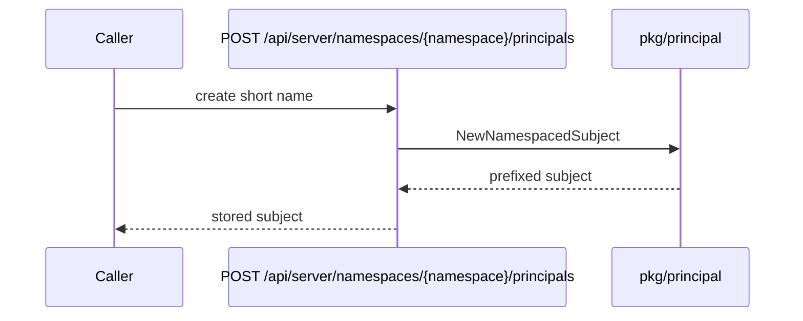
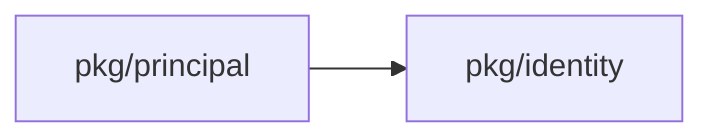

## Context

Subjects of principals share one flat space. The fix partitions new subjects by namespace at create time.

## Decisions

1. **Prefix by stable namespace ID.** The NEW constructor NewNamespacedSubject in pkg/principal builds namespace:<namespace ID>/<short-name> from a short name of 1 to 128 characters that matches ^[A-Za-z0-9][A-Za-z0-9._@+-]*$. The total stored subject is at most 256 characters. ValidateSubject refuses the prefix namespace: by ASCII case-insensitive match with no trim and no Unicode fold.
2. **No numbered migration.** Existing rows before the first tag are dev data. A dev reset converges them. No numbered migration and no compatibility shim.

## Structure

Unexported type namespacedSubject; only NewNamespacedSubject makes a value, and it checks the allowlist and the length bound.

## Risks

- A pre-change installation subject that starts with namespace: needs a rename by dev reset.

## Diagrams

After this change:

Modules that the change touches, and their imports on main:

## Quality attributes

| Attribute | Target | Unit | Scope |
| --- | --- | --- | --- |
| none affected | One string match on create; no latency or storage change. |  |  |

## Contracts

**Principal**

- Invariant: The stored subject of a namespace principal equals namespace:<namespace ID>/<short-name>.
- Invariant: No installation principal holds a subject that starts with namespace:.
- `NewNamespacedSubject`: pre: The short name matches the allowlist.. Post: Returns the prefixed subject of at most 256 characters..
- `ValidateSubject`: pre: Input is a candidate subject.. Post: Refuses the namespace: prefix without regard to ASCII case..
