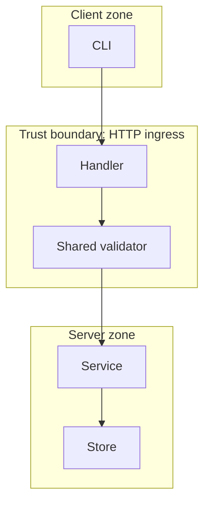

## Context

QA round 10 on main 519b3bd found small mismatches: shared hidden-character set gaps, case-only person names, internal text in answers, text/plain creates, script messages, and ended-restore cancel.

## Decisions

1. **Fix boundary.** Fix only the findings named in issue #2411; the temporary-administrator reason, job location repository, and deleted-unit cursor paths keep calling the shared set.
2. **Ended-restore cancel rule.** Cancel of a succeeded restore answers 409 restore.ended; cancel of a restore that already failed from a cancel answers 202 with no state change as a second cancel. Cancel wording and the failed state stay in qa-round-9-small-mismatches; only the ended-restore cancel answers live here.
3. **Public error text.** Lock 404 and drift start 400 use public answers with no inner text; registry 400 echoes at most 100 characters with broken bytes replaced.
4. **Name match and scripts.** Person-name match uses Unicode simple case folding checked atomically in the service with no schema change; stored frank, Frank, FRANK rows stay and read as the same name and are refused on next write.

## Structure

The shared hidden-character check stays the one check for the three QA paths; no new tool and no custom analyzer.

## Risks

- A caller with its own copy of the check still misses the fix; issue #2404 owns those copies.
- A client that matches message text breaks on the new error text.

## Quality attributes

| Attribute | Target | Unit | Scope |
| --- | --- | --- | --- |
| none affected | Low QA text and guard fixes with no latency or storage target |  |  |

## Threat model

Data flow and trust boundaries:

| Boundary | STRIDE | Threat | Layer | Guard | Hostile test |
| --- | --- | --- | --- | --- | --- |
| HTTP ingress | T | Attacker sends hidden characters or text/plain to bypass validation and store bad data | boundary check | Refuse text/plain with 415 on POST /api/server/namespaces | Send text/plain create and check 415 with no row |
| HTTP ingress | T | Attacker sends hidden characters or text/plain to bypass validation and store bad data | encode or contain | Cap echoed registry version at 100 characters with broken bytes replaced | Send 400-character version and check capped echo |
| HTTP ingress | T | Attacker sends hidden characters or text/plain to bypass validation and store bad data | limit | The 100-character cap bounds the answer size | Send 400-character version and check answer size |
| HTTP ingress | T | Attacker sends hidden characters or text/plain to bypass validation and store bad data | authorize at point of use | Check the grant for the create at the point of use | Call without grant and check denial |
| HTTP ingress | T | Attacker sends hidden characters or text/plain to bypass validation and store bad data | fail closed | Refuse U+FE0F, NBSP, and invalid UTF-8 with 400 and store nothing | Send U+FE0F and bad bytes and check refusal |

## Failure modes

| Step | Failure | Retry | State after |
| --- | --- | --- | --- |
| Cancel of a restore | Cancel arrives after the restore ended | A second cancel gives the same answer | Succeeded restore stays succeeded; failed-from-cancel restore stays failed |
| Artifact sweep tick | A tick finds zero jobs | The schedule runs the next tick at its interval | No blob deleted; the log line is written |
