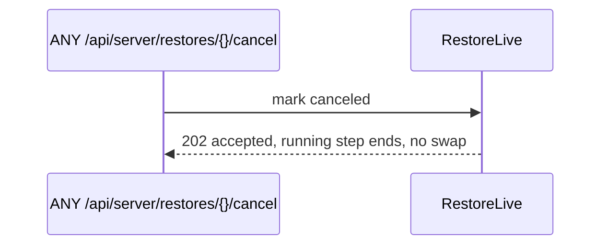
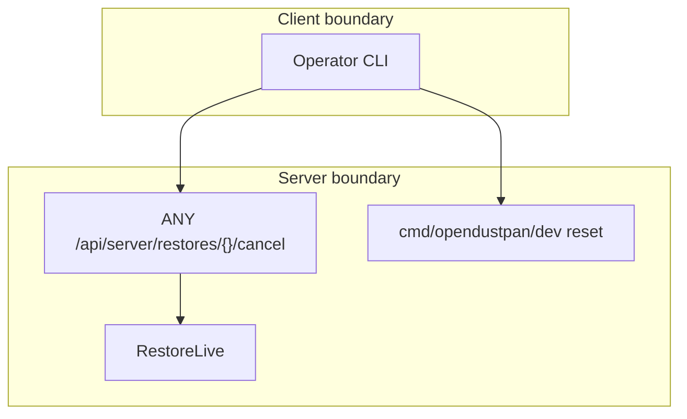

## Context

QA rounds 9 and 10 found small mismatches between guides and behavior.

## Decisions

1. **Docs plus two narrow fixes.** Render the stored pre-restore backup ID in internal/api/server/restores.go, and guard the replace of a kept copy in the dev reset path in cmd/opendustpan/dev.go. No new flag and no new type.
2. **Cancel timing wording.** The restore guide says cancel answers 202 at once, the restore stays checking until the running step ends, the final state is failed, and no swap runs.
3. **Swap start.** A cancel that arrives after the swap began does not stop the swap; the swap is one atomic step and the restore ends as succeeded. A cancel before the swap begins ends the restore as failed.

## Structure

No new type. The stored record already holds the pre-restore backup ID; the fix reads it in one function, so the missing-field class has one fix point.

## Risks

- Rendering preBackupID on a path that took no pre-restore backup.
- Changing namespace name rules instead of documenting the Pulumi CLI minimum.

## Diagrams

After this change:

## Quality attributes

| Attribute | Target | Unit | Scope |
| --- | --- | --- | --- |
| none affected | Docs and small error-text fixes with no latency or storage change |  |  |

## Threat model

Data flow and trust boundaries:

| Boundary | STRIDE | Threat | Layer | Guard | Hostile test |
| --- | --- | --- | --- | --- | --- |
| Client boundary | S | Spoofed operator cancels another installation restore | boundary check | Cancel route checks server:restore on @server at entry | Cancel with token without server:restore is denied |
| Client boundary | S | Spoofed operator cancels another installation restore | encode or contain | Cancel ID parsed as restore ID only, no path traversal into staging names | Cancel with ../staging ID is refused before use |
| Client boundary | S | Spoofed operator cancels another installation restore | limit | Cancel is one row update with bounded retry, no long hold on table lock | Cancel under load ends without deadlock |
| Client boundary | S | Spoofed operator cancels another installation restore | authorize at point of use | Cancel re-checks server:restore at point of state change | Revoked grant between read and write still denies cancel |
| Client boundary | S | Spoofed operator cancels another installation restore | fail closed | Unknown restore ID or ended restore denies with failed state and audit entry | Double cancel answers already ended with no swap |
| Server boundary | T | Tampered restore result or dev directory loses the kept data copy | boundary check | preBackupID rendered only from stored restore record, never from request body | Forged preBackupID in request body does not appear in result |
| Server boundary | T | Tampered restore result or dev directory loses the kept data copy | encode or contain | preBackupID encoded as opaque ID string in JSON result | Malformed stored ID is encoded safely with no log injection |
| Server boundary | T | Tampered restore result or dev directory loses the kept data copy | limit | Dev reset refusal bounds kept copies to two files and refuses replace when current holds zero rows | Repeated resets do not delete data copy under disk-full failure |
| Server boundary | T | Tampered restore result or dev directory loses the kept data copy | authorize at point of use | Dev reset checks no dev server runs on directory before move | Reset while dev runs is refused |
| Server boundary | T | Tampered restore result or dev directory loses the kept data copy | fail closed | Failed remake fails closed with error naming kept copies and put-back steps | Disk-full remake leaves kept copy and error names ls and cp steps |

## Contracts

**RestoreResult**

- Invariant: A restore result names the pre-restore backup when one was taken.
- Invariant: A canceled restore ends as failed and never swaps.
- `restoreLiveError`: pre: The pre-restore backup was taken before the live-blob copy.. Post: The result includes preBackupID when the stored record holds one..

**DevDataDir**

- Invariant: A failed remake keeps existing copies and names them in the error.
- Invariant: A kept copy that holds data is never replaced when the current database holds zero namespace rows.
- `dev`: pre: No dev server runs on the directory.. Post: A failed remake error names kept copies and put-back steps..
