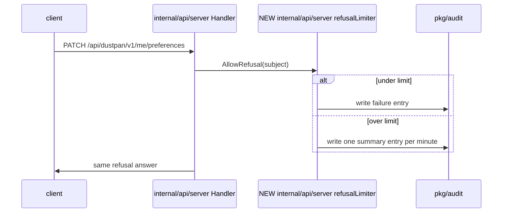
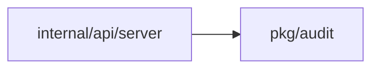
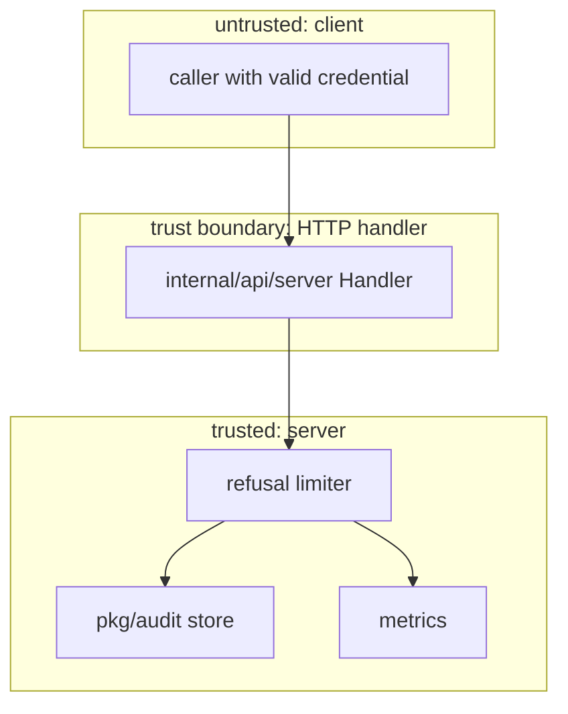

## Context

Refused requests on PATCH /api/dustpan/v1/me/preferences and the token routes in internal/api/server/tokens.go each append one failure or denied entry to the @server audit scope, which lets one credential fill the log.

## Decisions

1. **One shared refusal limiter with global caps.** Add one unexported NEW type refusalLimiter in NEW internal/api/server/refusallimit.go, in front of the refusal audit write and shared by all routes. Per verified subject bucket is 20 entries per 60 seconds with burst 20. A global @server refusal bucket is 200 entries per 60 seconds. An empty-subject bucket is 100 entries per 60 seconds for refusals with no verified subject. Over limit, return the same refusal answer, write no entry, and increment the dropped counter.
2. **Allowlist for policy and change entries.** Allowlist is the NEW const allowRefusalBypassKinds in the NEW file, with the NEW entry classes policy-denial and state-change. Those entries always write and never touch any bucket. The refusal class covers failure and denied entries for bad input on preferences and token routes.
3. **Per-process bound, eviction and summary record.** Limiter state is per server process and resets on restart, so the enforced limit is per process and multiplies by replica count. Bucket table holds at most 10000 subjects with LRU eviction; eviction resets that subject to a full bucket. Drops are visible in the dropped-entries metric and in at most one NEW summary audit entry per subject per 60 seconds that records only the dropped count, so drops cannot refill the log.

## Structure

Unexported NEW type refusalLimiter in NEW internal/api/server/refusallimit.go with NEW constructor func newRefusalLimiter that checks limit greater than zero and window greater than zero; only the constructor can make a value.

## Risks

- A limit that is too low hides brute-force signals; the dropped-entries metric and the one-per-minute summary entry mitigate this.

## Diagrams

After this change:

Modules that the change touches, and their imports on main:

## Quality attributes

| Attribute | Target | Unit | Scope |
| --- | --- | --- | --- |
| storage growth | 20 | entries/minute | @server audit scope per principal under refusal flood |
| storage growth | 200 | entries/minute | @server audit scope total under refusal flood per server process |
| request latency | 5 | ms added p99 | PATCH /api/dustpan/v1/me/preferences refusal path in internal/api/server |

## Threat model

Data flow and trust boundaries:

| Boundary | STRIDE | Threat | Layer | Guard | Hostile test |
| --- | --- | --- | --- | --- | --- |
| HTTP handler | D | One credential floods refusals to fill the @server audit log and hide real entries. | boundary check | Check entry class and subject at the refusal audit-write boundary before any store write. | Send a policy denial directly to the limiter with an empty bucket and verify it still writes an entry. |
| HTTP handler | D | One credential floods refusals to fill the @server audit log and hide real entries. | encode or contain | Bucket key is the verified principal subject only, never a header value; empty subject uses the separate empty-subject bucket. | Send mismatched subject header values and verify the bucket key stays the verified subject. |
| HTTP handler | D | One credential floods refusals to fill the @server audit log and hide real entries. | limit | Per-principal bucket of 20 per 60 seconds plus global caps of 200 per 60 seconds and 100 per 60 seconds for empty subjects with a bounded table. | Flood refusals from one credential and from many subjects and verify stored entries stay within the caps. |
| HTTP handler | D | One credential floods refusals to fill the @server audit log and hide real entries. | authorize at point of use | Existing route authorizer still refuses before the limiter; the limiter grants nothing. | Call the refusal path without a grant and verify refusal even with an empty bucket. |
| HTTP handler | D | One credential floods refusals to fill the @server audit log and hide real entries. | fail closed | Over-limit drops only the refusal entry, never the refusal; at most one summary entry per subject per minute keeps a record. | Flood refusals and verify the refusal answer is unchanged and drops are counted. |

## Contracts

**refusal limiter in NEW internal/api/server/refusallimit.go**

- Invariant: Refusal entries never change the refusal response.
- Invariant: Allowlisted policy-check and state-change entries bypass the refusal buckets.
- Invariant: Limiter state is per server process and in memory.
- `AllowRefusal`: pre: Caller passes the verified principal subject, which may be empty, and the entry class refusal, policy-denial, or state-change.. Post: Returns true and records one entry when all buckets allow it.; Returns false, writes no refusal entry and counts one drop when any bucket is over limit..
