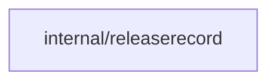

## Context

Guards read internal/releaserecord. An empty record means skip with a reason. A record with files means run with no skip. Parse fails closed. The tag workflow checks the record on version tags.

## Decisions

1. **Guards read the record.** Each of the five guards starts with t.Parallel then the Off check from the record. Only the one-baseline guard is deleted, at the tag commit after every other baseline edit of the milestone has merged.
2. **Tag workflow with append-only check.** The NEW .github/workflows/tag-record.yml runs on push of v tags with full history. It runs scripts/check-release-record.sh for the tag name and diffs the record against the merge base. A removed or commented line fails. A missing merge base fails closed.
3. **Parser refusals.** Parse refuses a line that starts with #v, an unknown dialect, a bad field, a duplicate line, one file with two hashes, and a tag that misses a dialect. The script calls Parse through go run.

## Structure

No new type. Guards call Record.Released and Parse in internal/releaserecord.

## Risks

- A hand-pushed tag with an empty record keeps guards off until the operator deletes the tag.

## Diagrams

Modules that the change touches, and their imports on main:

## Quality attributes

| Attribute | Target | Unit | Scope |
| --- | --- | --- | --- |
| none affected | Test guards and release checks only |  |  |
