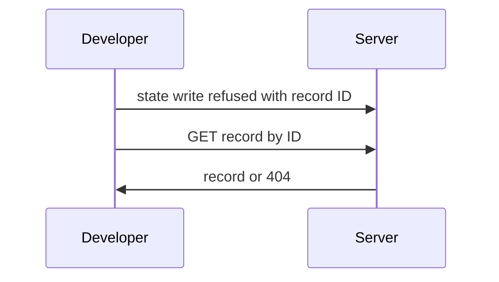
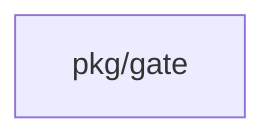
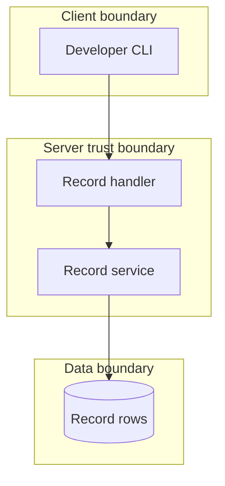

## Context

Refusals at state.write name a record ID, but no route reads it. This change adds read-only routes and fixes the refusal text.

## Decisions

1. **Two read routes with named guards.** The namespace route checks the namespace gate read action. The installation route checks installation:read-gates. Both look up by the gdr- ID and the scope. A failed check gives the same 404 as a missing record.
2. **Errors fail closed.** The service returns typed sentinels. The adapter maps denial and absence to 404 gate.not-found. A store error gives gate.unavailable with no content. The read returns the stored masked form only.

## Structure

The package internal/api/decisionrecord holds the handler (internal/api/decisionrecord/decisionrecord.go), the operations (internal/api/decisionrecord/operations.go), the routes (internal/api/decisionrecord/routes.go), the read service (internal/api/decisionrecord/service.go) and the port (internal/api/decisionrecord/port.go). The service checks the gdr- ID and the scope before it calls the port, and checks the scope again after the load. It returns the sentinels of pkg/gate. The handler maps denial and absence to 404 gate.not-found and a store error to 503 gate.unavailable. The store adapter pkg/store/internal/gatestore/records.go translates a driver error into gate.ErrUnavailable, so that the handler never sees a raw driver error.

## Risks

- A read that crosses scopes breaks isolation.
- A refusal that names a missing command blocks scripting.

## Layers (defense in depth)

| Layer | Guard | Hostile test |
| --- | --- | --- |
| HTTP handler | Checks the scope read action before any read and answers 404 on failure. | Read without the action, across namespaces and with no sign-in; expect the same 404 body each time. |
| service | Validates the ID and checks the scope again after the load. | Call with a forged scope and a non-gdr- ID; expect a sentinel. |
| port adapter | Query by ID and namespace with placeholders only. | Pass an ID with SQL metacharacters; expect no row. |

## Diagrams

After this change:

Modules that the change touches, and their imports on main:

## Quality attributes

| Attribute | Target | Unit | Scope |
| --- | --- | --- | --- |
| read latency | 200 | ms p95 | one record read by ID |
| isolation | 0 | records leaked | cross-namespace read |

## Threat model

Data flow and trust boundaries:

| Boundary | STRIDE | Threat | Layer | Guard | Hostile test |
| --- | --- | --- | --- | --- | --- |
| Server trust boundary | I | A caller reads a record of another scope by guessing its ID, or learns that it exists. | boundary check | Reject a malformed gdr- ID. | Send IDs with separators and null bytes; expect 404. |
| Server trust boundary | I | A caller reads a record of another scope by guessing its ID, or learns that it exists. | encode or contain | Placeholders only in the store query. | Send SQL metacharacters; expect no row. |
| Server trust boundary | I | A caller reads a record of another scope by guessing its ID, or learns that it exists. | limit | One record by ID, no list. | Send an empty ID; expect 404. |
| Server trust boundary | I | A caller reads a record of another scope by guessing its ID, or learns that it exists. | authorize at point of use | Check the scope read action and the scope again after the load; answer the same 404. | Read across namespaces and without the action; expect identical bodies. |
| Server trust boundary | I | A caller reads a record of another scope by guessing its ID, or learns that it exists. | fail closed | A store error gives gate.unavailable with no content. | Force a store error; expect no record bytes. |

## Contracts

**decision-record**

- Invariant: The ID keeps the gdr- prefix.
- Invariant: A read never changes the record.
- `readRecord`: pre: The ID has the gdr- prefix and the scope of the path.. Post: Returns the stored masked record to a caller with the read action.; Answers 404 otherwise..

## Failure modes

| Step | Failure | Retry | State after |
| --- | --- | --- | --- |
| Read record | Record purged during the read. | The retry also gives 404. | No content returned. |

## Change impact (computed from main)

Tests:

- `pkg/tempadmin/tempadmin_test.go` names `gate.ErrNotFound`
- `internal/removalalertsvc/fakes_test.go` names `gate.ErrNotFound`
- `pkg/manuallock/manuallock_test.go` names `gate.ErrNotFound`

Docs pages:

- `docs/guides/s3-blobs.md:89` names `gate.ErrNotFound`

ADRs:

- `docs/adr/0271-the-forge-port-git-host-connections-and-the-installation-level-github-app.md` names `gate.ErrNotFound`
- `docs/adr/0141-freeze-schedules.md` names `gate.ErrNotFound`
- `docs/adr/0355-gate-configuration-paths-and-errors-as-shipped.md` names `gate.ErrNotFound`
