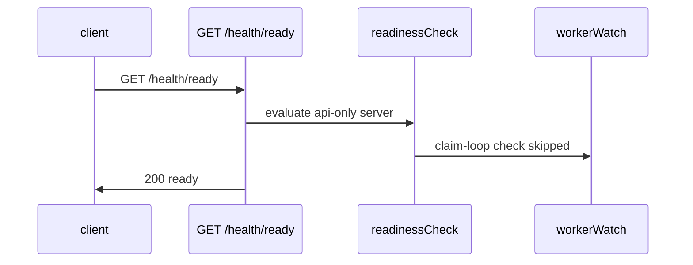
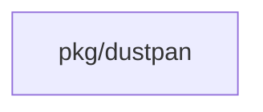

## Context

SDK servers run api, worker, or all components with an optional durable store. Readiness must match the active components.

## Decisions

1. **Component-gated claim-loop check.** Gate the claim-loop readiness check on the workerEnabled flag fixed at construction by NewServer plus options. Api-only servers skip the check even with a durable store. Worker and full servers with a durable store keep it. Servers with no durable store skip it. No start refusal is added because api-only with a durable store is a valid layout. The component set does not change after construction. A mutation test removes the workerEnabled guard to prove the worker signal stays.
2. **Grace clock starts at Start.** Start the 2-interval grace clock at Start. The claim loop starts only in Run. A worker server that never calls Run fails after the grace window.

## Structure

Unexported workerEnabled flag on Server set only by NewServer plus options; the readiness check constructor reads it.

## Risks

- Worker servers lose the claim-loop signal if gating reads the wrong component flag.
- An api-only server with a stuck remote worker reports ready on its api port, which the component layout makes visible.

## Diagrams

After this change:

Modules that the change touches, and their imports on main:

## Quality attributes

| Attribute | Target | Unit | Scope |
| --- | --- | --- | --- |
| none affected | Readiness timing unchanged; only which checks apply changes. |  |  |
