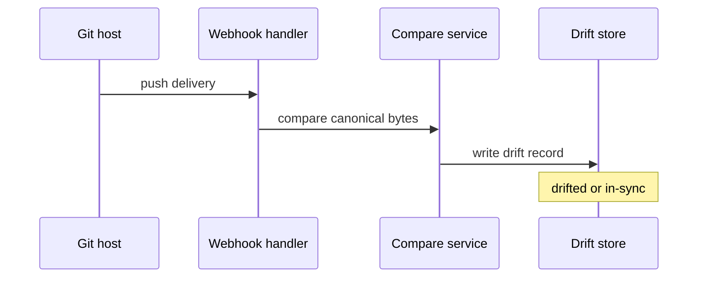
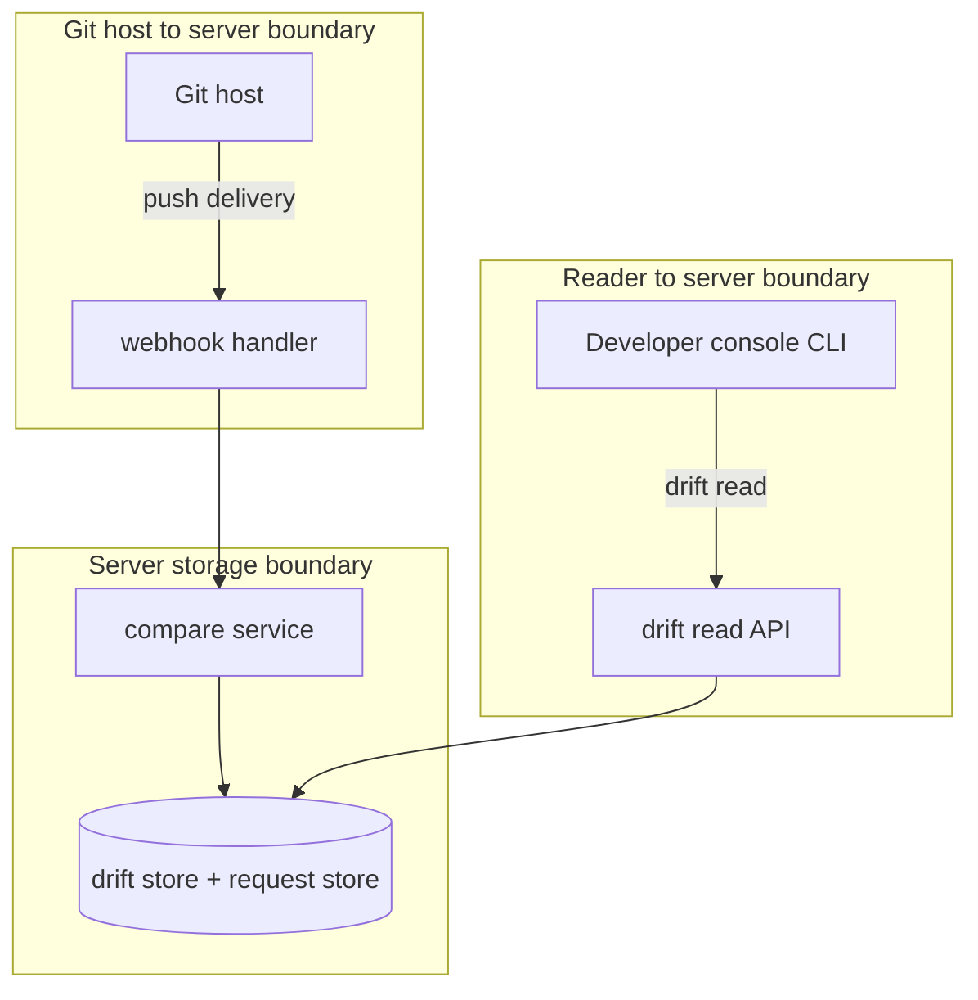

## Context

A self-service request has one stored document in the server and one request file in git at the ADR 111 path. A person with write access edits the file directly and pushes, bypassing the API. The server learns of the push through a forge webhook. Without a record, the next read or write-back loses the git edit or overwrites it. The short drift-record ADR is a deliverable of this change: it is written with the build and records the decisions below, including that a cleared record stays with commit id and time.

## Decisions

1. **Compare canonical bytes on each push delivery.** Parse each request file named by the delivery, compute canonical bytes of the stored request and of the git document with catalog.Document.Canonical, write a drift record when they differ and clear it when they match. The webhook answers 202 on parse failures and records invalid-file. A repeated delivery id is idempotent. A delivery whose commit is an ancestor of the recorded commit is ignored.
2. **Store drift beside the stored request with an explicit exit.** Store drift keyed by the stable request ID with status drifted, in-sync, invalid-file or file-removed, plus commit id, changed top-level field names, time, and error text. A cleared record stays as in-sync with the commit id and time of the clearing push. The webhook leaves the stored document unchanged. Exit is a push of matching bytes on the home ref. A write-back while drift shows is refused with 409 request.drifted.
3. **Catch up at start without a poll.** At server start the server reads the current file at the ADR 111 path for each request and runs the same compare, with a per-file timeout and a bounded batch that never blocks start. Missed pushes arrive as forge redeliveries through the existing public webhook route. No timer polls the forge.

## Structure

Unexported type gitDrift with constructor newGitDrift(stored, git catalog.Document, commit string) that checks canonical bytes, derives the changed field list, and refuses an empty commit id, so mismatched compare logic cannot build a drift value.

## Risks

- A push with many request files slows the webhook answer.
- A malformed request file in git confuses the reader without a visible status.
- A missed webhook during an outage leaves drift hidden until the next start or redelivery.

## Layers (defense in depth)

| Layer | Guard | Hostile test |
| --- | --- | --- |
| webhook trust | Forge webhook signature check at the HTTP boundary; reject a bad signature with 401 and write no drift record. | Send a push delivery with a wrong signature and confirm 401 and no drift record. |
| path and parse | Strict path allowlist of catalog/<ns>/<bp>/<name>/request.json; strict ADR 111 parse; invalid files become invalid-file status. | Send a delivery naming catalog/../../etc/request.json and one with an unknown field; traversal writes nothing and the unknown field becomes invalid-file. |
| use check | Drift read needs self-service:read; write-back checks drift in the same transaction as its git write and refuses with 409. | Read drift without self-service:read and confirm deny; start write-back over drift and confirm 409 with no write. |

## Diagrams

After this change:

## Quality attributes

| Attribute | Target | Unit | Scope |
| --- | --- | --- | --- |
| availability | 202 | ms p95 to answer 202 per delivery | push webhook handler under burst of request files |
| correctness | 0 | false drift marks per 1000 equal-document pushes | drift compare of stored document against git file |

## Threat model

Data flow and trust boundaries:

| Boundary | STRIDE | Threat | Layer | Guard | Hostile test |
| --- | --- | --- | --- | --- | --- |
| Git host to server boundary | S | Forged push delivery marks false drift or hides real drift | boundary check | Check webhook signature at the handler; reject a bad signature with 401 | Replay a push with wrong signature and confirm 401 with no drift write |
| Git host to server boundary | S | Forged push delivery marks false drift or hides real drift | encode or contain | Allowlist request paths and strict parse; traversal and unknown fields become no-write or invalid-file | Send traversal path and unknown field and confirm no write and invalid-file |
| Git host to server boundary | S | Forged push delivery marks false drift or hides real drift | limit | Bound delivery size and per-file work; idempotent delivery id | Send oversize delivery and duplicate delivery and confirm 413 and single record |
| Git host to server boundary | S | Forged push delivery marks false drift or hides real drift | authorize at point of use | Webhook writes drift only for the home repository of the request | Send a delivery for a repository that is not the home repository and confirm no write |
| Git host to server boundary | S | Forged push delivery marks false drift or hides real drift | fail closed | Deny on signature or size failure and write an audit entry with delivery id | Force a signature failure and confirm deny with no partial write and an audit entry |
| Server storage boundary | T | Tampered git file corrupts the stored request or its drift record | boundary check | Compare canonical bytes only; never trust git text as desired state | Push file with reordered keys and extra white space and confirm in-sync |
| Server storage boundary | T | Tampered git file corrupts the stored request or its drift record | encode or contain | Canonical form with UTF-16 key order and no white space before compare | Push reordered keys and confirm the stored canonical form is unchanged |
| Server storage boundary | T | Tampered git file corrupts the stored request or its drift record | limit | Bound compare work per file and at start with a per-file timeout | Send a delivery with many request files and confirm a bounded 202 answer |
| Server storage boundary | T | Tampered git file corrupts the stored request or its drift record | authorize at point of use | Drift keyed by stable request ID; webhook never edits the stored document | Push edit and confirm stored document bytes unchanged |
| Server storage boundary | T | Tampered git file corrupts the stored request or its drift record | fail closed | Deny write-back on store error with no partial write and keep prior drift | Force a store error during mark and confirm deny with no partial write |
| Reader to server boundary | I | Reader without rights sees drift or bypasses drift to overwrite git | boundary check | Drift read route declares self-service:read and rejects missing credentials | Read drift without credentials and confirm deny |
| Reader to server boundary | I | Reader without rights sees drift or bypasses drift to overwrite git | encode or contain | Render status, commit id, and field names as plain text with no git content passthrough | Push a file with hostile markup in a field and confirm the drift read returns escaped text |
| Reader to server boundary | I | Reader without rights sees drift or bypasses drift to overwrite git | limit | Drift read returns one record, so the answer size is bounded | Read a drift with a very long error text and confirm the answer stays under the cap |
| Reader to server boundary | I | Reader without rights sees drift or bypasses drift to overwrite git | authorize at point of use | Drift read checks self-service:read at point of use; write-back rechecks drift and refuses with 409 | Read without grant and write over drift and confirm deny and 409 |
| Reader to server boundary | I | Reader without rights sees drift or bypasses drift to overwrite git | fail closed | Deny on auth error and write an audit entry for mark and clear | Force store error during mark and confirm deny with no partial write and audit entry |

## Contracts

**self-service request**

- Invariant: Drift record keys by stable request ID, never by renamable name
- Invariant: Stored request document unchanged by drift mark or clear
- `Record git drift`: pre: push delivery passed signature and path checks. Post: drift status visible with commit id and changed fields.
- `Push matches stored document`: pre: git bytes equal stored canonical bytes. Post: status in-sync with commit id and time.

## Failure modes

| Step | Failure | Retry | State after |
| --- | --- | --- | --- |
| push delivery | Webhook delivery lost during outage | Catch-up read at server start and forge redelivery of the same delivery id | drift updated from current file |
| compare | Malformed request file in git | Push a fixed file; status stays invalid-file until then | invalid-file with field error |
| write-back | Write-back races drift mark | Write-back rechecks drift in the same transaction as its git write and answers 409 | no write, drift kept |
