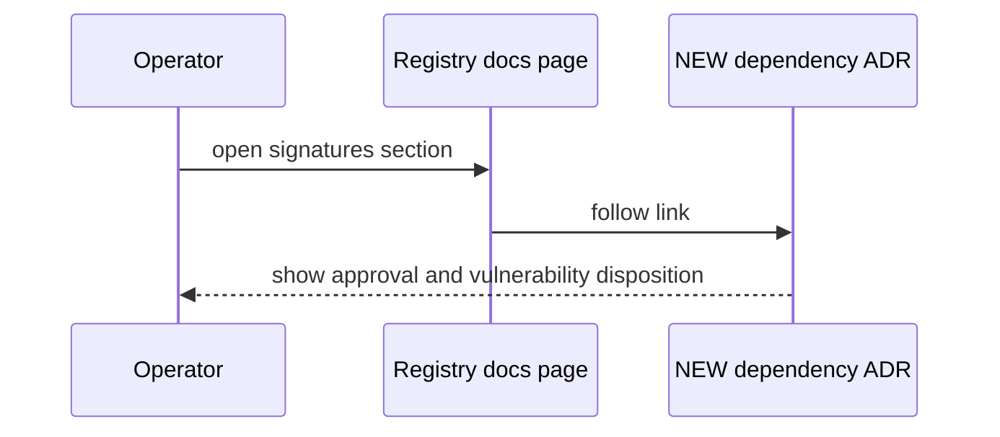
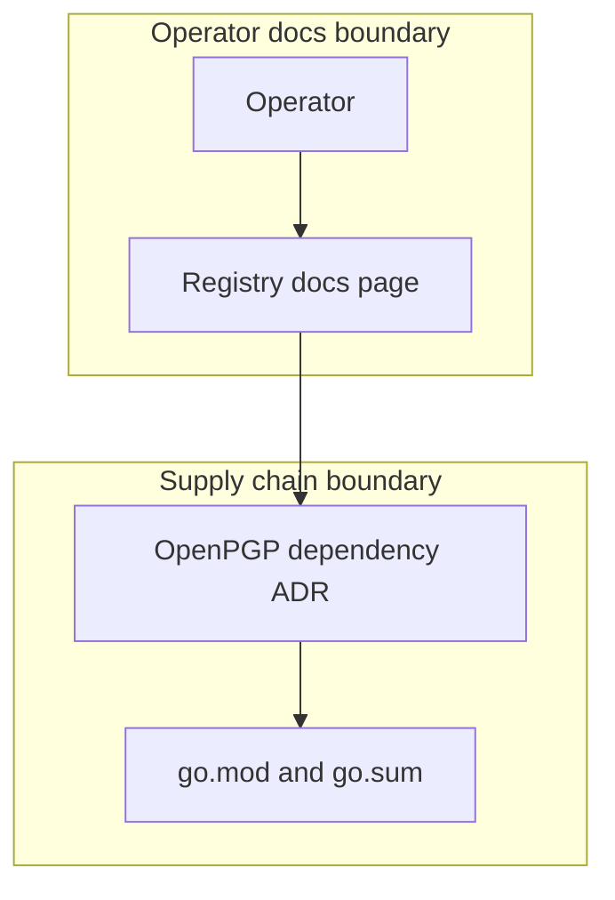

## Context

The registry signature check needs an OpenPGP dependency. Issue 1293 asks for its own ADR with the approved modules, the approval and the GO-2026-5932 disposition.

## Decisions

1. **Record the dependency in one ADR.** Write one ADR with the confirmed owner approval, the module versions that match go.mod output, the reason go-crypto replaces the frozen package, and fresh govulncheck output with the affected symbol count.
2. **Number, list and link with existing checks only.** Use the next free number from docs/adr/INDEX.md at write time, add the index entry, and link the registry docs signature section to the ADR. Checks use go list -m, make vuln, make docs-lint and rg. No new tool.

## Structure

No code change. One ADR file under docs/adr/, its entry in docs/adr/INDEX.md, and one docs link from the registry page.

## Risks

- The ADR records versions that differ from go.mod, so readers trust a wrong fact.

## Diagrams

After this change:

## Quality attributes

| Attribute | Target | Unit | Scope |
| --- | --- | --- | --- |
| correctness | 100 | percent of recorded versions that match go.mod | OpenPGP dependency ADR |

## Threat model

Data flow and trust boundaries:

| Boundary | STRIDE | Threat | Layer | Guard | Hostile test |
| --- | --- | --- | --- | --- | --- |
| Supply chain boundary | T | A dependency update changes a module version, so the ADR no longer matches go.mod and misleads the Operator. | boundary check | The version check compares the ADR versions with go list -m output. | Change one version in the ADR text and run the version check. It fails and names the module. |
| Supply chain boundary | T | A dependency update changes a module version, so the ADR no longer matches go.mod and misleads the Operator. | fail closed | On a mismatch the change is not done and the owner reviews before ship. | Run make vuln with a differing result. The ADR is not shipped until the owner reviews the fresh output. |
| Operator docs boundary | S | A dead or wrong docs link sends the Operator to a page that is not the ADR. | boundary check | make docs-lint checks that each docs link resolves. | Point the link to a missing ADR file and run make docs-lint. It names the dead link. |

## Failure modes

| Step | Failure | Retry | State after |
| --- | --- | --- | --- |
| Follow the registry docs link to the ADR. | Docs link points to a missing ADR file. | Add the ADR file and the index entry, then run the docs check again. | Link resolves and the docs check passes. |
| Run the vulnerability check again. | Fresh govulncheck output differs from the issue report. | Paste the fresh output into the ADR and ask the owner to review the risk before ship. | ADR records fresh output with owner review. |
