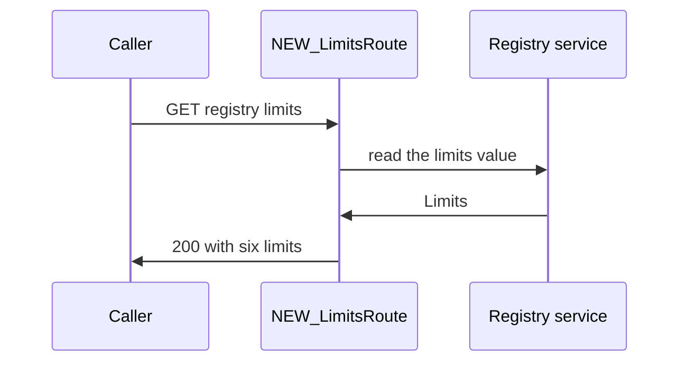
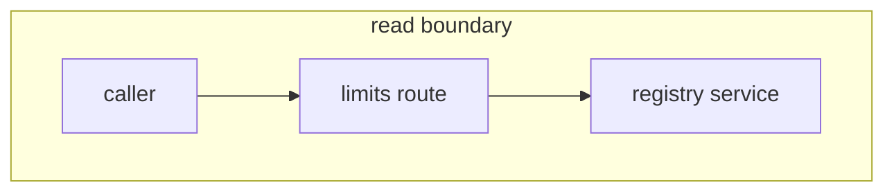

## Context

The registry refuses a publish at a request limit and at the unpack limits. The values are in code and in an error text. No route shows them. The "No magic" rule needs the effective value in the API.

## Decisions

1. **One source for each limit.** Add one value type, `registry.Limits`, in `pkg/registry` with the six limits. The handler, the unpack and the new route read the same value. The route cannot show a value that a check does not use.
2. **A read route on the namespace.** Add GET .../registry/limits to the route table with the action registry:read, like the other read routes. The answer holds numbers and a unit name for each limit.

## Structure

`registry.Limits` has unexported fields and one constructor that checks that each limit is above zero. The service gets the value at construction. The route reads it through the service. No other code holds a limit as a literal.

## Risks

- The route shows a value that a check does not enforce (a second source).
- A change of a limit without a change of the docs page.

## Layers (defense in depth)

| Layer | Guard | Hostile test |
| --- | --- | --- |
| port adapter | The limits are not stored. The constructor of `registry.Limits` refuses a limit of zero or less. | Build a value with a limit of zero; the constructor returns the invalid sentinel. |
| service | The service reads the limits from the one value that the unpack and the upload check also read. | Change the value in a test; the unpack, the upload check and the answer of the route all follow. |
| HTTP handler | The route is a read route: it checks the read grant on the namespace before the answer and takes no body. | Ask without the read grant and with a body; the answers are 403 and no body is read. |

## Diagrams

After this change:

New imports of this change (each one allowed by the module rules):

- `internal/api/registry` imports `pkg/registry`

## Quality attributes

| Attribute | Target | Unit | Scope |
| --- | --- | --- | --- |
| limits read | 0 | store reads for each request | GET /api/dustpan/v1/namespaces/{}/registry/limits |

## Threat model

Data flow and trust boundaries:

| Boundary | STRIDE | Threat | Layer | Guard | Hostile test |
| --- | --- | --- | --- | --- | --- |
| read boundary | I | A caller without a grant reads the registry limits of a namespace and learns its setup. | boundary check | The route takes no body and no query value, and a request with either gets 400. | Send a body and a query value; expect 400. |
| read boundary | I | A caller without a grant reads the registry limits of a namespace and learns its setup. | encode or contain | The answer holds numbers and fixed unit names only, no text of the caller. | Request with a hostile namespace path value; expect 404 and no echo of the value. |
| read boundary | I | A caller without a grant reads the registry limits of a namespace and learns its setup. | limit | The answer has a fixed size of six values. | Read the answer; expect six values. |
| read boundary | I | A caller without a grant reads the registry limits of a namespace and learns its setup. | authorize at point of use | The route checks registry:read on the namespace object. | Ask with an access token without the grant; expect 403. |
| read boundary | I | A caller without a grant reads the registry limits of a namespace and learns its setup. | fail closed | An unknown namespace gets 404 and a failed read of the grant gets a refusal. | Ask for an unknown namespace; expect 404. |

## Contracts

**registry limits**

- Invariant: Each limit that the route shows is the value that the check of that limit uses.
- `read limits`: pre: Caller holds registry:read on the namespace. Post: Answer holds the request limit, the unpacked size, the file count, the size of one file, the expansion limit and the manifest size.

## Failure modes

| Step | Failure | Retry | State after |
| --- | --- | --- | --- |
| Read limits | The caller has no read grant. | Ask an administrator for the grant, then read again. | 403 and no value shown. |
