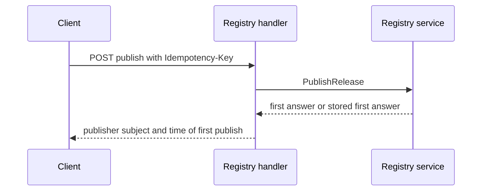
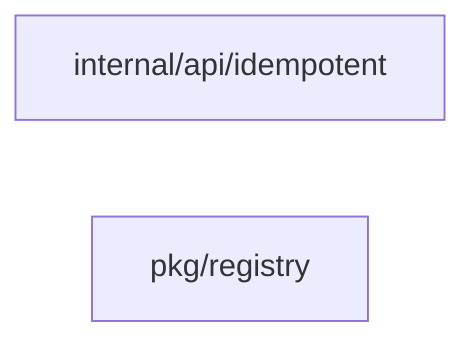

## Context

Registry publish uses Idempotency-Key replay and the management version list shows releases.

## Decisions

1. **Replay stored answer.** Store the first publish answer byte for byte in the existing Idempotency-Key record with caller, namespace, body fingerprint, publisher subject string and time. PublishRelease returns those bytes on replay. A failed first publish stores nothing. An atomic claim of the key makes a concurrent repeat wait.
2. **Served flag read-only helper.** Expose served as a read-only boolean on each module and provider version list entry. A read-only helper reads the same served data as the download path. The download path is unchanged.

## Structure

Unexported stored publish answer with a constructor that copies the first publish bytes, subject string and time. The version view type gains a read-only served field set by its constructor from the helper.

## Risks

- Replay returns the first publisher subject to a holder of the same key. Mitigation: same caller, namespace and fingerprint check, and a hostile cross-caller test.
- Served flag drifts from the serve path. Mitigation: one helper and a test that the list flag and the download agree.

## Diagrams

After this change:

Modules that the change touches, and their imports on main:

## Quality attributes

| Attribute | Target | Unit | Scope |
| --- | --- | --- | --- |
| none affected | Small metadata fix with no latency or storage target change |  |  |

## Contracts

**registry release**

- Invariant: A repeat publish with a stored Idempotency-Key returns the stored answer and creates no new release.
- Invariant: Each version list entry carries the current served flag from the same served data as the download path.
- `PublishRelease`: pre: Idempotency-Key matches a stored record of the same caller, namespace and body fingerprint.. Post: A repeat returns the stored first publisher subject and time byte for byte.; A concurrent repeat creates no second release.; A failed first call stores no answer..
- `ListVersions`: pre: Caller holds read access on the namespace registry.. Post: Each entry carries the current served flag..
