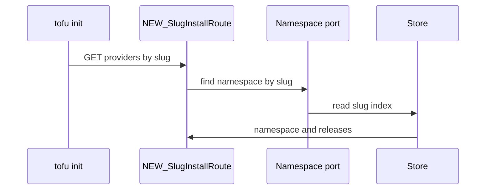
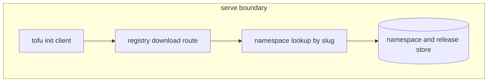

## Context

The registry serves each release under a namespace in the URL. A namespace name outside the registry-safe subset cannot publish, and a rename changes the URL. The server maps each namespace to a registry-safe slug.

## Decisions

1. **Stable slug from ID.** Derive the registry slug for each namespace from its stable ID in lowercase with unsafe characters removed, store the slug on the namespace record at the first publish, index slug to namespace for lookup (no backfill of earlier namespaces: no tag shipped the earlier shape, so the slug is set at the first publish), keep the name path of main for existing releases with slug winning on conflict, append a short suffix on collision or empty result, and edit the baseline of each dialect in place with no numbered migration.
2. **One lookup in the namespace port.** The lookup from slug to namespace is one method of the namespace port with its conformance cases. The registry install route calls it and no other code reads the slug column.

## Structure

The slug column has one writer: the namespace store method that sets the slug inside the transaction of the first publish. The install route reads the slug through the namespace port only.

## Risks

- Namespace name outside the safe subset breaks registry URLs.
- Two namespaces get the same slug and one serves the releases of the other.

## Layers (defense in depth)

| Layer | Guard | Hostile test |
| --- | --- | --- |
| port adapter | The store keeps a unique index on the slug in each dialect and refuses a second namespace with the same slug. | Set the same slug on two namespaces; the second write fails with the conflict sentinel and no row changes. |
| service | The service derives the slug, adds the suffix on a collision and refuses a slug outside the safe subset. | Derive a slug from an ID that strips to an empty string; the service returns a slug with the suffix. |
| HTTP handler | The install route checks the slug characters against the safe subset before the lookup, then checks the read grant on the namespace of the slug owner. | Request install with a dot-dot slug and with a slug of another namespace without a grant; the answers are 404 and 403. |

## Diagrams

After this change:

New imports of this change (each one allowed by the module rules):

- `internal/api/tfe` imports `pkg/namespace`

## Quality attributes

| Attribute | Target | Unit | Scope |
| --- | --- | --- | --- |
| slug lookup | 1 | store reads for each install request | GET /v1/providers/{namespace}/{type}/versions |

## Threat model

Data flow and trust boundaries:

| Boundary | STRIDE | Threat | Layer | Guard | Hostile test |
| --- | --- | --- | --- | --- | --- |
| serve boundary | I | A client requests a slug that belongs to another namespace and reads its releases. | boundary check | Download validates slug characters against the safe subset before the lookup. | Request install with a dot-dot slug; expect 404 registry.not-found. |
| serve boundary | I | A client requests a slug that belongs to another namespace and reads its releases. | encode or contain | Serve encodes the slug in URLs and serves bytes with a fixed content type. | Fetch a release under a slug with a hostile name; expect safe encoding. |
| serve boundary | I | A client requests a slug that belongs to another namespace and reads its releases. | limit | The lookup reads one row for each request. | Request a slug that maps to no namespace; expect one read and 404. |
| serve boundary | I | A client requests a slug that belongs to another namespace and reads its releases. | authorize at point of use | Download checks the read grant on the namespace object of the slug owner. | Fetch a private release without the read grant; expect 403. |
| serve boundary | I | A client requests a slug that belongs to another namespace and reads its releases. | fail closed | The route answers 404 for an unknown slug and for a slug that maps to two namespaces. | Request a slug with two owners in a fixture; expect 404 and an audit entry. |

## Contracts

**namespace registry slug**

- Invariant: Registry slug derives from stable namespace ID and never changes on rename.
- Invariant: Each slug maps to one namespace.
- `serve releases under slug`: pre: slug maps to one namespace. Post: client receives release bytes under slug path.

## Failure modes

| Step | Failure | Retry | State after |
| --- | --- | --- | --- |
| Set slug at first publish | Two first publishes of two namespaces derive the same slug | The second publish retries with the suffix. | Each slug maps to one namespace. |
