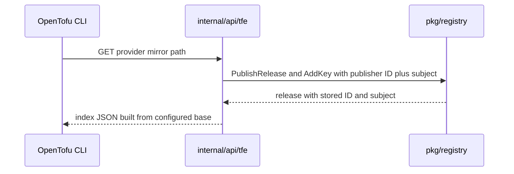
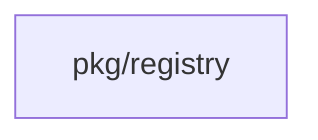
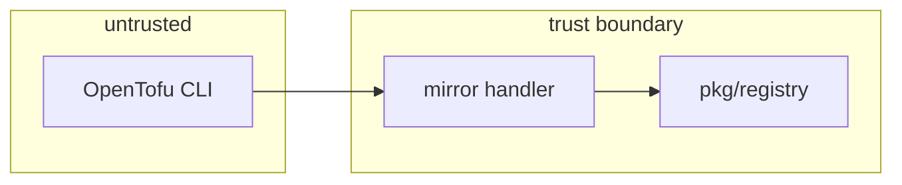

## Context

Issue 1294 states Release.PublishedBy and KeyRecord.AddedBy hold the subject. The mirror reads the Host header and compares it with --public-url. The change keeps the subject fields, adds a nullable stable principal ID beside each, edits each baseline in place, and stops reading the Host header.

## Decisions

1. **Stable ID beside subject, old rows stay readable.** Keep PublishedBy and AddedBy subject strings. Add one nullable principal ID column beside each subject. Old rows keep subject with null ID and read as subject with empty ID. When the ID points to an existing principal the display uses the resolved name, else the display uses the stored subject. A recreated principal with the same subject is a new ID and does not adopt old rows.
2. **Configured base only, Host header ignored.** Never read the request Host header or port for routing or URL building. Build mirror URLs only from the stored public URL base including scheme, host, and port, with the host normalized to ASCII lowercase. At startup refuse a public URL whose host is empty or has a trailing dot, and fold ASCII case once. When the public URL is unset the mirror answers 404 registry.not-found. A request that arrives on an alias host is served with URLs built from the configured base.

## Structure

Unexported type publisher in pkg/registry with constructor newPublisher that takes a principal ID string and a subject string and refuses an empty subject.

## Risks

- Bootstrap token has no principal record, so ID stays null and subject stays the display string.
- Proxy or alias host reaches the path but receives URLs built from the configured base only.

## Diagrams

After this change:

Modules that the change touches, and their imports on main:

## Quality attributes

| Attribute | Target | Unit | Scope |
| --- | --- | --- | --- |
| none affected | No latency or storage target changes; publisher ID is one nullable stored column beside the kept subject |  |  |

## Threat model

Data flow and trust boundaries:

| Boundary | STRIDE | Threat | Layer | Guard | Hostile test |
| --- | --- | --- | --- | --- | --- |
| Client to mirror handler | S | Spoofed Host header routes the mirror read or poisons URLs | boundary check | No Host header input enters routing or URL building; canonical base comes only from the stored public URL | Send Host evil.example with a valid mirror path and check the answer URLs still use the configured base |
| Client to mirror handler | S | Spoofed Host header routes the mirror read or poisons URLs | encode or contain | Build mirror URLs from the configured base only, with the host folded to ASCII lowercase | Send mixed-case and trailing-dot Host values and check the answer URLs are unchanged |
| Client to mirror handler | S | Spoofed Host header routes the mirror read or poisons URLs | limit | Mirror read needs no grant; publish and key write need the registry grants on the namespace | Publish with a reader access token and expect refusal |
| Client to mirror handler | S | Spoofed Host header routes the mirror read or poisons URLs | authorize at point of use | Check publish and key-write grants at the point of use on the namespace object | Call PUT version with a dropped grant and expect refusal |
| Client to mirror handler | S | Spoofed Host header routes the mirror read or poisons URLs | fail closed | Deny on grant failure with an audit entry; host mismatch writes no audit entry because the Host header is ignored | Send unknown Host and check no audit flood; publish without grant writes one audit entry |

## Contracts

**Release**

- Invariant: A published version never changes after publish.
- Invariant: PublishedBy resolves to the publisher for audit display, including bootstrap and removed principals.
- `PublishRelease`: pre: Caller holds the registry publish grant on the namespace.. Post: The release keeps its subject string and stores the publisher principal ID when the caller has a principal record..

**KeyRecord**

- Invariant: AddedBy resolves to the adder for audit display, including bootstrap and removed principals.
- `AddKey`: pre: Caller holds the registry key grant on the namespace.. Post: The key record keeps its subject string and stores the adder principal ID when the caller has a principal record..
