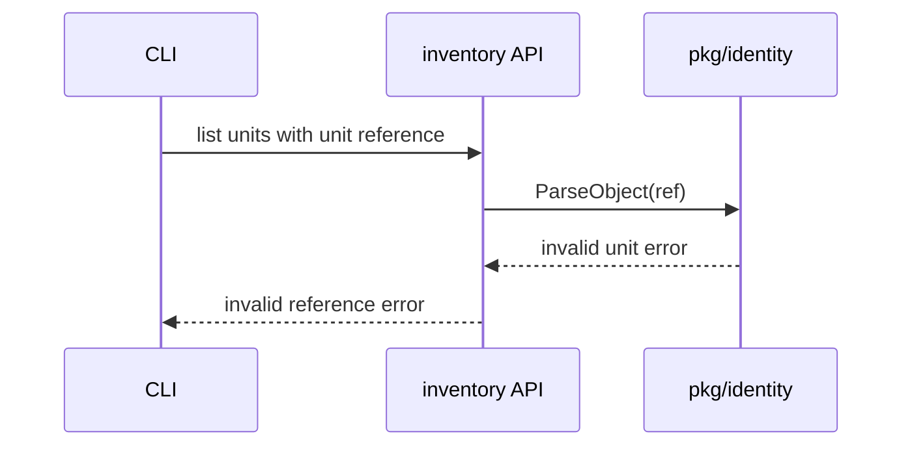
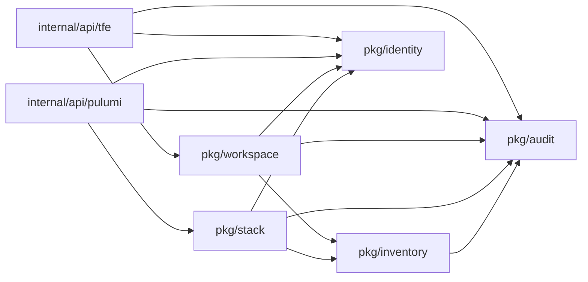
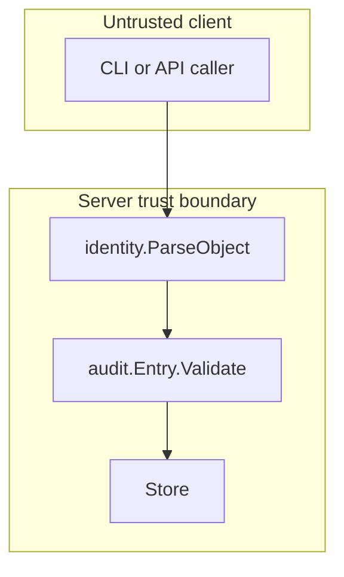

## Context

Unit references enter through inventory, saved views, and store lookups. Audit objects enter through success and refusal paths. One shared hidden-rune set stops bidi and zero-width text at each boundary.

## Decisions

1. **Reuse one hidden-rune set with no new import.** Match the audit.IsHiddenRune set (Cc, Cf, Zl, Zp) with a local unicode check in pkg/identity, with no new import edge from pkg/identity to pkg/audit. A parity test asserts the local check agrees with audit.IsHiddenRune on Cc, Cf, Zl, and Zp, so the two copies cannot drift.
2. **Add second layer in audit validation.** Check Object and ObjectID in audit.Entry.Validate as a second layer. Denied paths keep refusal.Clean before Validate, so the stored refusal record holds the cleaned value and Validate never turns a refusal into a lost write.
3. **Fail the request on a bad reference.** One bad reference fails the request that carries it with an error that repeats no raw hidden text. Existing rows with hidden runes fail closed on read. No stored-row repair, no shim, no rename.

## Structure

No new type. validUnitName uses a local Cc, Cf, Zl, Zp check tied to audit.IsHiddenRune by a parity test, and audit.Entry.Validate uses audit.IsHiddenRune for Object and ObjectID, so an invalid value cannot pass the boundary.

## Risks

- A reference with hidden runes stops matching; the issue trace finds no such names from tool adapters

## Layers (defense in depth)

| Layer | Guard | Hostile test |
| --- | --- | --- |
| boundary check | validUnitName rejects Cc, Cf, Zl, Zp in each part of the reference | Send reference with U+202E, U+2066, U+2028, U+2029, U+200B, newline, U+0007 direct to ParseObject and prove rejection |
| fail closed | audit.Entry.Validate rejects hidden runes in Object and ObjectID after refusal.Clean on the denied path | Send audit entry with hidden rune in Object and in ObjectID direct to Validate and prove rejection, and send raw denied reference through Clean then Validate and prove the write succeeds |

## Diagrams

After this change:

Modules that the change touches, and their imports on main:

## Quality attributes

| Attribute | Target | Unit | Scope |
| --- | --- | --- | --- |
| latency | less than 1 ms added | ms | identity.ParseObject and audit.Entry.Validate per call |

## Threat model

Data flow and trust boundaries:

| Boundary | STRIDE | Threat | Layer | Guard | Hostile test |
| --- | --- | --- | --- | --- | --- |
| Server trust boundary: unit reference and audit object input | T | Bidi override in unit reference changes console display order | boundary check | validUnitName rejects Cc, Cf, Zl, Zp without repair | Send U+202E, U+2066, U+2028, U+200B direct to ParseObject and expect rejection |
| Server trust boundary: unit reference and audit object input | T | Bidi override in unit reference changes console display order | encode or contain | No normalization; refused value is never stored | Send bidi text and prove the refused value never reaches the store |
| Server trust boundary: unit reference and audit object input | T | Bidi override in unit reference changes console display order | limit | Reject before store lookup with smallest error reply | Send hidden-rune reference and prove an invalid error without a stored row |
| Server trust boundary: unit reference and audit object input | T | Bidi override in unit reference changes console display order | authorize at point of use | ParseObject and Entry.Validate check at point of use for each caller | Call store adapter path direct with hidden rune and prove refusal without caller check |
| Server trust boundary: unit reference and audit object input | T | Bidi override in unit reference changes console display order | fail closed | Unknown or hidden value denies closed with invalid error | Send hidden rune in ObjectID direct to Validate and prove invalid error |

## Contracts

**identity object reference**

- Invariant: Unit part holds no rune in Cc, Cf, Zl, or Zp
- Invariant: Reference keeps tool, namespace, and tool name form
- `identity.ParseObject`: pre: Input is UTF-8 text. Post: Accepted reference holds no hidden rune in any part; Rejected reference returns an invalid error and stores nothing.

**audit entry**

- Invariant: Object and ObjectID hold no hidden rune
- Invariant: Denied path stores the cleaned value
- `audit.Entry.Validate`: pre: Denied entries pass refusal.Clean before Validate. Post: Entry with hidden rune in Object or ObjectID is invalid; Cleaned denied entry passes Validate.
