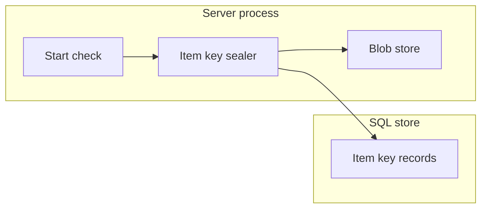

## Context

No production path builds the item sealer yet. Fix the three blockers before step 3 wires the sealer and before any tag ships item keys.

## Decisions

1. **Fail-closed start, in-place atomic rewrap, final v0.** CheckWrapper lists item key wrapper IDs at start and refuses to start on an unknown ID, an unwrap failure or a missing blob. RewrapItemKeys rewrites each live blob in place under the same v0 key with an atomic blob Put and no change to the record version, so a crash is safe to retry. The NEW token v0 is the exact version string under the ADR 220 prefix and ships before any tag.
2. **Offline rewrap.** The rewrap command runs with the server stopped. No live writer runs, so no key under the prior key-encryption key appears after the last pass.

## Structure

The unexported item key blob key builder fixes the version token to v0, and only its constructor makes a blob key from a checked namespace ID and item key ID.

## Risks

- Rewrap time grows with the item key count; paging bounds memory but not time.
- The operator must keep the prior key-encryption key until the rewrap ends on every copy.

## Layers (defense in depth)

| Layer | Guard | Hostile test |
| --- | --- | --- |
| boundary check | The start-up allowlist of known wrapper IDs denies an unknown ID. | Seed an item key record with an unknown wrapper ID and start; start fails. |
| encode or contain | The blob key builder takes only the namespace ID and item key ID and a fixed v0 token. | Pass traversal text as the namespace ID; the builder rejects it. |
| limit | Check and rewrap page the list and handle one blob at a time. | Seed many item keys; check and rewrap finish with bounded memory. |
| authorize at point of use | Each open uses the wrapper ID, scope and item ID in the associated data. | Move a blob to another item ID; the open fails. |
| fail closed | Any wrap, blob or list error blocks start or stops rewrap and names the blob key. | Corrupt one wrapped blob; start and rewrap fail. |

## Quality attributes

| Attribute | Target | Unit | Scope |
| --- | --- | --- | --- |
| none affected | No user-visible latency or throughput changes; item key counts are small before any tag ships item keys |  |  |

## Threat model

Data flow and trust boundaries:

| Boundary | STRIDE | Threat | Layer | Guard | Hostile test |
| --- | --- | --- | --- | --- | --- |
| Server start and rewrap | T | An old backup or tampered row presents an item key under an unknown key-encryption key. | boundary check | Allowlist of known wrapper IDs at start. | Inject an unknown wrapper ID and start; start fails. |
| Server start and rewrap | T | An old backup or tampered row presents an item key under an unknown key-encryption key. | encode or contain | Blob keys come only from the builder with the namespace prefix and v0. | Pass path traversal as the namespace ID; the builder rejects it. |
| Server start and rewrap | T | An old backup or tampered row presents an item key under an unknown key-encryption key. | limit | Paged iteration over records and blobs. | Seed many item keys; check and rewrap stay in the page bound. |
| Server start and rewrap | T | An old backup or tampered row presents an item key under an unknown key-encryption key. | authorize at point of use | The wrap associated data binds scope, kind and item ID. | Swap two blobs; the open fails. |
| Server start and rewrap | T | An old backup or tampered row presents an item key under an unknown key-encryption key. | fail closed | Any wrap, blob or list error blocks start or stops rewrap. | Corrupt one blob; start and rewrap fail. |

## Contracts

**ItemKey**

- Invariant: Each item key record binds scope, kind and item ID in the wrap associated data.
- Invariant: A shredded record never opens content.
- Invariant: Each blob key carries the namespace prefix.
- `CheckWrapper`: pre: The store lists data key and item key wrapper IDs.. Post: An unknown item key wrapper ID returns an error and blocks start..
- `RewrapItemKeys`: pre: The server is stopped and holds the current and prior key-encryption keys.. Post: Each live item key blob is under the current key-encryption key, and a repeat run changes nothing..
- `ItemKeyBlobKey`: pre: The namespace ID and item key ID are valid.. Post: The key is the namespace prefix, item-keys, the item key ID and the token v0..

## Failure modes

| Step | Failure | Retry | State after |
| --- | --- | --- | --- |
| Rewrap of one item key blob | The process stops before or during the blob Put. | Run the rewrap command again; it skips blobs already under the current key. | Each blob is wholly under the prior or the current key-encryption key; none is partial. |
| Start-up check of item key wrappers | A list, wrap or blob error occurs. | Fix the cause and start again. | The server did not start and wrote nothing. |
