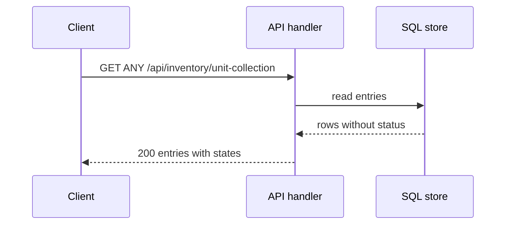
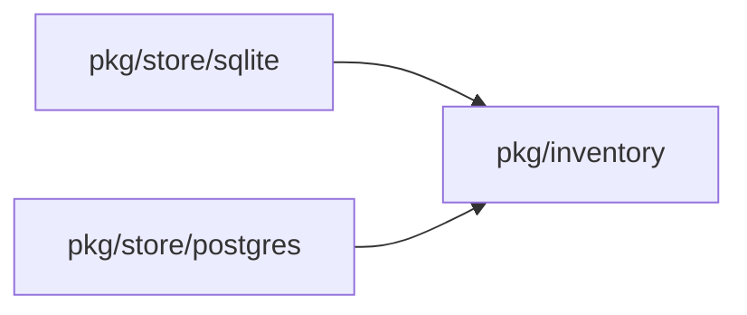
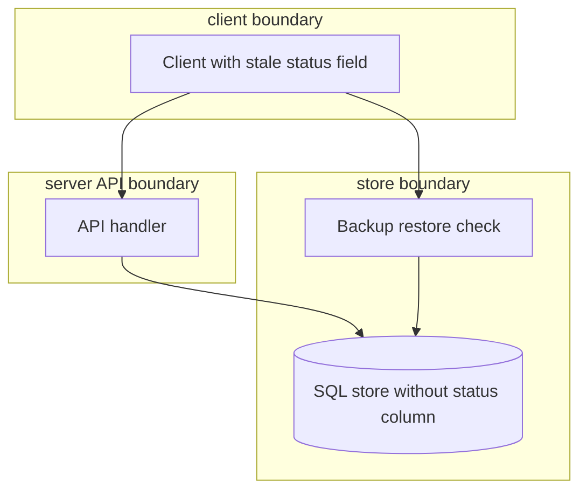

## Context

The inventory keeps a free-string status that no writer sets. The fixed states array is the only unit state.

## Decisions

1. **Removal over output filter.** Delete the column and the fields so no path can write, read, or back up a stale value.
2. **Baseline edit with no numbered migration.** Edit the single baseline of each dialect in place and run make generate. Add no numbered migration. This deviates from the issue text which names migration 0108, because migration 0108 does not exist on main and project rules forbid numbered migrations before the first tag.

## Structure

Deleting the stored columns and the fields makes the stale-value class impossible: no type holds a status, so no constructor can set one.

## Risks

- A dev database made before the edit fails the baseline hash check and needs dev reset.
- The console still parses status until its paired change merges before the next server tag.

## Diagrams

After this change:

Modules that the change touches, and their imports on main:

## Quality attributes

| Attribute | Target | Unit | Scope |
| --- | --- | --- | --- |
| none affected | Removes an unused field with no latency or storage target |  |  |

## Threat model

Data flow and trust boundaries:

| Boundary | STRIDE | Threat | Layer | Guard | Hostile test |
| --- | --- | --- | --- | --- | --- |
| client API | T | A stale client writes a status value that tampers the inventory view. | boundary check | Handler allowlist drops the unknown status key and uses the fixed states array only. | Send a unit write with a status value and show the stored entry keeps states only. |
| client API | T | A stale client writes a status value that tampers the inventory view. | encode or contain | API encodes entries with the states array and never copies the status input to output. | Send status with control characters and show the response carries no status field. |
| client API | T | A stale client writes a status value that tampers the inventory view. | limit | State filter keeps the 9-value limit and ignores a stale status query value. | Send 10 state values with a status value and show the server refuses the excess. |
| client API | T | A stale client writes a status value that tampers the inventory view. | authorize at point of use | Handler checks namespace read access before it reads an entry. | Call listUnits without a grant and show denial with no entry data. |
| client API | T | A stale client writes a status value that tampers the inventory view. | fail closed | Unknown status input fails closed by ignore with no stored value and no error leak. | Replay a stored response with status and show the server ignores it. |
| store boundary | T | An old backup restores a status column that resurrects the removed field. | boundary check | Restore checks the table list and refuses a backup with a status column. | Restore a backup with a status column and show refusal with no rows written. |
| store boundary | T | An old backup restores a status column that resurrects the removed field. | encode or contain | SQL uses placeholders and the baseline schema with no status column. | Restore a status value with SQL text and show it reaches no column. |
| store boundary | T | An old backup restores a status column that resurrects the removed field. | limit | Restore writes no status data and keeps backup size within the namespace limit. | Restore a backup with extra status data and show refusal before writes. |
| store boundary | T | An old backup restores a status column that resurrects the removed field. | authorize at point of use | Restore checks namespace write access on the target namespace. | Restore without the grant and show denial with no rows written. |
| store boundary | T | An old backup restores a status column that resurrects the removed field. | fail closed | Schema hash mismatch fails closed with ErrSchemaDiverged and no partial restore. | Open an old database file and show the server refuses to open it. |

## Contracts

**inventory entry**

- Invariant: An entry carries the states array and no status value.
- `listUnits`: pre: The caller holds read access on the namespace.. Post: Each entry carries states and no status field..
- `getUnit`: pre: The caller holds read access on the namespace.. Post: The entry carries states and no status field..
