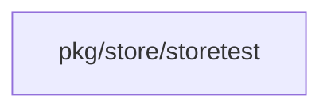

## Context

Store conformance tests use fixed waits that fail on a loaded machine. One earlier fix added a shared poll limit. This change applies the same pattern to the remaining waits.

## Decisions

1. **Poll to a shared per-test deadline.** Replace each listed fixed wait in pkg/store/storetest with a call to the NEW helper Poll that checks a state change every 200 milliseconds and ends at one shared per-test deadline. 200 milliseconds keeps the test database load low. Every store uses one code path.
2. **One deadline per test.** Build one NEW type testDeadline with the NEW constructor newTestDeadline in pkg/store/storetest, and pass one value into each helper of a test, including checkRecovered, so waitBackupEnd plus the operation loop share the same end time. Poll stops at test cancellation. When the deadline passes during a check call, Poll waits for that call and then fails with a timeout error that names the wait and the awaited state.
3. **Transient retry with fail-fast permanent errors.** Retry only a not-yet-changed result and a not-found result where the state appears later. Every other error fails the test at once with the check error and the wait name.
4. **Provisional deadline value and export.** Use one 15 minute per-test deadline provisionally so three stuck tests stay below the 60 minute package timeout, pending the owner decision. Keep StuckTestLimit exported until the owner decides, with a test-only doc comment.

## Structure

In pkg/store/storetest, test helpers take the NEW unexported type testDeadline. Only the NEW constructor newTestDeadline makes a value, and it checks that the deadline is in the future.

## Risks

- A longer shared deadline can hide a slow store adapter.
- A 200 millisecond poll can load the test database.

## Diagrams

Modules that the change touches, and their imports on main:

## Quality attributes

| Attribute | Target | Unit | Scope |
| --- | --- | --- | --- |
| none affected | Test-only change; no production latency, storage, or rate target changes. |  |  |

## Contracts

**pkg/store/storetest**

- Invariant: One shared deadline bounds every poll of one test.
- `Poll`: pre: The shared per-test deadline is in the future.. Post: Poll returns when the awaited state appears before the deadline.; Poll fails the test with a named timeout error at the deadline..
