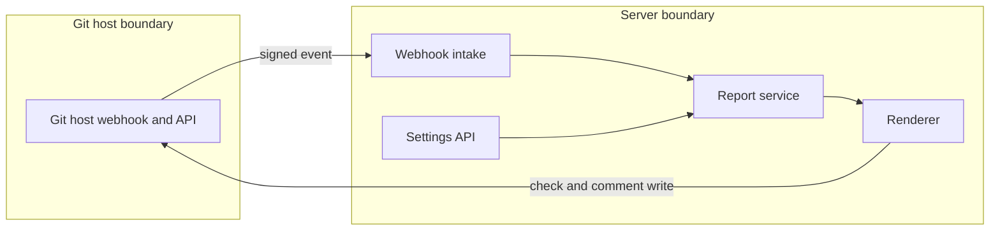

## Context

Reporting sits above jobs and change orders. The Forge port gets a check method behind a capability. A pure renderer builds the comment. Timing resolves from the widest scope.

## Decisions

1. **Pure renderer.** The renderer takes unit status, counts, addresses with their kind of change and links. It has no input for a value. It cuts the whole comment at 60,000 characters.
2. **Fixed check name.** The summary check name is the constant opendustpan/plans. A unit check name is the constant, a slash and the unit name.
3. **Summary rule.** The summary check passes only when every unit plan has succeeded or has no change. A failed plan, an approval wait, an unfinished plan and a Git host error give a failing or pending summary. A review request with zero units gives a passing summary that says no unit changed. The check binds to the head commit of the plans. A push event whose head differs from the plans commit writes nothing.
4. **Fenced edits.** Each review request has one stored row with the comment ID and a version number. A write checks the version in the same transaction and fails if it is older.
5. **Comment repair.** The server finds its comment by marker and author. A comment with the marker by another author is ignored. If two own comments hold the marker, the server edits the oldest and deletes the others. A deleted comment gets one new comment.
6. **Catch-up.** A write that failed is retried by one durable operation with backoff, so a check does not stay pending when no new event comes.
7. **Timing resolution.** The widest level that forbids overrides wins. Else the narrowest set value wins. An unset level inherits. The unit value stays stored when a wider forbid is set later, and the API shows the level. Writes need the settings manage action on the object and make an audit entry.

## Structure

An unexported type planComment with the constructor NewPlanComment. It sorts units by stable unit ID, refuses negative counts and has no field for a value. Only the constructor makes a valid value.

## Risks

- A second push posts a second comment.
- The summary stays green while a unit waits.
- A comment exceeds the limit of the Git host.

## Layers (defense in depth)

| Layer | Guard | Hostile test |
| --- | --- | --- |
| webhook intake | Check the signature, refuse a replay, never decide on the payload alone. | A payload with a bad signature reports nothing. |
| renderer and Forge adapter | The renderer type has no value field. The adapter edits only a comment of its own author. | A plan with secret values renders no value. |

## Quality attributes

| Attribute | Target | Unit | Scope |
| --- | --- | --- | --- |
| Comment edits per review request | 1 | comment | each review request, after any number of pushes |
| Report latency after the last plan finishes | 5 | seconds, p95 | summary check and comment write with a fake Git host |

## Threat model

Data flow and trust boundaries:

| Boundary | STRIDE | Threat | Layer | Guard | Hostile test |
| --- | --- | --- | --- | --- | --- |
| Git host boundary | S | A forged webhook triggers a report. | boundary check | Verify the signature and refuse a replay. | A payload with a bad signature reports nothing. |
| Git host boundary | S | A forged webhook triggers a report. | encode or contain | The report reads the head commit fresh and uses the payload only as a hint. | A payload that names a false head writes nothing. |
| Git host boundary | S | A forged webhook triggers a report. | limit | The server limits the body size of a webhook. | An oversize body is refused. |
| Git host boundary | S | A forged webhook triggers a report. | authorize at point of use | The report acts only on a review request of a stored Git host connection. | An event for an unknown repository reports nothing. |
| Git host boundary | S | A forged webhook triggers a report. | fail closed | An unknown event or a failed read denies and writes an audit entry. | An unknown event type reports nothing. |
| Server boundary | I | The comment leaks a secret value of a plan. | boundary check | The report reads counts and addresses only from the plan summary. | A plan summary with a value field is refused. |
| Server boundary | I | The comment leaks a secret value of a plan. | encode or contain | The renderer type has no value field and escapes Markdown. | A plan with a secret value renders no value. |
| Server boundary | I | The comment leaks a secret value of a plan. | limit | The comment has a fixed limit of 60,000 characters. | A plan with many addresses gives a cut comment. |
| Server boundary | I | The comment leaks a secret value of a plan. | authorize at point of use | The adapter edits only a comment of its own author. | A comment of another author is not edited. |
| Server boundary | I | The comment leaks a secret value of a plan. | fail closed | A render error writes no comment. | A negative count writes no comment. |
| Server boundary | E | A unit write of pre-merge passes around a wider forbid. | boundary check | The value is an allowlist of post-merge or pre-merge. | An unknown value is refused with 400. |
| Server boundary | E | A unit write of pre-merge passes around a wider forbid. | encode or contain | The write uses SQL placeholders and the stable unit ID. | A unit name with SQL text changes no other row. |
| Server boundary | E | A unit write of pre-merge passes around a wider forbid. | limit | The setting holds one small value for each level. | A large body is refused. |
| Server boundary | E | A unit write of pre-merge passes around a wider forbid. | authorize at point of use | The settings write needs the manage action on the object and checks the wider levels. | A unit write against a forbidding namespace gives 409. |
| Server boundary | E | A unit write of pre-merge passes around a wider forbid. | fail closed | An error in the level read denies the write and writes an audit entry. | A failed read of the namespace level refuses the write. |

## Failure modes

| Step | Failure | Retry | State after |
| --- | --- | --- | --- |
| Write with a version number | A slow writer resumes after a newer write | The older write is refused and not retried | The newer comment and check stay |
| Post the comment | The server stops before it records the comment ID | The next edit finds the comment by marker and author | One comment exists |
| Write the summary check | The Git host answers with an error | A durable operation retries with backoff | The summary check is not reported as passed until a write succeeds |
