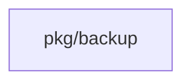
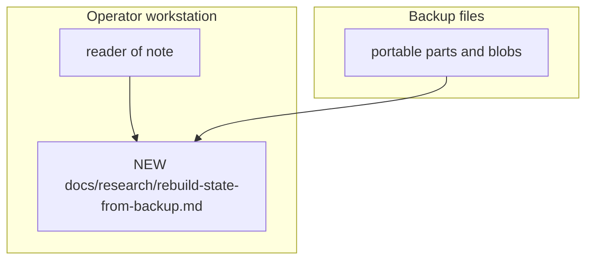

## Context

The portable backup exists and docs/guides/migrate-out.md covers live reads. Commands never touch the database. The note fills the gap the guide leaves: rebuild from backup files alone.

## Decisions

1. **Research note first.** Write a research note only, with no command, no route, and no format change. The note maps portable tables and blobs to a Pulumi DIY backend layout and to one OpenTofu state file per workspace, covers older schema, cross-dialect restore, format 1 refusal, checksum failure, missing blobs, large blob-held state, many stacks, renamed and deleted units by stable ID, and states the key holder and passphrase supply gap.

## Structure

No new structure in this change.

## Risks

- A later offline rebuild that decrypts secrets widens secret exposure if the key holder is not bounded.

## Diagrams

Modules that the change touches, and their imports on main:

## Quality attributes

| Attribute | Target | Unit | Scope |
| --- | --- | --- | --- |
| none affected | research note only, no runtime path changes |  |  |

## Threat model

Data flow and trust boundaries:

| Boundary | STRIDE | Threat | Layer | Guard | Hostile test |
| --- | --- | --- | --- | --- | --- |
| Backup files | T | A tampered table file or blob changes rebuilt state. | boundary check | The note allows only portable manifest format 3 and refuses format 1 before any read. | Offer a format 1 manifest and fail when the note path would accept it. |
| Backup files | T | A tampered table file or blob changes rebuilt state. | encode or contain | The note states blob keys stay opaque and paths are contained. | Offer a foreign blob path and fail when the note path would follow it. |
| Backup files | T | A tampered table file or blob changes rebuilt state. | limit | The note bounds the read to one backup ID. | Offer two backup IDs and fail when the note path would mix them. |
| Backup files | T | A tampered table file or blob changes rebuilt state. | authorize at point of use | The later build needs backup read actions on the backup object. | Run without the grant and fail when the read would proceed. |
| Backup files | T | A tampered table file or blob changes rebuilt state. | fail closed | Checksum failure stops the rebuild with backup.corrupt. | Corrupt one table file and fail when the rebuild would continue. |
| Operator workstation | I | Plain-text secrets leak during re-encryption with a passphrase provider. | boundary check | The note states the passphrase comes only from a stored secret or named prompt, never a flag. | Pass the passphrase as a flag and fail when the note path would accept it. |
| Operator workstation | I | Plain-text secrets leak during re-encryption with a passphrase provider. | encode or contain | The note states re-encrypted secrets never reach logs or audit text. | Inspect the note procedure output and fail when plain text would log. |
| Operator workstation | I | Plain-text secrets leak during re-encryption with a passphrase provider. | limit | The note bounds secret handling to one scope at a time. | Offer two scopes and fail when the note path would mix keys. |
| Operator workstation | I | Plain-text secrets leak during re-encryption with a passphrase provider. | authorize at point of use | The later build checks the caller may reveal secrets of that scope. | Run without reveal rights and fail when plain text would return. |
| Operator workstation | I | Plain-text secrets leak during re-encryption with a passphrase provider. | fail closed | Unknown key version denies the rebuild. | Offer an unknown key version and fail when the rebuild would continue. |
