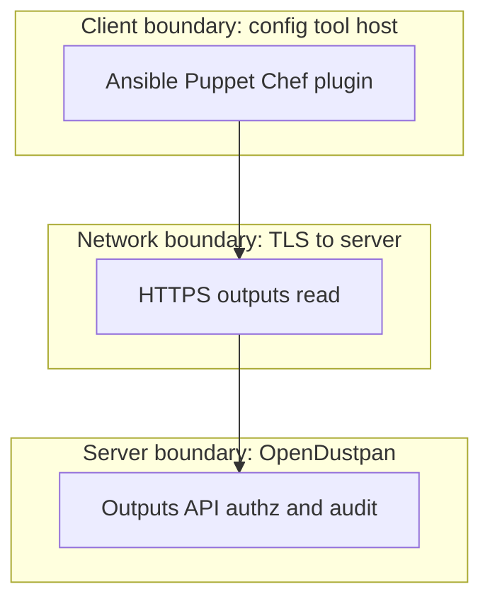

## Context

Teams pass IPs, hostnames and secrets from stacks and workspaces to Ansible, Puppet and Chef with scripts or raw state reads. Raw state exposes more than outputs. A general outputs API with least-privilege reads is the later fix boundary; this change only researches it.

## Decisions

1. **Research note first.** Write a research note, not code and not plugins. Cover the six issue points. The note records per-output read action, secret-output behavior, version by state version, relation to the output-sharing actions on main, and down-server behavior as recommendations for a later change.

## Structure

No structure change. No unexported type. No new tool. Research only.

## Risks

- Note proposes raw state access for clients; mitigated by requiring a least-privilege outputs API with a separate read action in the note.
- Stale cache serves a rotated secret; mitigated by a later change with short TTL plus re-read on use.
- Token leaks through logs or files; mitigated by a later change with short-lived tokens and no secret logging.

## Layers (defense in depth)

| Layer | Guard | Hostile test |
| --- | --- | --- |
| boundary check | Note requires allowlist of tool, namespace, unit name, output name, and state version at the later API boundary. | Later handler test sends traversal output name directly to handler and expects rejection. |
| encode or contain | Note requires JSON encoding and quoted YAML Hiera rendering at each client point of use. | Later client test feeds template markers and expects literal text output. |
| limit | Note requires caps on outputs per request, value bytes, cache count, and TTL. | Later test serves oversize list and expects cap plus limit error. |
| authorize at point of use | Note requires per-output read action checked at point of use, separate from unit read. | Later service test calls outputs read with unit-read grant only and expects denial plus audit. |
| fail closed | Note requires fail-closed on unreachable server, unknown scope, and denied secret read with audit. | Later test points plugin at closed port and expects error with no stale secret. |

## Quality attributes

| Attribute | Target | Unit | Scope |
| --- | --- | --- | --- |
| none affected | Research note only; no runtime path changes |  |  |

## Threat model

Data flow and trust boundaries:

| Boundary | STRIDE | Threat | Layer | Guard | Hostile test |
| --- | --- | --- | --- | --- | --- |
| Client boundary: config tool host | I | Plugin logs or inventory file disclose secret output values | boundary check | Allowlist unit reference, output name, and state version at plugin input. | Pass path traversal output name directly to plugin parser; it rejects without a server call. |
| Client boundary: config tool host | I | Plugin logs or inventory file disclose secret output values | encode or contain | Quote output values for YAML JSON Hiera context at point of use. | Feed output value with template markers directly to renderer; output stays literal text. |
| Client boundary: config tool host | I | Plugin logs or inventory file disclose secret output values | limit | Cap cached outputs count, bytes, and TTL recommended in note. | Serve oversize outputs list to plugin cache; plugin refuses and fails closed. |
| Client boundary: config tool host | I | Plugin logs or inventory file disclose secret output values | authorize at point of use | Plugin sends short-lived token and requests only named outputs. | Request secret output with inventory-only token directly at API; server denies. |
| Client boundary: config tool host | I | Plugin logs or inventory file disclose secret output values | fail closed | On unreachable server plugin stops run with one command that helps. | Point plugin at closed port; run ends in error, no stale secret served. |
| Network boundary: TLS to server | T | Network attacker reads or changes outputs in transit | boundary check | Allowlist host and output path at client before TLS open. | Pass redirect host directly to client; client rejects without opening connection. |
| Network boundary: TLS to server | T | Network attacker reads or changes outputs in transit | encode or contain | Pin TLS and encode bearer in header only, never in URL. | Feed token in URL directly to client; client rejects and sends header only. |
| Network boundary: TLS to server | T | Network attacker reads or changes outputs in transit | limit | Cap response bytes and call timeout recommended in note. | Serve slow oversize body directly to client; client aborts on timeout. |
| Network boundary: TLS to server | T | Network attacker reads or changes outputs in transit | authorize at point of use | Client presents short-lived token for named outputs at each call. | Replay expired token directly at API; server denies and audits denial. |
| Network boundary: TLS to server | T | Network attacker reads or changes outputs in transit | fail closed | On TLS or auth error stop without cache write. | Break TLS directly on test server; client ends in error with no secret cached. |
| Server boundary: OpenDustpan | E | Caller with unit read elevates to secret output read | boundary check | Allowlist tool, namespace, unit name, output name, and version in API. | Send bad unit reference characters directly to handler; handler rejects with error code. |
| Server boundary: OpenDustpan | E | Caller with unit read elevates to secret output read | encode or contain | Use SQL placeholders and JSON encoding for output reads. | Send quote in output name directly to service; query stays parameterized. |
| Server boundary: OpenDustpan | E | Caller with unit read elevates to secret output read | limit | Limit outputs per request, value bytes, and read rate recommended in note. | Request huge page directly at handler; handler caps page and returns limit error. |
| Server boundary: OpenDustpan | E | Caller with unit read elevates to secret output read | authorize at point of use | Check per-output read action for the caller object at point of use. | Call outputs read with unit-read grant only; service denies and audits denial. |
| Server boundary: OpenDustpan | E | Caller with unit read elevates to secret output read | fail closed | Deny unknown scope and audit each denial. | Call outputs read with unknown action directly at service; service denies closed. |
