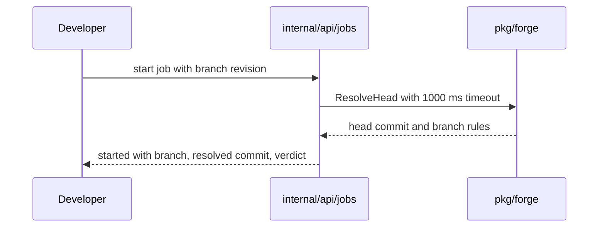
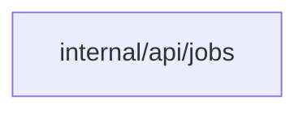
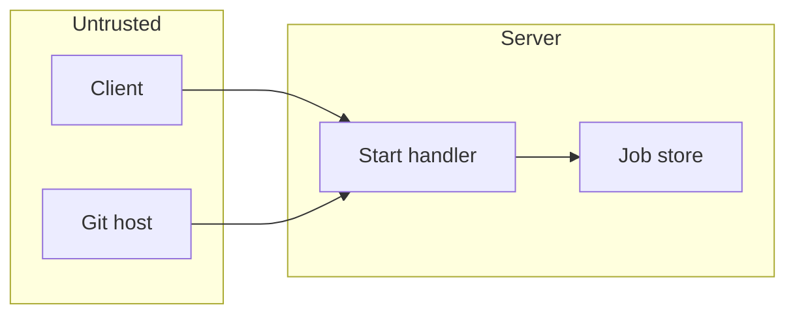

## Context

Job start takes the requested revision from the start request with no server-side resolution, so the protected-branch condition fails closed.

## Decisions

1. **Opt-in resolution that never blocks start.** Setting trusted-source-check has values on and off, default off, stored on the namespace settings resource. The API shows the effective value and the layer that set it. When off the server uses the requested revision as main does. When on the NEW constructor ResolveCommitAtStart calls the NEW forge method ResolveHead with a 1000 ms timeout; a forge failure, rate limit, auth failure, missing rules, or unknown repository ID gives verdict untrusted and the start still succeeds with protected-branch secrets denied.
2. **Stored references and first-apply rule.** The job stores repository ID mapped from the unit code location at start, requested branch, resolved commit, last approved apply commit, and verdict in the single refusal-reason field that write-back-record-audit-entry defines for GET jobs; this change adds no second verdict field. A tag or raw SHA resolves to itself with empty branch and verdict untrusted and no history check. A branch head resolves to the host head at start; that stored commit is the commit the plan checks out. No merge around the gate compares the stored commits before and after the gate window; force-push compares against the stored last approved apply commit; first apply with no prior commit is untrusted for the protected-branch condition and stores its commit as baseline.

## Structure

Unexported resolvedSource, made only by ResolveCommitAtStart, which checks the setting, the revision allowlist, and the verdict invariants.

## Risks

- A Git host outage denies protected-branch secrets until the host answers; other jobs start as before.

## Diagrams

After this change:

Modules that the change touches, and their imports on main:

## Quality attributes

| Attribute | Target | Unit | Scope |
| --- | --- | --- | --- |
| latency | 1500 | ms p95 added at start, includes 1000 ms forge timeout | job start with forge resolution |

## Threat model

Data flow and trust boundaries:

| Boundary | STRIDE | Threat | Layer | Guard | Hostile test |
| --- | --- | --- | --- | --- | --- |
| Client to start handler | T | A forged revision claims a protected head. | boundary check | Allowlist revision shape and length at the handler. | Send an oversized revision; expect request.body-invalid. |
| Client to start handler | T | A forged revision claims a protected head. | encode or contain | Store only the host-resolved commit, never the client string. | Send a forged SHA; stored commit equals host head. |
| Client to start handler | T | A forged revision claims a protected head. | limit | Forge timeout 1000 ms inside 1500 ms start budget. | Hang the forge stub; start succeeds with verdict untrusted. |
| Client to start handler | T | A forged revision claims a protected head. | authorize at point of use | Check the unit job-start grant at the point of use. | Start without the grant using an access token; expect denial. |
| Client to start handler | T | A forged revision claims a protected head. | fail closed | Unknown or tampered verdict denies protected-branch secrets; start still succeeds. | Tamper the stored verdict; protected-branch secrets denied. |

## Contracts

**Job**

- Invariant: The stored resolved commit always pairs with the stable repository ID that produced it.
- Invariant: The start of a job never fails because the forge cannot be reached; only the verdict fails closed.
- `ResolveCommitAtStart`: pre: The trusted-source-check setting is on and the start request carries a revision.. Post: The job stores branch, resolved commit, repository ID and verdict untrusted or trusted..

## Failure modes

| Step | Failure | Retry | State after |
| --- | --- | --- | --- |
| Resolve head at start | The forge call times out, rate-limits, or auth fails. | A later start resolves again; no retry of the same start. | The job is stored with verdict untrusted and protected-branch secrets denied. |
