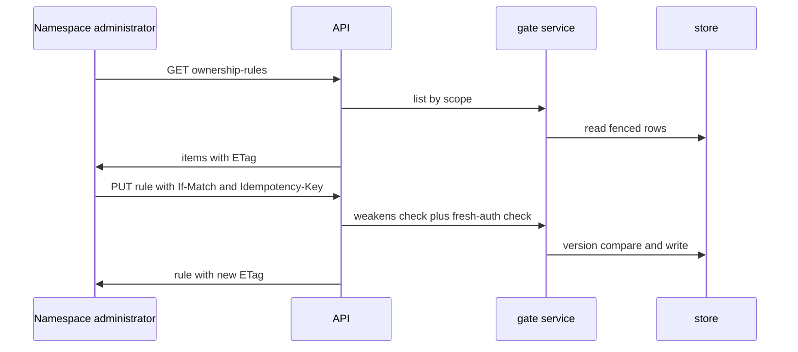
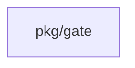
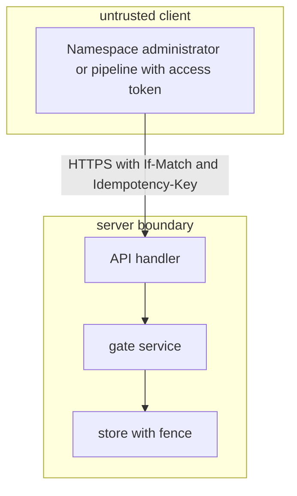

## Context

Ownership rules are stored gate data with no REST access today. The change adds thin REST routes over the gate package with ETag preconditions and a single weakens check shared by approval rules, approval defaults and ownership rules.

## Decisions

1. **Ownership rule routes.** Add list, read, put and delete routes for ownership rules at namespace scope, collection scope and unit scope, each with its authorization action and object in the route table. A put carries ETag and honors If-Match; a stale match answers 412 and changes nothing. A create uses If-None-Match star; an update or delete with no If-Match answers 428.
2. **One weaken rule.** Put one weakens function in the gate domain next to the rule types that maps each field to weaken or tighten: mode, count, groups, users, paths, when, unless and freshAuthSeconds, plus create as non-weakening and delete as weakening. An undecidable when, unless or glob comparison is weakening. Each write route calls it before it writes. A write that does not weaken security works with a session or an access token. A write that weakens security needs a fresh authentication and fails with 403 mfa.fresh-step-required on an access token, a service principal without a fresh step or an agent.

## Structure

No new tool and no new analyzer. The unexported ownership rule record keeps its constructor check in pkg/gate. The weakens function is a pure function on old and new rule values so the bug class of divergent weaken checks is impossible.

## Risks

- A weaken definition that misses a field lets a pipeline weaken a rule with an access token.
- A missing action on one route breaks the route policy check.

## Layers (defense in depth)

| Layer | Guard | Hostile test |
| --- | --- | --- |
| HTTP handler | Handler checks sign-in, authorization action on the scope object, ETag If-Match, JSON shape and size limit before it calls the service. | Send a stale If-Match, an unknown field and an oversize body directly at the handler; each is refused and the stored rule is unchanged. |
| service | Service holds the weakens check and the fresh-authentication check at the point of use for each write, independent of the handler. | Call the service write with an access token that weakens the rule while the handler check is bypassed; the service refuses with 403 mfa.fresh-step-required. |
| port adapter | Store write runs in the namespace fence transaction with a version compare; a concurrent winner makes the loser fail with no partial write. | Race two puts with the same ETag directly at the port; one wins and the other gets a version conflict with no lost update. |

## Diagrams

After this change:

Modules that the change touches, and their imports on main:

## Quality attributes

| Attribute | Target | Unit | Scope |
| --- | --- | --- | --- |
| correctness | 412 within 500 ms with no state change | ms | PUT ownership rule with stale If-Match |
| correctness | 403 mfa.fresh-step-required within 500 ms with no state change | ms | weakening write with access token |
| availability | first page within 1000 ms for 100 rules | ms | list ownership rules page |

## Threat model

Data flow and trust boundaries:

| Boundary | STRIDE | Threat | Layer | Guard | Hostile test |
| --- | --- | --- | --- | --- | --- |
| server boundary | S | A caller forges or replays a write to relax or delete an ownership rule | boundary check | Handler rejects stale If-Match, unknown fields and oversize bodies before service call | Send stale If-Match and oversize glob set directly at handler; both refused with no write |
| server boundary | S | A caller forges or replays a write to relax or delete an ownership rule | encode or contain | Paths and when text are stored as data and never resolved as file paths or code | Send path traversal in paths; server stores it as text or answers 400 with no file access |
| server boundary | S | A caller forges or replays a write to relax or delete an ownership rule | limit | Body size and evaluator limits bound CPU and memory on when and glob sets | Send when expression above limit; server answers 400 without evaluation |
| server boundary | S | A caller forges or replays a write to relax or delete an ownership rule | authorize at point of use | Handler enforces ownership-rule action on the scope object at point of use | Call put without the manage action; server answers 403 |
| server boundary | S | A caller forges or replays a write to relax or delete an ownership rule | fail closed | Weakening write with access token fails closed with 403 mfa.fresh-step-required | Send weaken with valid token bypassing handler check; service still refuses |
| server boundary | D | A hostile rule body exhausts the evaluator or escapes its scope | boundary check | Handler checks shape, size and content type before evaluation | Send malformed body directly at handler; server answers 400 with no evaluation |
| server boundary | D | A hostile rule body exhausts the evaluator or escapes its scope | encode or contain | When expression runs in the bounded evaluator with no file or network access | Send when text with traversal; evaluator treats it as data with no escape |
| server boundary | D | A hostile rule body exhausts the evaluator or escapes its scope | limit | When expression size and evaluator limits bound CPU and memory | Send when expression above limit; server answers 400 without evaluation |
| server boundary | D | A hostile rule body exhausts the evaluator or escapes its scope | authorize at point of use | Evaluation runs only after authorization on the scope object | Call put without manage action; server answers 403 before evaluation |
| server boundary | D | A hostile rule body exhausts the evaluator or escapes its scope | fail closed | Undecidable when or glob comparison fails closed as weakening | Send undecidable expression; server treats it as weakening and needs fresh auth |

## Contracts

**ownership rule**

- Invariant: Rule ID is immutable within its scope
- Invariant: Stored ETag changes on each write
- Invariant: Delete is a weakening change
- `put`: pre: Caller holds manage action on the scope object; If-Match equals stored ETag for update or If-None-Match star for create; Weakening write holds fresh authentication. Post: Stored rule equals request body and ETag advances.
- `delete`: pre: Caller holds manage action on the scope object; If-Match equals stored ETag; Caller holds fresh authentication. Post: Rule is absent and audit entry exists.

## Failure modes

| Step | Failure | Retry | State after |
| --- | --- | --- | --- |
| put or delete ownership rule | Stale If-Match on put or delete | Read again and retry once with the new ETag | Stored rule unchanged |
| put or delete ownership rule | Weakening write with access token | Do not retry with the token; sign in as a person with fresh authentication and retry | Stored rule unchanged with 403 mfa.fresh-step-required |
| concurrent writes on one rule ID | Concurrent put and delete race | Read again and retry once with the new ETag | One winner applied, loser gets 412 or 404 with no partial write |
