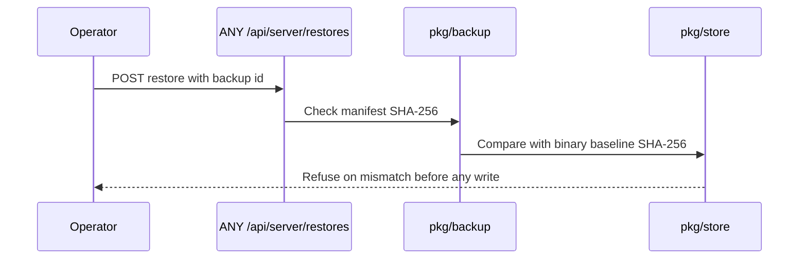
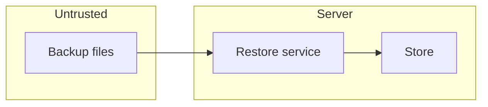

## Context

Untagged builds edit the baseline in place, so the schema version alone cannot tell two baselines apart. The store open path already refuses on SHA-256 difference. The restore path compares version and dialect only.

## Decisions

1. **SHA-256 in manifest with fail-closed restore.** Add one manifest field baselineSha256 as 64 lowercase hex chars. The backup records the SHA-256 of the raw embedded baseline SQL bytes of its dialect, computed by the NEW function BaselineSha256. The restore computes the same value at runtime and compares dialect, then schema version, then hash before it opens any table file and before it touches the live database. Old manifests with no hash and malformed hashes refuse with the NEW error code restore.baseline-mismatch. The error repeats nothing of the hash. The audit entry holds the backup identity and the refusal cause, and no hash bytes.
2. **One hash until the tag.** Until the first tag the manifest holds one hash per dialect. This narrows the issue text, which asks for the SHA-256 of each applied migration. A per-migration list belongs to the tag change.
3. **Refusal audit uses the checked port.** This change builds after write-audit-entry-when-person and writes each refusal through its construction-checked audit append port, so the refusal audit cannot bypass the checked path.

## Structure

Unexported manifest check type built only by a constructor that checks dialect, version, and SHA-256 allowlists.

## Risks

- Old backups without the new field refuse even when the schema is in fact equal.

## Layers (defense in depth)

| Layer | Guard | Hostile test |
| --- | --- | --- |
| boundary check | Port adapter refuses a manifest with missing or malformed SHA-256. | Send a manifest with empty and overlong hash direct to the reader. |
| authorize at point of use | Restore service compares manifest SHA-256 with binary SHA-256 before any write. | Replay a manifest with correct version and wrong hash; no table file opens. |
| fail closed | Refusal writes an audit entry and changes no data. If the audit write fails the restore stays refused. | Retry the refused restore; store content stays the same. |

## Diagrams

After this change:

## Quality attributes

| Attribute | Target | Unit | Scope |
| --- | --- | --- | --- |
| latency | 5 | s | restore enter step |
| storage growth | 128 | bytes | backup manifest |

## Threat model

Data flow and trust boundaries:

| Boundary | STRIDE | Threat | Layer | Guard | Hostile test |
| --- | --- | --- | --- | --- | --- |
| Backup files to restore service | T | Backup from another baseline version reaches the restore path. | boundary check | Allowlist manifest fields; refuse missing or malformed SHA-256 of 64 lowercase hex chars. | Feed truncated and oversize hash strings direct to the reader. |
| Backup files to restore service | T | Backup from another baseline version reaches the restore path. | encode or contain | Treat hash as opaque hex; never run it as path or SQL. | Feed path and SQL text as hash; reader treats it as plain text. |
| Backup files to restore service | T | Backup from another baseline version reaches the restore path. | limit | Size limit on manifest read of 1 MiB per manifest. | Feed oversize manifest; read stops at limit. |
| Backup files to restore service | T | Backup from another baseline version reaches the restore path. | authorize at point of use | Check stored installation restore grant before compare at ANY /api/server/restores. | Call restore without grant over access token; request denies. |
| Backup files to restore service | T | Backup from another baseline version reaches the restore path. | fail closed | Refuse closed with NEW code restore.baseline-mismatch and audit before any write; the check stops honest drift only and content tamper stays under backup.corrupt. | Force read error; restore denies with no table file opened. |

## Contracts

**Backup manifest**

- Invariant: Manifest carries dialect, schema version, and baseline SHA-256 as 64 lowercase hex chars.
- Invariant: Manifest without a valid hash never reaches a table-file read.
- `Record baseline hash`: pre: Binary holds the embedded baseline SQL of its dialect.. Post: Manifest holds the baseline SHA-256 of the making binary..
- `Refuse hash mismatch`: pre: Manifest holds a well-formed baseline SHA-256.. Post: Mismatched SHA-256 refuses before any restore write..
- `Refuse missing or malformed hash`: pre: Reader enforces 64 lowercase hex chars and a manifest size limit.. Post: Missing or malformed hash refuses before any restore write..
- `Audit refusal`: pre: Restore entered with a backup identity.. Post: Each refusal writes an audit entry through the checked append port and changes no data..
