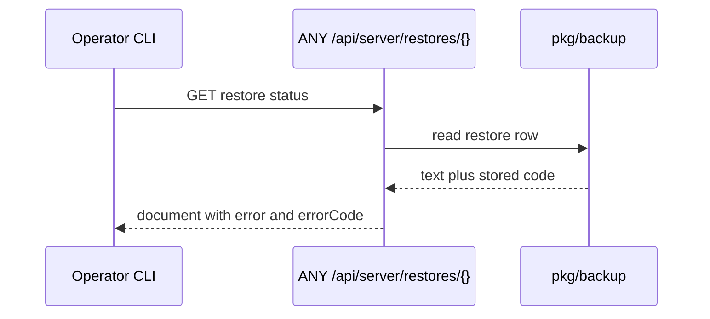
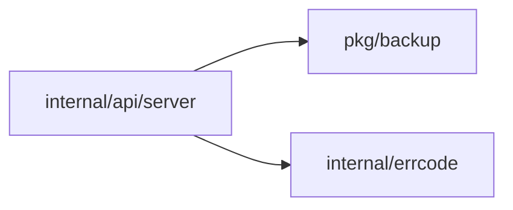
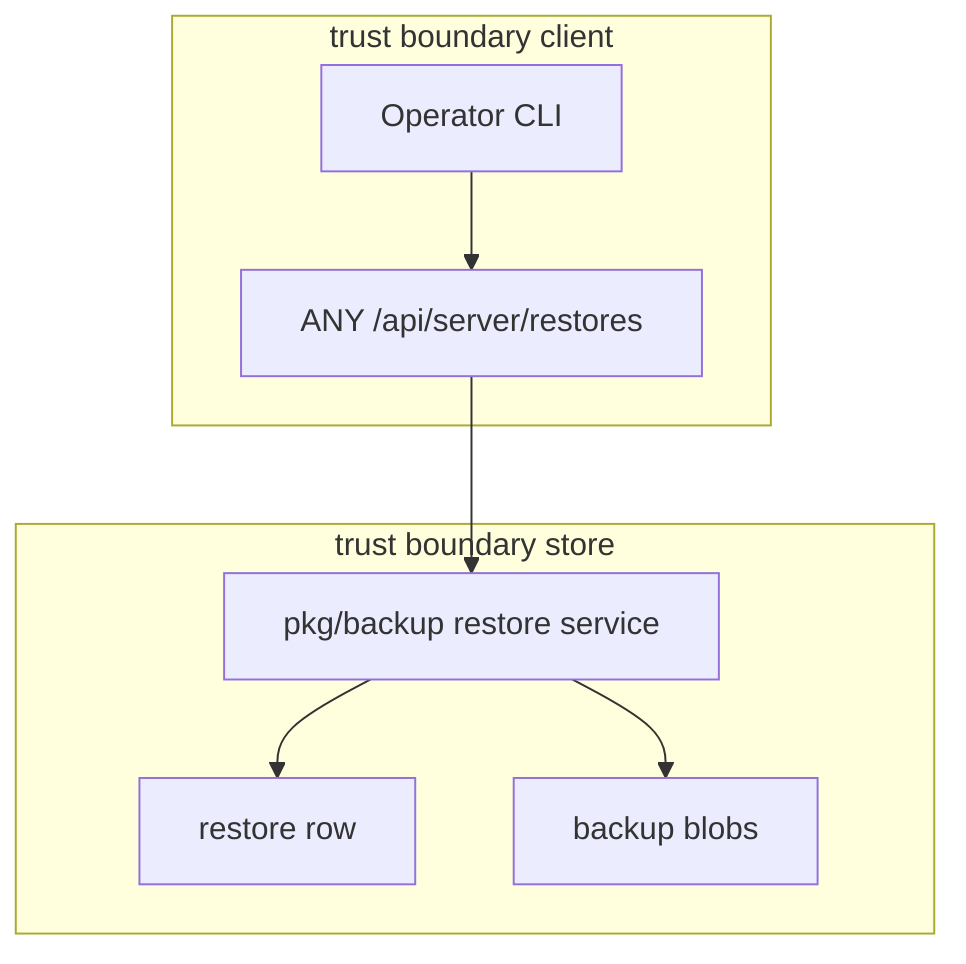

## Context

A failed restore stores reason text without its catalog code. A restore of an unknown backup ID fails late with corrupt text.

## Decisions

1. **Coded restore failure.** Store the catalog code beside the text in the restore row baseline of each dialect, edited in place with no numbered migration. Return it as optional errorCode on GET ANY /api/server/restores/{}. The start checks backup existence after the grant check and answers 404 with the NEW error code `backup.not-found`. Old rows with no code return empty errorCode.

## Structure

Unexported restoreFailure value built only by the NEW constructor newRestoreFailure(text, code) in pkg/backup. An empty code is allowed only for old rows and uncoded failures.

## Risks

- Old rows have text with no code and return empty errorCode.
- A backup removed between the start check and the read fails from the worker with the NEW error code `backup.not-found`.

## Layers (defense in depth)

| Layer | Guard | Hostile test |
| --- | --- | --- |
| boundary check | Handler rejects unknown and malformed backup IDs with coded errors. | POST unknown and malformed IDs directly to the handler and check 404 and 400 codes. |
| encode or contain | Row stores text and code as separate columns with placeholders only. | Write hostile text with quotes and check the row keeps code intact. |
| limit | Start performs no copy and stores no row for an unknown ID. | Start many unknown IDs and check no worker work starts. |
| authorize at point of use | Grant check runs before the existence check on start and read. | Call start and read without the grant for known and unknown IDs and check identical denial. |
| fail closed | Unknown read errors end failed with backup.not-found and corrupt reads keep backup.corrupt. | Remove the backup mid-restore and check the worker ends failed with backup.not-found. |

## Diagrams

After this change:

Modules that the change touches, and their imports on main:

## Quality attributes

| Attribute | Target | Unit | Scope |
| --- | --- | --- | --- |
| none affected | Small metadata field on an infrequent operator read; no latency budget change. |  |  |

## Threat model

Data flow and trust boundaries:

| Boundary | STRIDE | Threat | Layer | Guard | Hostile test |
| --- | --- | --- | --- | --- | --- |
| trust boundary client | S | Spoofed operator probes backup IDs through the restore start. | boundary check | Handler allowlists backup ID shape and restore document fields. | Send oversized and malformed backup IDs to ANY /api/server/restores and check rejection. |
| trust boundary client | S | Spoofed operator probes backup IDs through the restore start. | encode or contain | Handler encodes error text and stores code in a separate column. | Submit hostile error text and check the stored code stays intact. |
| trust boundary client | S | Spoofed operator probes backup IDs through the restore start. | limit | Unknown ID starts no worker and stores no row. | Flood unknown IDs and check no restore work starts. |
| trust boundary client | S | Spoofed operator probes backup IDs through the restore start. | authorize at point of use | Handler checks the restore grant before the existence check. | Call start without the grant for known and unknown IDs and check identical denial. |
| trust boundary client | S | Spoofed operator probes backup IDs through the restore start. | fail closed | Unknown ID answers 404 backup.not-found with no live change. | Restore an unknown ID after grant removal and check denial with no row. |
| trust boundary store | T | Tampered backup data misleads the restore into corrupt live state. | boundary check | Worker rechecks backup existence before the blob read. | Delete the backup between start and read and check coded failure. |
| trust boundary store | T | Tampered backup data misleads the restore into corrupt live state. | encode or contain | Blob reads use placeholders and contained keys only. | Restore a backup naming hostile blob keys and check containment holds. |
| trust boundary store | T | Tampered backup data misleads the restore into corrupt live state. | limit | Worker bounds blob reads for a missing backup. | Restore a backup with many missing blobs and check the worker stops with one code. |
| trust boundary store | T | Tampered backup data misleads the restore into corrupt live state. | authorize at point of use | Worker enforces the restore grant on status reads. | Read ANY /api/server/restores/{} without the grant and check denial. |
| trust boundary store | T | Tampered backup data misleads the restore into corrupt live state. | fail closed | Missing backup ends failed with backup.not-found and keeps live data unchanged. | Remove the backup mid-restore and check live data is unchanged. |

## Contracts

**Restore operation**

- Invariant: A failed restore keeps its failure text and its catalog code together.
- Invariant: An unknown backup ID starts no live work.
- `sanitizeRestoreError`: pre: Restore ended in failed state with stored text.. Post: Result carries the stored catalog code for coded failures and an empty code otherwise..
