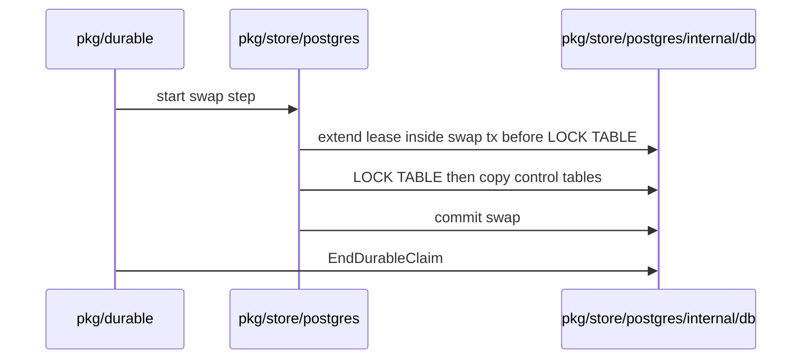
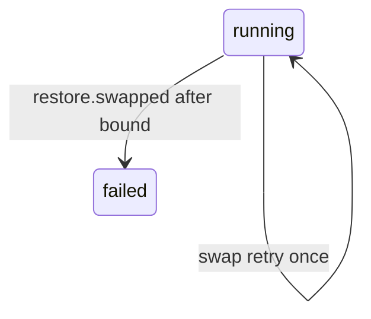
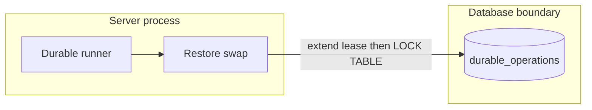

## Context

The restore swap runs keepControlTables in one long transaction with an exclusive lock on durable tables. A renewal during the wait blocks on that lock and the lease expires. A concurrent writer can also deadlock the swap. Both make the swap run twice.

## Decisions

1. **Pre-extend the lease before LOCK TABLE and bound the retry.** Extend the restore claim lease inside the swap transaction before LOCK TABLE by 120 s, for PostgreSQL in keepControlTables and for SQLite in copyControlTables. Use a lock timeout of 30 s. Record each failed swap attempt with its SQLSTATE in the operation record and show the extended lease deadline there. Retry the swap at most 1 more time, then end the restore with restore.swapped.

## Structure

An unexported restoreSwap type with a constructor that checks the 120 s margin exceeds the 30 s lock timeout; only its Run method opens the swap transaction.

## Risks

- The natural second deadlock party is unknown; the bound of 1 retry plus a recorded SQLSTATE caps the cost.
- SQLite blocks writers for the whole swap; the same in-transaction pre-extend applies.

## Layers (defense in depth)

| Layer | Guard | Hostile test |
| --- | --- | --- |
| limit | Constructor of restoreSwap refuses a margin at or below the 30 s lock timeout. | TestRestoreSwapRefusesShortMargin fails when the guard is removed. |
| encode or contain | Fixed table lock order inside one swap transaction. | TestRestoreSwapLosesALockConflictOnTheDurableTables drives a conflicting writer. |
| authorize at point of use | Pre-extend checks the claim holder for the operation ID at point of use. | TestRestoreSwapDeniesForeignClaim with a foreign claim. |

## Diagrams

After this change:

States and transitions after this change:

## Quality attributes

| Attribute | Target | Unit | Scope |
| --- | --- | --- | --- |
| latency | 1 swap run and 0 claim_lost events | runs | restore swap with a 60 s injected lock wait |

## Threat model

Data flow and trust boundaries:

| Boundary | STRIDE | Threat | Layer | Guard | Hostile test |
| --- | --- | --- | --- | --- | --- |
| Database boundary | D | A lock wait or a deadlock stops the swap and repeats the costly step. | boundary check | The constructor of restoreSwap refuses a margin of 120 s or less above the lock timeout of 30 s. | TestRestoreSwapRefusesShortMargin sends a 30 s margin and expects refusal. |
| Database boundary | D | A lock wait or a deadlock stops the swap and repeats the costly step. | encode or contain | Fixed table lock order inside one transaction. | TestRestoreSwapLosesALockConflictOnTheDurableTables drives a conflicting writer. |
| Database boundary | D | A lock wait or a deadlock stops the swap and repeats the costly step. | limit | Lock timeout of 30 s and at most 1 swap retry. | TestRestoreSwapStopsAfterOneRetry forces two deadlocks and expects restore.swapped. |
| Database boundary | D | A lock wait or a deadlock stops the swap and repeats the costly step. | authorize at point of use | The pre-extend checks the claim holder for the operation ID. | TestRestoreSwapDeniesForeignClaim presents a foreign claim and expects denial. |
| Database boundary | D | A lock wait or a deadlock stops the swap and repeats the costly step. | fail closed | After 2 failures the restore ends with restore.swapped and the attempt is recorded. | TestRestoreSwapFailsClosedAfterBound forces two failures and expects restore.swapped. |

## Contracts

**durable operation claim**

- Invariant: One holder owns one claim at one time.
- Invariant: A lost claim ends the step once.
- `EndDurableClaim`: pre: The caller holds the claim or the lease expired.. Post: The claim ends with completion or a recorded failure..

**restore swap**

- Invariant: The swap runs inside one transaction with a fixed table lock order.
- Invariant: A failed swap attempt is recorded with its reason.
- `keepControlTables`: pre: The caller holds the restore claim with a pre-extended lease.. Post: Control rows are copied, or the transaction rolls back with a recorded attempt..

## Failure modes

| Step | Failure | Retry | State after |
| --- | --- | --- | --- |
| swap | The lock wait exceeds the renewal interval. | No renewal is needed; the pre-extended lease covers the wait. | running |
| swap | The swap deadlocks with a writer on durable tables. | Roll back, record SQLSTATE 40P01, retry at most 1 more time. | running, then failed with restore.swapped after the bound |
| swap | The lock wait exceeds 30 s. | Roll back, record the timeout, use the one retry. | failed with restore.swapped |
