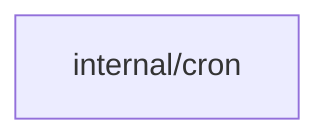

## Context

pruneExpired exists. It has no caller on a schedule, and nothing stops two sweeps at once. Owner decision, 13 Nov 2026 (queue P14), keeps the sweep off namespace runner pools.

## Decisions

1. **One lease for the sweep.** The sweep takes the store lease before it prunes. A process that cannot take it skips the run and logs the holder.
2. **The cron home.** internal/cron holds the trigger. pkg/dustpan/area_retention.go holds the sweep and its wiring.

## Structure

An unexported sweeper type holds the lease and the pruning function. Only its constructor makes a value, and it refuses a missing lease or a retention below the minimum.

## Risks

- A process that dies with the lease blocks the next run until the lease expires.

## Diagrams

Modules that the change touches, and their imports on main:

## Quality attributes

| Attribute | Target | Unit | Scope |
| --- | --- | --- | --- |
| Sweep exclusivity | 1 | sweep running at one time | one installation with any number of server processes |
| Lease recovery after a dead holder | 1 | lease duration until the next run | one installation |

## Failure modes

| Step | Failure | Retry | State after |
| --- | --- | --- | --- |
| Take the lease | The store is not reachable. | The next schedule tick tries again. | No record is pruned. |
