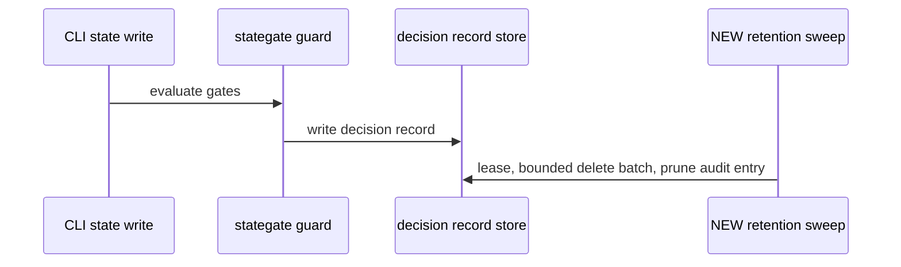
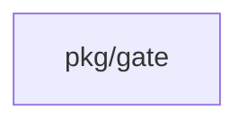
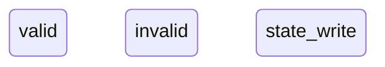
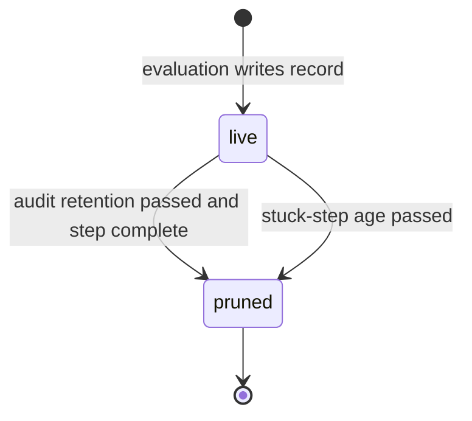

## Context

Each state.write evaluation writes one decision record in the same transaction as the step it explains, except a refusal, which uses its own transaction. Lock requests on a free workspace cause one evaluation each, so records grow with no prune.

## Decisions

1. **Keep every evaluation record.** Keep one record per evaluation, including allow results with no gate. A retry on a held workspace runs no evaluation.
2. **Prune by audit retention with a single holder.** Add a retention sweep, pruneExpired, that deletes state.write records past the audit retention, ordered by stable record ID, in batches of 100, one holder at a time through a 5 minute store lease, once per hour, safe to restart. It reads the audit retention at sweep time. An open step blocks prune, except a step stuck past retention plus 7 days; the prune entry marks it open-step.
3. **Keep the audit reference after prune.** Each batch deletes its records and writes its prune audit entry in one transaction, at most 100 IDs per entry. The audit entry of the explained step keeps its record ID. State writes proceed while the sweep holds its lease.

## Structure

NEW unexported type recordSweeper in pkg/gate holds auditRetention and batchSize, made only by its constructor that checks both; only its NextBatch method selects expired state.write records for delete.

## Risks

- Lock retry storms still write one record per free-lock attempt before the sweep removes them; the sweep bounds growth over time with no per-change cap.
- A large backfill makes the first sweep run many batches; bounded batches and the lease keep each batch small and restartable.

## Diagrams

After this change:

Modules that the change touches, and their imports on main:

States on main in the touched packages:

States and transitions after this change:

## Quality attributes

| Attribute | Target | Unit | Scope |
| --- | --- | --- | --- |
| storage growth | 100 records per batch, one sweep per hour | records per sweep run | one namespace with OpenTofu lock retries |

## Contracts

**decision record**

- Invariant: One record per evaluation, ordered by stable record ID.
- Invariant: Expired record deletes only after its step completes or its stuck-step age passes.
- `pruneExpired`: pre: Caller holds the sweep lease.; Batch is bounded and ordered by record ID.. Post: Only records past audit retention are deleted.; Prune audit entry names each deleted ID..

## Failure modes

| Step | Failure | Retry | State after |
| --- | --- | --- | --- |
| Retention sweep batch delete. | Sweep lease lost mid-batch. | A later sweep reruns the batch; delete and prune entry commit in one transaction. | Only records that still exist delete; unexpired records stay. |
| Decision record write in state.write path. | Record write fails during state write. | The write fails closed with 503 gate.unavailable and the client retries. | No partial record stays; an unlocked-write refusal may leave the lock residue that ADR 335 decision 3 allows. |
| Prune audit entry write. | Prune audit entry write fails. | The batch transaction rolls back and a later sweep reruns it. | Records stay until the batch and its entry commit together. |
