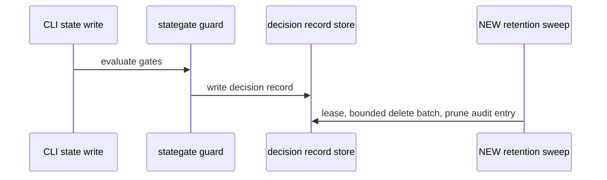
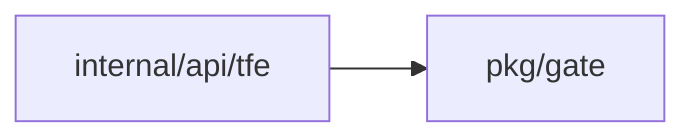
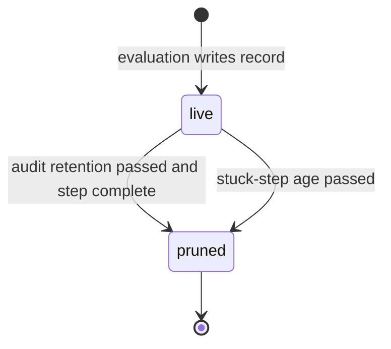

## Context

Each state.write evaluation writes one decision record in the same transaction as the step it explains, except a refusal which uses its own transaction. OpenTofu lock retries cause one evaluation per free-lock attempt, so records grow with no prune.

## Decisions

1. **Keep every evaluation record.** Keep one record per evaluation, including allow results with no gate, per ADR 222 decision 3. A retry against a held lock runs no evaluation and writes no record.
2. **Prune by audit retention with a single holder.** Add a retention sweep, NEW function pruneExpired, that deletes state.write decision records past the audit retention, oldest first by stable record ID, in bounded batches of 100 with one holder at a time through a 5 minute store lease once per hour, safe to restart mid-batch. The sweep reads the audit retention at sweep time. An open step blocks prune until the step completes, except a stuck step past retention plus 7 days becomes eligible and the prune entry marks it open-step.
3. **Keep the audit reference after prune.** Each prune batch deletes its records and writes its prune audit entry in one transaction, with at most 100 IDs per entry. The audit entry of the explained step keeps its record ID after the record is pruned when such an entry exists. When no step entry exists, the prune entry alone names the IDs and the record still prunes after retention. State writes proceed while the sweep holds its lease; the lease guards only the sweep.

## Structure

NEW unexported type recordSweeper in pkg/gate holds auditRetention and batchSize, made only by its constructor that checks both; only its NextBatch method selects expired state.write records by stable record ID for delete.

## Risks

- Lock retry storms still write one record per free-lock attempt before the sweep removes them; the sweep bounds growth over time by hourly cadence and batches of 100, with no per-change cap on record writes.
- A large backfill of old records makes the first sweep run many batches; bounded batches and the single-holder lease keep each batch small and restartable.

## Diagrams

After this change:

Modules that the change touches, and their imports on main:

States on main in the touched packages:

States and transitions after this change:

## Quality attributes

| Attribute | Target | Unit | Scope |
| --- | --- | --- | --- |
| storage growth | 100 records per batch, one sweep per hour | records per sweep run | one namespace with OpenTofu lock retries |

## Contracts

**decision record**

- Invariant: One record per evaluation, ordered by stable record ID.
- Invariant: Expired record deletes only after its step completes or its stuck-step age passes.
- `pruneExpired`: pre: Caller holds the sweep lease.; Batch is bounded and ordered by record ID.. Post: Only records past audit retention are deleted.; Prune audit entry names each deleted ID..

## Failure modes

| Step | Failure | Retry | State after |
| --- | --- | --- | --- |
| Retention sweep batch delete. | Sweep lease lost mid-batch. | Lease expires and a later sweep reruns the batch; the batch delete and its prune entry commit in one transaction so a rerun deletes only records that still exist. | Only records that still exist delete; unexpired records stay. |
| Decision record write in state.write path. | Record write fails during state write. | Allowed write fails closed with 503 gate.unavailable and the client retries the write; a refusal record write fails in its own transaction with no state change and the client retries. | No partial record stays; the step has no new record; an unlocked-write refusal may leave the lock residue that ADR 335 decision 3 already allows. |
| Prune audit entry write. | Prune audit entry write fails. | The batch transaction rolls back so records stay, and a later sweep reruns the same batch. | Records stay until the batch and its entry commit together. |
