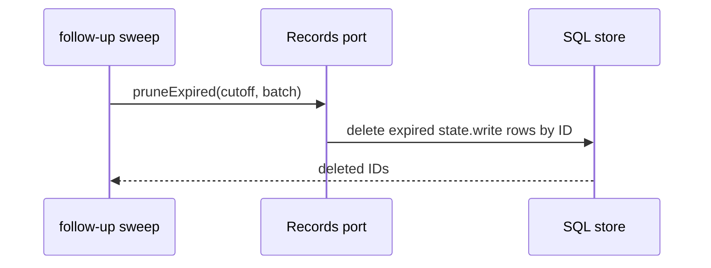
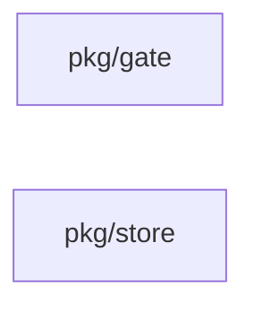
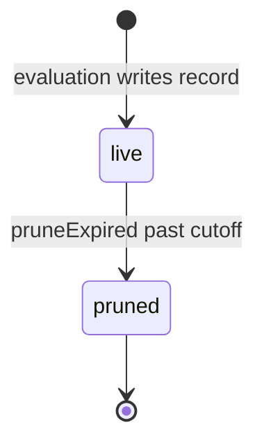

## Context

The decision record port in pkg/gate/store.go has no delete method for state.write records. The records grow with each lock request on a free workspace.

## Decisions

1. **One port method.** pruneExpired takes a cutoff time and a batch size of 1 to 1000 records. It deletes at most that many state.write records of one call, older than the cutoff, ordered by record ID, and returns the deleted IDs. Other kinds of record stay.
2. **Caller owns the schedule.** The method holds no timer and no lease. The follow-up change adds both.

## Structure

NEW unexported type pruneRequest in pkg/gate holds the cutoff and the batch size. Only its constructor makes a value, and it refuses a zero cutoff and a batch size below 1 or above 1000.

## Risks

- Until the follow-up ships, no job calls the method, so the table still grows.

## Diagrams

After this change:

Modules that the change touches, and their imports on main:

States on main in the touched packages:

States and transitions after this change:

## Quality attributes

| Attribute | Target | Unit | Scope |
| --- | --- | --- | --- |
| Prune call duration | at most 1000 records deleted for each call, in one transaction | records for each call | one pruneExpired call on one namespace |

## Contracts

**decision record**

- Invariant: One record for each evaluation.
- Invariant: A prune deletes only state.write records older than the cutoff.
- `pruneExpired`: pre: The cutoff is set.; The batch size is between 1 and 1000.. Post: At most the batch size is deleted, lowest IDs first.; The deleted IDs are returned..

## Failure modes

| Step | Failure | Retry | State after |
| --- | --- | --- | --- |
| pruneExpired delete | The store fails in the middle of a batch. | The caller calls the method again. | The batch rolls back, and no unexpired record is deleted. |
