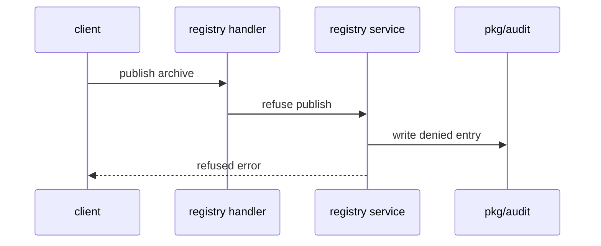

## Context

Denied module and provider archive publishes in internal/registry/service/module.go refuse without a namespace audit record. The fix records each denial and stores nothing.

## Decisions

1. **Denied publish writes audit only.** Write one denied audit entry on every refused module and provider archive publish in the refusal path in internal/registry/service/module.go, before any release or blob write. The entry holds actor, action, object and refusal reason, and holds no archive bytes. If the audit write fails, the publish stays refused with the current refusal error.

## Structure

The refusal path writes the denied entry through the existing audit writer passed to the service constructor. No structure removes the need for this ordered write, so a regression test asserts one denied entry and no release and no blob on each refusal cause.

## Risks

- A denied publish stores a release or blob.
- A denied audit entry holds archive content.

## Diagrams

After this change:

## Quality attributes

| Attribute | Target | Unit | Scope |
| --- | --- | --- | --- |
| none affected | Audit-only change to an already refused path |  |  |

## Contracts

**registry release**

- Invariant: A denied publish creates no release record.
- Invariant: A denied publish leaves no content blob.
- `PublishModuleArchive`: pre: Archive publish was refused.. Post: One denied namespace audit entry exists.; No release record and no content blob exist for the refused version..
