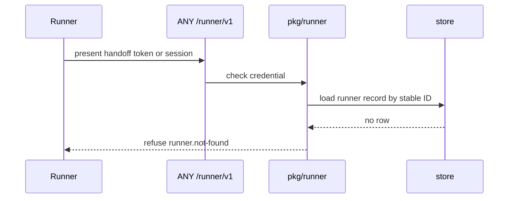
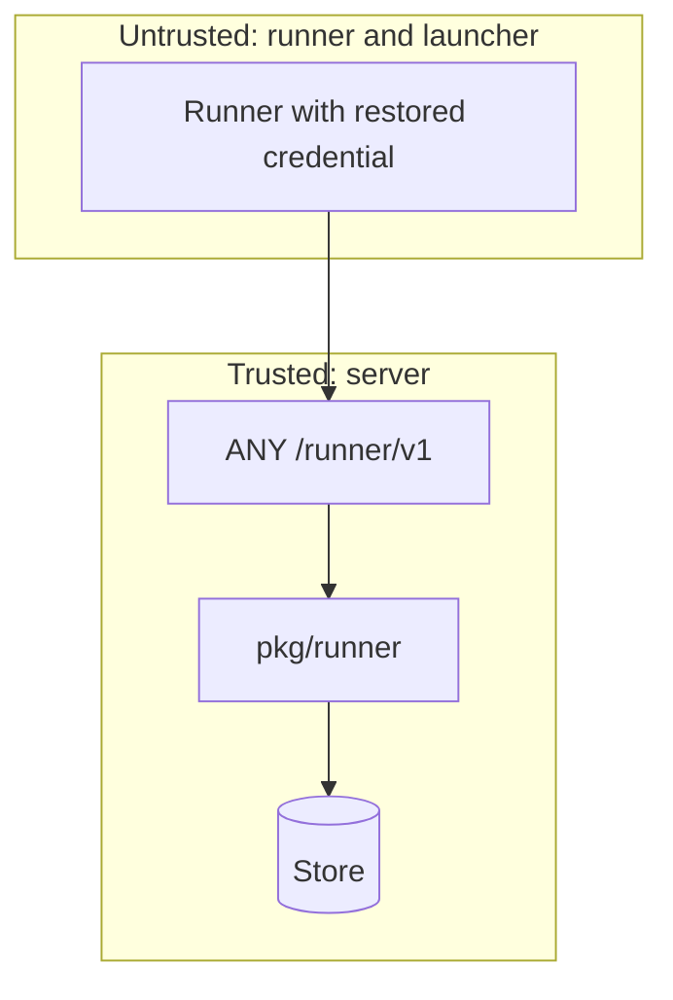

## Context

Restored backups can hold handoff tokens and sessions whose runner record is absent. Use-time refusal closes the trust gap without rewriting backup contents.

## Decisions

1. **Refuse orphaned runner credentials at use time by stable ID.** Check runner existence by stable runner ID at each handoff-token and session use in the runner service, behind one helper, so both store adapters inherit the same refusal. The check runs before single-use consumption, so a refused token is not burned. Orphaned rows stay in place and are refused on each use. A store outage fails closed with a server error, while an absent runner fails with runner.not-found.
2. **No new audit record for the refusal.** No new audit record. The refusal is a synchronous request denial reported through the existing request result.

## Structure

Unexported runner-credential gate type with a constructor that requires the runner store; only the constructor can build a credential check, which makes missing-runner use without an ID lookup impossible.

## Risks

- Both adapters must share the same use-time check so behavior does not diverge.
- A removed then re-created runner with the same name must not accept old credentials, hence the ID bind.

## Diagrams

After this change:

## Quality attributes

| Attribute | Target | Unit | Scope |
| --- | --- | --- | --- |
| none affected | Restore and use-time refusal add no latency or storage target |  |  |

## Threat model

Data flow and trust boundaries:

| Boundary | STRIDE | Threat | Layer | Guard | Hostile test |
| --- | --- | --- | --- | --- | --- |
| Runner and launcher to ANY /runner/v1 | S | Spoofed or replayed restored credential for an absent runner gains access. | boundary check | Reject malformed credential before store read with runner.invalid. | Send a malformed handoff token and confirm runner.invalid. |
| Runner and launcher to ANY /runner/v1 | S | Spoofed or replayed restored credential for an absent runner gains access. | encode or contain | Use placeholders for credential lookup, no string query. | Send credential text with SQL metacharacters and confirm exact lookup. |
| Runner and launcher to ANY /runner/v1 | S | Spoofed or replayed restored credential for an absent runner gains access. | limit | Bound credential size and lookup timeout per request. | Send oversize credential and confirm refusal without store read. |
| Runner and launcher to ANY /runner/v1 | S | Spoofed or replayed restored credential for an absent runner gains access. | authorize at point of use | Confirm runner record by stable ID exists at point of use and refuse absent runner with runner.not-found. | Present restored credential with absent runner ID and confirm runner.not-found. |
| Runner and launcher to ANY /runner/v1 | S | Spoofed or replayed restored credential for an absent runner gains access. | fail closed | Absent runner denies with runner.not-found; store outage denies with a server error and no use. | Remove runner row and confirm runner.not-found; fail the store and confirm denial with server error. |
