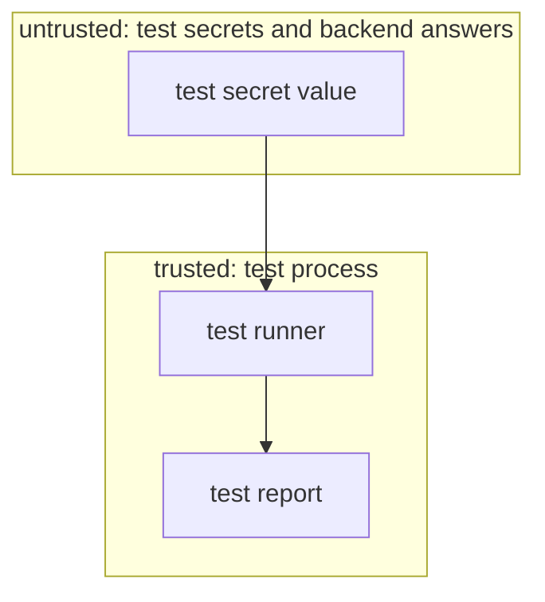

## Context

The mixed-version test runs an old and a new server against one store. A secret must read the same on both.

## Decisions

1. **Choose the backend by listener.** The test sends each read to the address of one server, and sets the same public URL on both servers. It records the address that served each read.
2. **Plaintext stays out of output.** The test compares plaintext in memory. A failure message names the backend and the secret name, never the value.
3. **Cleanup.** The test deletes its secret in a cleanup step, so a rerun on a restarted server starts clean.

## Structure

No new unexported type. The change adds helpers in e2e/upgrade_mixed_test.go only.

## Risks

- The two servers share one store, so a failed read may point at the key setup instead of the backend.

## Layers (defense in depth)

| Layer | Guard | Hostile test |
| --- | --- | --- |
| encode or contain | The test compares plaintext only in memory and never writes it to logs or the report. | Set a canary plaintext, run the test, then search the report and logs for the canary and fail if found. |

## Quality attributes

| Attribute | Target | Unit | Scope |
| --- | --- | --- | --- |
| none affected | Test-only change with no server behavior change |  |  |

## Threat model

Data flow and trust boundaries:

| Boundary | STRIDE | Threat | Layer | Guard | Hostile test |
| --- | --- | --- | --- | --- | --- |
| untrusted: test secrets and backend answers to trusted: test process | I | Test plaintext leaks into the report or logs. | boundary check | The test uses a random test-only secret name and value, never a real secret. | Point the test at a copy of a real secret name and check the test refuses to use it. |
| untrusted: test secrets and backend answers to trusted: test process | I | Test plaintext leaks into the report or logs. | encode or contain | The test holds plaintext only in memory and never writes it to the report or logs. | Use a canary value, run the test, and search the report and logs for the canary. |
| untrusted: test secrets and backend answers to trusted: test process | I | Test plaintext leaks into the report or logs. | limit | The test creates one secret and deletes it in cleanup, so at most one test secret exists. | Fail the delete step and check the rerun reports the leftover secret instead of adding another. |
| untrusted: test secrets and backend answers to trusted: test process | I | Test plaintext leaks into the report or logs. | authorize at point of use | The test reads with the same test principal that wrote the secret, and each read goes to the chosen backend listener. | Send a read with a different principal and check the read is denied. |
| untrusted: test secrets and backend answers to trusted: test process | I | Test plaintext leaks into the report or logs. | fail closed | On any mismatch or missing read the test fails closed and reports only the backend name, never the plaintext. | Return a wrong plaintext from one listener and check the failure names the backend without the value. |
| untrusted: test secrets and backend answers to trusted: test process | T | Both reads reach one backend while the test reports both backends checked. | boundary check | The test addresses each read to the listener of one backend and records which listener answered. | Stop one backend and check the test fails and names the missing backend. |
| untrusted: test secrets and backend answers to trusted: test process | T | Both reads reach one backend while the test reports both backends checked. | encode or contain | Backend identity comes from the listener the test chose, not from a value in the answer. | Return an answer that claims the other backend and check the test still attributes it to the listener. |
| untrusted: test secrets and backend answers to trusted: test process | T | Both reads reach one backend while the test reports both backends checked. | limit | The test performs one write and two reads, then deletes the secret. | Add a third read and check the test fails its count check. |
| untrusted: test secrets and backend answers to trusted: test process | T | Both reads reach one backend while the test reports both backends checked. | authorize at point of use | The test uses the writer principal for both reads, so no other principal can supply a read. | Swap in another principal for one read and check the step is refused. |
| untrusted: test secrets and backend answers to trusted: test process | T | Both reads reach one backend while the test reports both backends checked. | fail closed | When a backend serves no read the test fails instead of accepting two reads from one backend. | Send both reads to one listener and check the test fails for the missing backend. |
