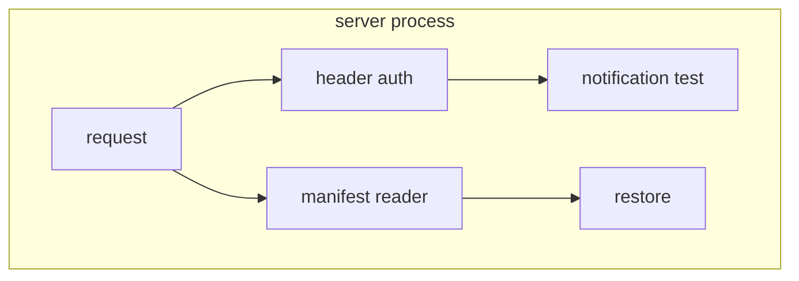

## Context

Three review follow-ups: notification test limiter error handling in internal/api/notifications/notifications.go, plain-mode secret header lifetime in internal/headerauth/headerauth.go, and untrusted backup manifest bounds in pkg/backup/service.go.

## Decisions

1. **Limiter preserves sentinels and bounds warnings.** Notification limiter wrapper joins ErrLimitUnavailable with the maintenance or schema-minimum sentinel so errors.Is still finds the 503 sentinel; counter failures write one warning per 60 s per process with no database text, no message send and no audit entry.
2. **Strip header after read.** Header auth middleware deletes every value of the plain-mode secret header with Header.Del after it reads the value, on success and on refusal, including early returns.
3. **Bounded manifest reader with fixed limits.** Backup manifest reader uses a NEW unexported bounded reader made only by its constructor: 10 MB total per manifest and 100000 unverified keys per manifest, fixed constants with no setting; a refused restore writes no partial state.

## Structure

The NEW unexported boundedReader holds maxBytes and maxKeys, and only its constructor newBoundedReader checks the bounds before any read.

## Risks

- Secret header value reaches a downstream handler or a log.
- Oversized manifest holds memory during restore.

## Layers (defense in depth)

| Layer | Guard | Hostile test |
| --- | --- | --- |
| strip secret after use | Delete every secret header value after read on success and on refusal. | Send two secret header values and assert a downstream handler reads none. |
| bound untrusted manifest | Refuse above 10 MB total reads and above 100000 unverified keys per manifest. | Send 100001 unverified keys and assert refusal with no partial state. |

## Diagrams

Modules that the change touches, and their imports on main:

## Quality attributes

| Attribute | Target | Unit | Scope |
| --- | --- | --- | --- |
| storage growth | 10 | MB max before refusal | one backup manifest read |
| rate | 1 | warning per 60 s max | one server process notification test counter |

## Threat model

Data flow and trust boundaries:

| Boundary | STRIDE | Threat | Layer | Guard | Hostile test |
| --- | --- | --- | --- | --- | --- |
| client to header auth | S | Plain-mode secret header leaks downstream | boundary check | Delete every secret header value after read on success and refusal. | Send two secret header values and assert a downstream handler reads none. |
| client to header auth | S | Plain-mode secret header leaks downstream | encode or contain | Keep the secret value out of logs and error text. | Force a refusal and assert logs hold no secret bytes. |
| client to header auth | S | Plain-mode secret header leaks downstream | limit | Evaluate each request alone with no retry state. | Send two requests with the same header and assert each is evaluated alone. |
| client to header auth | S | Plain-mode secret header leaks downstream | authorize at point of use | Deny when authentication does not allow the request. | Send a wrong secret and assert denial. |
| client to header auth | S | Plain-mode secret header leaks downstream | fail closed | Deny on a read failure and strip the header before return. | Force a store error and assert denial with the header stripped. |
| client to manifest reader | D | Oversized backup manifest exhausts memory | boundary check | Refuse when the stated length exceeds 10 MB. | Send a manifest that states 20 MB and assert refusal. |
| client to manifest reader | D | Oversized backup manifest exhausts memory | encode or contain | Read only through the bounded reader. | Send a manifest over 10 MB across two reads and assert refusal. |
| client to manifest reader | D | Oversized backup manifest exhausts memory | limit | Refuse above 10 MB and 100000 unverified keys per manifest. | Send 100001 unverified keys and assert refusal. |
| client to manifest reader | D | Oversized backup manifest exhausts memory | authorize at point of use | Deny restore without the restore grant before manifest read. | Call restore without the grant and assert denial. |
| client to manifest reader | D | Oversized backup manifest exhausts memory | fail closed | Refuse a truncated manifest with no partial restore. | Send a truncated manifest and assert no state written. |
