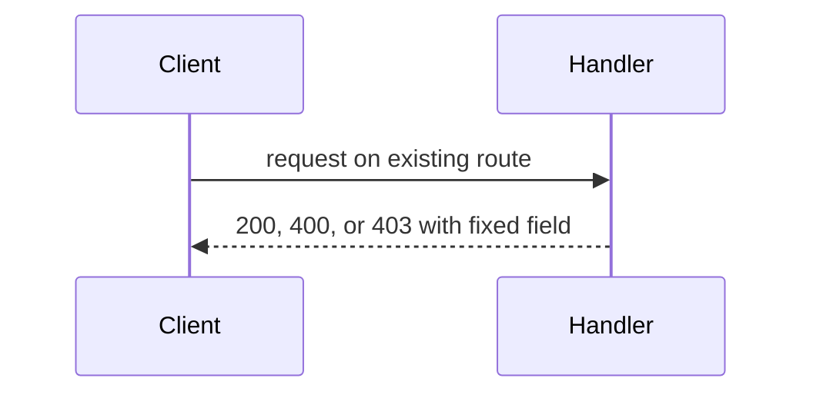
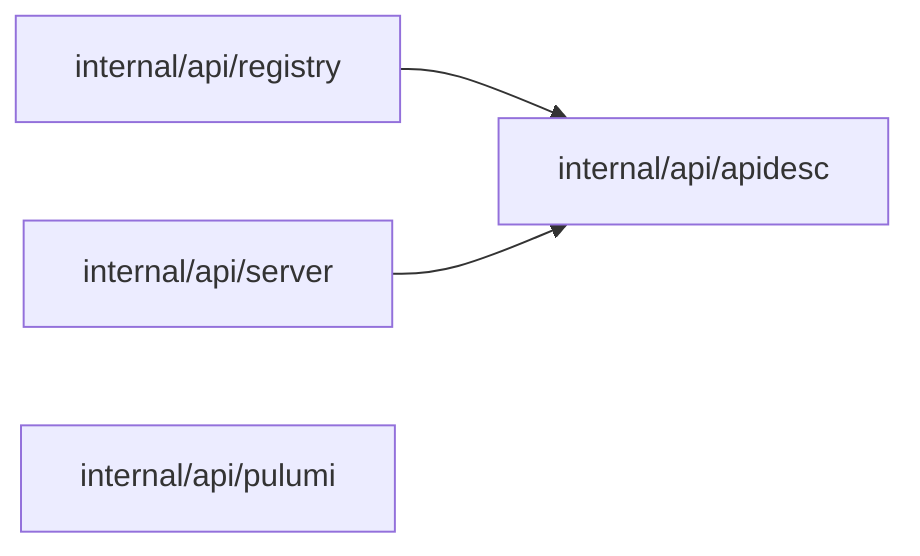
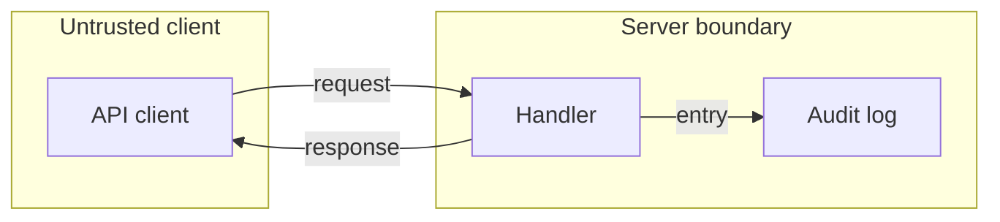

## Context

API handlers under internal/api/registry, internal/api/server, internal/api/pulumi, and internal/api/apidesc. Each item is a small handler or schema fix with its own test in the same package.

## Decisions

1. **Fix at the named layer.** Fix each item at the handler or schema layer named in the issue in issue order. Each fix keeps its route, status code, and scope.
2. **Nil maps are nullable.** Declare a nil map without omitempty as nullable in both the schema and the JSON output, and keep the field present as null.

## Structure

No new unexported type. Each fix uses the existing handler, document, and schema types named in the issue.

## Risks

- Seven small fixes in one change; each fix has its own failing test so a failure points to one item.

## Diagrams

After this change:

Modules that the change touches, and their imports on main:

## Quality attributes

| Attribute | Target | Unit | Scope |
| --- | --- | --- | --- |
| none affected | Handler-only fixes with no latency or storage target change |  |  |

## Threat model

Data flow and trust boundaries:

| Boundary | STRIDE | Threat | Layer | Guard | Hostile test |
| --- | --- | --- | --- | --- | --- |
| Untrusted client to Handler | T | A client sends operator-owned fields, including null values, to set values it does not own. | boundary check | Refuse the six operator-owned fields by presence in internal/api/server/githost_connections.go | TestOperatorFieldPresence sends each field with null and non-null values and expects 400 |
| Untrusted client to Handler | T | A client sends operator-owned fields, including null values, to set values it does not own. | encode or contain | Strict decode keeps field presence | TestOperatorFieldPresence sends a case variant and expects 400 |
| Untrusted client to Handler | T | A client sends operator-owned fields, including null values, to set values it does not own. | limit | Existing request body limit stays | TestOperatorFieldPresence sends an otherwise-valid body and expects success |
| Untrusted client to Handler | T | A client sends operator-owned fields, including null values, to set values it does not own. | authorize at point of use | Existing stored-grant gate stays on the route | TestOperatorFieldPresence sends the request without a grant and expects 403 |
| Untrusted client to Handler | T | A client sends operator-owned fields, including null values, to set values it does not own. | fail closed | An undecodable body gets 400 | TestOperatorFieldPresence sends malformed JSON and expects 400 |
| Handler to Client | I | Error text leaks internal wrapper prefixes. | boundary check | Return only the public reason of the forge invalid value | TestForgeInvalidHidesWrappers with several wrappers |
| Handler to Client | I | Error text leaks internal wrapper prefixes. | encode or contain | Fixed public text | TestForgeInvalidHidesWrappers with an empty reason |
| Handler to Client | I | Error text leaks internal wrapper prefixes. | limit | One reason in the response | TestForgeInvalidHidesWrappers counts the reason once |
| Handler to Client | I | Error text leaks internal wrapper prefixes. | authorize at point of use | Existing gate before the handler | TestForgeInvalidHidesWrappers without a grant expects 403 |
| Handler to Client | I | Error text leaks internal wrapper prefixes. | fail closed | An unknown error gets a fixed answer | TestForgeInvalidHidesWrappers with an unknown error |
